# Polly manual

Polly turns the M-VAVE FM-1 into a pocket arranger, inspired by the Yamaha QY70. Pick a style, and a band of
eight instruments plays along. Hold a chord, and the bass, the guitars and the strings follow it. Write a few
bars of chords, and Polly plays a full song from them.

The sounds are the 128 General MIDI instruments and a drum kit, from Sonivox EAS. You hear them through the
speaker or the headphone jack, and you can play them over MIDI too.

New to Polly? Start with [101 Playing live](docs/course/101-playing-live.md) in
[Polly School](docs/course/README.md). Each lesson is short and has a video. Come back to this manual when you
want to look something up.

- [Cheat sheet](#cheat-sheet)
- [Getting around](#getting-around)
- [Styles and grooves](#styles-and-grooves)
- [Chords](#chords)
- [Progressions](#progressions)
- [The song](#the-song)
- [Recording an instrument](#recording-an-instrument)
- [Melodies](#melodies)
- [Fixing notes](#fixing-notes)
- [Sound](#sound)
- [Songs and saving](#songs-and-saving)
- [Setup and MIDI](#setup-and-midi)
- [The QY70 bank](#the-qy70-bank)
- [Updating and safety](#updating-and-safety)
- [Page by page](#page-by-page)
- [Screen mirroring](#screen-mirroring)
- [Screen reader](#screen-reader)
- [Credits](#credits)

## Cheat sheet

This chapter collects the words Polly uses, the common tasks, and what each button does. The rest of the
manual uses the same words.

### The words

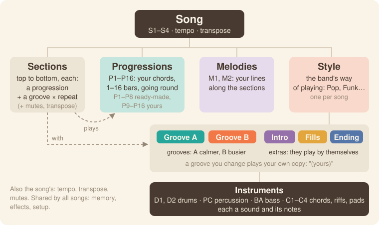

```
Song (S1–S4)
├─ Sections        each plays a progression with a groove, a set number of times
├─ Progressions    P1–P16
├─ Melodies        M1, M2
└─ Style           Groove A, Groove B, Intro, Fills, Ending
   └─ Instruments  D1, D2, PC, BA, C1–C4
```

- **Song** (S1–S4): one piece of music. Each song has its own style, progressions, sections, melodies, tempo
  and transpose.
- **Section**: a part of the song, such as a verse or a chorus. A section plays one progression with one
  groove, a set number of times. A song can have up to 32 sections, and plays them from top to bottom.
- **Progression** (P1–P16): a row of chords that plays in a loop, 1 to 16 bars long. P1–P8 come ready-made,
  and P9–P16 are for your own. The screen often shortens it to "Prog".
- **Chord**: one chord in a progression.
- **Melody** (M1, M2): a line you record along the whole song, section by section.
- **Style**: the way the band plays, such as Pop or Funk. Each song has one style.
- **Groove**: how the band plays a section. **Groove A** is calmer and **Groove B** is busier.
- **Intro, Fill, Ending**: extra parts of a style that the band plays by itself. The Intro opens the song
  and the Ending closes it. In a song, a Fill plays when the next section has a different groove, and you can
  ask for one at any time.
- **Instrument**: one player in the band. D1 and D2 are drums, PC is percussion and BA is bass. C1–C4 play
  chords, riffs and pads. Each instrument has a sound and its own notes.
- **Sound**: what an instrument or a melody plays with. It's one of the 128 General MIDI sounds, or the drum
  kit.
- **(edited)**: what the screen adds once you change a groove, as in "Groove A (edited)". From then on, Polly
  plays your edited copy. The style itself doesn't change, and BACK TO STYLE switches back to it. See
  [Edited grooves](#edited-grooves).
- **Tempo**: the song's speed, in BPM.
- **Transpose**: moves everything up or down in pitch, including the keys you play. The song has a
  transpose, and each section can add its own.
- **Repeat**: how many times a section plays.
- **Mute**: silences an instrument or a melody. See [Mutes](#mutes).
- **Follow**: what Polly does when no progression is playing. The band follows the chords you play, and
  Home's **KNOB 4** (Prog) shows "follow".
- **Memory**: 16 places that keep your grooves and melodies. The four songs share them. Progressions don't
  use memory, because each song keeps its own.
- **Undo / Redo**: take back a change, or bring it back.
- **Click**: the woodblock that counts the beats while you record.
- **Count-in**: the bar of clicks you hear before a recording starts.
- **Backup**: a copy of your songs, kept in a file on a computer.
- **Mirror**: Polly's screen, shown live on a computer. You can also play the panel from there.

### How do I…

Count the white keys 1 to 16 from the left, and the black keys 1 to 11. "Hold **HOME** and press…" means keep
**HOME** down while you press the next thing.

| How do I… | Do this |
| --- | --- |
| pick a style | Press **HOME** and turn **KNOB 1**. |
| play a progression | Hold **HOME** and press white key *n*, and P*n* plays in a loop. If the band is already playing, it switches at the next bar. |
| change the groove | Hold **HOME** and press black key 2 for Groove A or 3 for Groove B. Black key 4 plays a fill, 1 the Intro and 5 the Ending. |
| set the tempo | Turn **KNOB 2** on Home. On any other page, hold **HOME** and turn **SELECT**. |
| write a progression | Press **HOME** and turn **KNOB 4** counterclockwise to "follow". Press **REC**, then **PLAY**. After a bar of clicks, play one chord per bar, then press **REC** again. |
| go to bar 1, beat 3 | Press **ARP**. Turn **KNOB 1** (Bar) to 1 and **KNOB 2** (Beat) to 3. Press **OCT−** or **OCT+** to step one beat back or forward. |
| fix a chord | Press **ARP**. Move to the chord with **KNOB 1** (Bar) and **KNOB 2** (Beat), then turn **KNOB 3** (Root) or **KNOB 4** (Type). To change its bass note, turn **SELECT** to page 2 and turn **KNOB 3** (Bass). |
| delete a chord | Press **ARP** and move to the chord with **KNOB 1** and **KNOB 2**. Press **SEL**, and the list opens on CLEAR CHORD. Press **SEL** again. |
| lengthen a progression | Press **ARP**, turn **SELECT** to page 2 and turn **KNOB 1** (Length). |
| copy a progression | On Home or the Progression page, hold **SAVE** and press white key *n*. Polly copies the progression to P*n*. |
| open the Song page | On Home, press **HOME**. Press it again to go back. |
| add a section | On the Song page, press white key *n*. A section playing P*n* goes in where the coral arrow points. If the cursor is on END, it goes at the end. |
| remove a section | On the Song page, move to it with **KNOB 1** (Section) and turn **KNOB 2** (Prog) down past P1 to "–". Polly removes it when you leave the Song pages. |
| skip a section's fill | On the Song page, turn **KNOB 3** (Groove) to "A no fill" or "B no fill". |
| play from section 3 | On the Song page, turn **KNOB 1** (Section) to 3 and press **SEL**. The list opens on PLAY FROM SECTION 3. Press **SEL** again. |
| loop the song | On the Song page, turn **SELECT** to page 2 and turn **KNOB 4** (At end) to "again". |
| change an instrument's sound | Press **EDIT**, turn **ALGORITHM** to the instrument and turn **KNOB 1** (Sound). |
| mute an instrument in one section | On the Song page, move to the section and press the instrument's black key. Black keys 1–8 are D1 to C4. Or, while you're in a song, press **SEQ**, turn **ALGORITHM** to the instrument and turn **KNOB 4** (Muted in 2). |
| mute an instrument outside a song | Press **SEQ**, turn **ALGORITHM** to the instrument and turn **KNOB 4** (Muted). Turn it again to unmute. |
| record into an instrument | Press **SEQ**, turn **ALGORITHM** to the instrument, and press **REC** and then **PLAY**. Play along, then press **REC** again. |
| record a melody | On the Song page, press **PLAY**. Press **EDIT** and turn **ALGORITHM** past C4 to M1. Press **REC**, play, and press **REC** again. |
| fix one wrong note | Press **SEQ** twice to open Notes, and turn **ALGORITHM** to the instrument or melody. Turn **SELECT** until the coral ring is on the note, then turn **KNOB 2** (Pitch). To delete the note, press **EDIT**. |
| undo or redo | Hold **HOME** and press **REC** to undo, or **PLAY** to redo. |
| switch songs | Hold **HOME** and turn **PRESETS**. |
| save | Press **SAVE**. Polly also saves by itself when it's stopped, about four seconds after you last touch it. |
| see what's using the memory | Press **SEQ**, then **SEL**. Turn **SELECT** down to MEMORY at the end of the list, and press **SEL**. |
| back up | Connect the FM-1 to a computer, open the [Backup page](https://charlesvestal.github.io/fm1-polly/backup/) in Chrome or Edge, and press **Back up**. |
| start a song from scratch | Stop. On the Song page, press **SEL**, turn **SELECT** to NEW SONG and press **SEL**. Press **SEL** again to confirm. |
| go back to factory settings | Stop. Press **GLO**, then **SEL**, and choose FACTORY RESET. Press **SEL** again to confirm. |

### The buttons

| Control | What it does |
| --- | --- |
| **PLAY** | Starts and stops. On the Song page, it plays the song. |
| **REC** | Records what the keys play on this page: chords, an instrument, a melody or sections. |
| **SEL** | Opens a list of this page's settings and actions. When Polly asks a question, **SEL** means yes. |
| **HOME** | Opens Home. On Home, it opens the Song page. Hold **HOME** for the shortcuts. When Polly asks a question, **HOME** means no. |
| **ARP** | Opens the Progression page, where you edit chords. |
| **SEQ** | Opens the Band page, where you see each instrument's notes. Press it again to open Notes and fix single notes. |
| **EDIT** | Opens the Sound page, where you pick the instrument's sound and range. |
| **LFO** | Opens the Mixer. |
| **FX** | Opens Effects, for reverb and chorus. |
| **ENV** | Opens the Style page, where you choose which style plays each groove and extra. |
| **GLO** | Opens Setup. Its page 2 is Status. |
| **SAVE** | Saves. Hold it and press a white key to make a copy. |
| **OCT−** / **OCT+** | Move the keys down or up an octave. |
| **SELECT** | Turns to a button's next page. In a list, it moves up and down. |
| **ALGORITHM** | Picks the instrument, or a melody. |
| **PRESETS** | Steps to the next item of whatever the page shows. |
| **KNOB 1–4** | Set the four values at the bottom of the screen. |

Wherever you are, the two lines at the bottom of the screen tell you what each control does on that page. To
find out more about a button, hold it for a second, and a card explains it. For details, see
[Getting around](#getting-around).

## Getting around

This chapter explains the panel, the screen and the lights.

### The panel

For a list of every button, see the [cheat sheet](#the-buttons). This table covers the controls that do more
than one thing. For every page and its knobs, see [Page by page](#page-by-page).

| Control | What it does |
| --- | --- |
| **PLAY** | Starts and stops. On a Song page, it plays the song from section 1. If a progression is already playing, the song starts at the next bar. If **REC** is on, Polly [counts in](#how-recording-works) with a bar of clicks first. |
| **REC** | Records what the keys play on this page. On Home and the Progression page, it writes chords into the progression. If no progression is playing on Home, it starts a new one. If you press it on Home while you're in a song, the song pauses ("SONG PAUSED"), and you write into the progression of the section that was playing, or of the section at the Song page's cursor. On Band, Sound and Notes, it records the selected instrument, or a melody if you're in a song. On the Song page, it [writes sections](#writing-sections-while-the-song-plays). |
| **SEL** | Opens a list of the page's actions and settings. The list starts on the first action, such as LOAD PROGRESSION, PLAY FROM SECTION or CLEAR C1. Turn **SELECT** up to reach the page's values and MORE. The bottom line tells you what **SELECT**, **ALGORITHM**, **SEL** and **HOME** do in the list. |
| **HOME** | Opens Home. On Home, it opens the Song page, and on the Song page it takes you back to Home. |
| Hold **HOME** | Shows the shortcuts on the screen. Press a white key to play that progression. Press the one that's playing to stop it, and the band follows your chords again. Press black keys 1–5 for a groove or an extra. Turn **SELECT** to set the tempo, or **PRESETS** to change songs. Press **REC** to undo and **PLAY** to redo. |
| **SEQ** | Opens the Band page, where you see the groove's notes. Its page 2 is Groove length. Press **SEQ** again on either page to edit single notes, and press it once more to go back to Band. |
| **EDIT** | Opens the Sound page. Its page 2, Sound 2, has the high key and the channel. A melody has only the first page. In Notes, **EDIT** deletes the selected note. |
| Hold **SAVE** | Hold it and press white key *n* to make a copy. On Home or the Progression page, Polly copies the progression to P*n*. On Band or Groove length, it copies the groove to place *n* in memory. You can copy a progression while Polly plays, but to copy a groove, stop first. If the place already holds something, Polly asks before it overwrites it. |
| **SELECT** | Turns to the button's next or previous page. In a list, it moves up and down. |
| **ALGORITHM** | Picks the instrument, on any page. It goes D1, D2, PC, BA, C1, C2, C3, C4, and then the melodies M1 and M2. |
| **PRESETS** | Does something different on each page. On Home and the Progression page, it steps to the next progression. Hold **HOME** and turn it to change songs. |
| **OCT−** / **OCT+** | Move the keys down or up an octave, from −3 to +3. On the Progression page, they move the cursor one beat back or forward instead. |
| Keys | Play chords on Home and the Progression page, and the selected instrument on Band, Sound and Notes. On the Song page they add sections and set mutes, and on the Mixer they pick a strip. |
| Hold a button for a second | A card explains what the button does on this page. Let go, and nothing changes. **HOME** shows its shortcuts instead. |

### Pages and dots

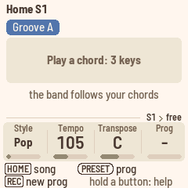

Press a page button to open its first page. The button stays lit while you're on any of its pages. The one
exception is **SEQ**: on the Band pages, pressing it opens Notes. Some buttons have a second page, which you
reach by turning **SELECT**. The dots at the right, above the knobs, show which page you're on.

**HOME** switches between Home and the Song page. You play and write progressions on Home, and you put them
in order on the Song page. The Song page has a second page too, which you reach by turning **SELECT**.

### The screen

From top to bottom, the screen has five parts.

- At the top, the header starts with a small keycap of the page's button and the page's name, such as
  "[SEQ] Band". On Home it shows the song instead, such as "Home S1", and while you hold **HOME** it reads
  "HOME + a key · S1". The tempo sits at the right, except on Home, where **KNOB 2** shows it. If MIDI clock
  is setting the tempo, you'll see "ext" there. A coral dot means Polly is recording, and "unsaved" means you
  have changes to save. At the far right is the battery. It shows three bars when it's full, and fewer as it
  runs down. At one bar or none it turns coral, and it's time to charge. When the FM-1 is plugged into a
  computer, it shows a lightning bolt instead. While it charges from a wall charger, the bars read high.
- The middle is the page itself.
- Just above the knobs, the tag line tells you where you are, from the song down. On Band, Sound and Mixer it
  reads something like "S1 › Pop › Groove A › C1 Acoustic Grand". On the Progression page it's "S1 › P9
  Verse". On the Song page, or on Home while you're in a song, it's just "S1". With no progression playing it
  reads "S1 › follow", and with a melody selected, "S1 › M1 Choir Aahs". If the line gets too long, the first
  steps drop off. The tag line doesn't show your place inside the page, such as a bar or a section. The
  cursor shows that.
- The knobs strip shows what **KNOB 1–4** do on this page, with their values. When you turn a knob, it shows
  coral for a moment. Pages without knobs, such as Status, don't have the strip.
- The two bottom lines label each control with a pill, like the labels printed on the panel. Next to each
  one is what it does here.

The first part of the bottom lines is for the three encoders, in round pills. It tells you what turning
**SELECT**, **ALGORITHM** (ALGO) and **PRESETS** (PRESET) will change, for example "[SELECT] page · [ALGO]
instrument · [PRESET] groove".

- SELECT turns the button's pages, and the dots show which page you're on. If a button has only one page,
  SELECT isn't listed. In Notes, SELECT picks a note.
- On Home, the line starts with "[HOME] song", because **HOME** opens the Song page from there.
- ALGO picks the instrument or melody the keys play. You'll see it on the pages that show an instrument:
  Band, Groove length, Sound, Sound 2, the two Mixer pages and Notes.
- PRESET steps through the progressions on Home and the Progression page, the sections on the Song page, the
  grooves on Band and Groove length, the sound families on Sound, the zoom in Notes, and the styles on the
  Style page.
- While you hold **HOME**, the line reads "[SELECT] tempo · [PRESET] song".

The second part is for the keys and buttons, in square keycaps. It tells you what they do on this page,
for example "[KEYS] chords · [REC] write · [OCT] cursor", "[KEYS] C1 · [REC] record" or "[WHITE] progression ·
[BLACK] mutes". While Polly records, it reads "[REC] stop". Controls you use together appear joined, as in
"[HOME]+[KEYS] sections". On Effects, Style, Setup and Status the keys do nothing, so you only see the
encoders' part. When everything fits on one line, you see only one line.

A few screens are different:

- The very first screen says "[REC] new prog · hold a button: help".
- In a list, you only see the list's own line, such as "[SELECT] move · [SEL] do it · [HOME] back".
- A question says "[SEL] yes · [HOME] no".
- While you hold **HOME**, the second part says "[REC] undo · [PLAY] redo".
- While a help card is up, the line says "let go: nothing changes".

### Messages

Short messages such as "SAVED" or "NEXT GROOVE B" cover the header for a moment, in a rounded box. The icon
tells you what kind of message it is:

- A beige **i** brings news, such as "PROGRESSION P1 POP".
- A beige **✓** means something is done, such as "SAVED" or "CLEARED".
- A beige **arrow back or forward** is an undo or a redo, and the message says what it changed.
- A coral **?** is a question. It stays until you answer. Press **SEL** for yes or **HOME** for no.
- An ink **!** means Polly couldn't do what you asked. The message says why, such as "RESET · STOP FIRST", and
  stays up for two seconds.

### The cursor, the playhead and the colours

The cursor is a thick coral outline. It shows you where the knobs and keys will write.

- On the Progression page, it goes around a chord's cell, and the bar and beat numbers turn coral.
- On the Song page, it goes around a section, and "section 3 of 6" appears above the rows.
- On Band, it's a line down through the instruments. The bar and beat, such as "bar 2.3", sit in coral above
  it.
- On Sound with M1 or M2 selected, it goes around a section of the melody and that section's first bar.

Whatever is playing is filled teal, and on Band the playhead is a teal line. If you see a coral outline around
a teal fill, the cursor is on the beat that's playing.

Whatever you change flashes coral for half a second. You'll see it on a chord, a section, an instrument's row,
a bar of notes you just recorded, and anything undo or redo brings back. In Notes, only the notes you changed
flash, with a small mark on the song line. That way the ring around the selected note stays clear while you
turn a knob.

Each color means one thing:

- **Teal** is what's sounding now: the bar, beat, section or progression that's playing, and the playhead.
  Nothing else is teal.
- **Coral** is you. It marks the cursor, the flash of an edit, the knob you turned, REC, a chord you play over
  a progression, and questions and messages.
- **Ink** and its grays are for everything that stays put: names, values, the selection in a list, and the
  ring that marks where PLAY will start.
- **Slate** and **amber** are Groove A and Groove B, on their pills. The extras (Intro, Fills, Ending) have
  outlined pills.
- **Plum** is for the melodies.

### The instruments

A groove has eight instruments, named as on the QY70:

| Instrument | Usually plays |
| --- | --- |
| D1, D2 | Drums |
| PC | Percussion |
| BA | Bass |
| C1–C4 | Chords, riffs and pads |

Turn **ALGORITHM** on any page to pick an instrument. The screen shows its name and sound, the keys play
that sound, and **REC** records into it. On a new Polly, C1 is selected, and it plays piano. After C4 come
the song's two melodies, M1 and M2. See [Melodies](#melodies).

### The keys

At octave 0, the 27 keys go from F3 to G5. Press **OCT−** or **OCT+** to move them an octave at a time. The
FM-1's keys don't sense how hard you press, so every note plays at the same velocity.

### The lights

- **PLAY** is green while Polly plays, and red while it plays and records. If you press **REC** while Polly
  is stopped, **PLAY** blinks red. Press it, and Polly counts in for a bar and starts recording.
- **REC** lights while Polly records, and while it waits for you to press **PLAY**.
- **SAVE** lights when you have something to save.
- The button of the page you're on is lit.
- Keys light while you hold them, unless Setup's Lights is set to "off".
- While you hold **HOME**, a black key lights for the groove or extra that's playing, or the one coming next.
  A white key lights for the progression that's playing.
- On the Song page, the black keys of the instruments muted in the section at the cursor glow dimly.
- With Setup's Lights set to "on", the other buttons glow dimly too, so you can find them in the dark.
## Styles and grooves

A **style** is the way the band plays. This chapter shows you how to pick a style, switch between its grooves and
set the tempo. Every style has two grooves, plus extras that play before, between and after them.

| Part | What it does |
| --- | --- |
| Intro | Plays once at the start, then Groove A. |
| Groove A | The calmer groove. Plays in a loop. |
| Groove B | The busier groove. Plays in a loop. |
| Fill AB | One bar that leads from Groove A into Groove B. |
| Fill BA | One bar that leads from Groove B back to Groove A. |
| Ending | Plays once, then stops. |

Polly has 16 styles of its own: Pop, Funk, Rock, Ballad, Bossa, Swing, Shuffle, Reggae, Hip hop, House,
Disco, Country, Gospel, Waltz, Latin and Ambient. Their drums are real drummers' performances from the
Groove MIDI Dataset. If you install a [QY70 bank](#the-qy70-bank), the QY70's 128 preset styles come after
them on the Style knob, and the knob's label changes to "QY style".

### Picking a style

On Home, turn **KNOB 1** (Style). You can change styles while the band plays, and each of the four songs
has its own style.

Every style has its own tempo, and picking a style sets it, until you set the song's tempo yourself. From
then on, Polly keeps your tempo when you change styles and tells you so, for example "TEMPO KEPT 84 (HOUSE
122)". If you'd rather have the style's tempo, press **SEL**. The list opens on STYLE TEMPO 122, and pressing
**SEL** again uses it. After that, picking a style sets the tempo again.

**Edited grooves stay.** Once you record into a groove or an extra, or change one of its sounds, Polly plays
an [edited copy](#edited-grooves) instead of the style's. You'll see "Groove A (edited)" on its pill on Home
and Band, "House (edited)" on the Style knob, and "Pop (edited)" on the Style page.

When you turn the Style knob, only the grooves that still play the style change. Your edited ones stay as they are.
That way you can keep your edited Groove A and hear the rest of the band in Funk, then in Rock. When you stop turning the
knob, Polly asks "KEEP YOUR EDITED GROOVE A?" or "KEEP YOUR 2 EDITED GROOVES?". Press **SEL** to keep
them, or press **HOME** to play the new style's grooves instead, just as BACK TO STYLE would. Either way, your
copies stay in memory.

To give a groove back to the style, play it first. While the band plays, hold **HOME** and press the groove's
black key. Then press **SEL** on the Band page and choose BACK TO STYLE (see [the groove's actions](#the-grooves-actions-sel)).
Your copy stays in memory, so you can pick it again later.

### Changing grooves

Hold **HOME** and press a black key:

| Black key | Plays |
| --- | --- |
| 1 | Intro |
| 2 | Groove A |
| 3 | Groove B |
| 4 | Fill |
| 5 | Ending |

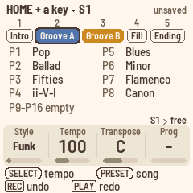

While you hold **HOME**, the screen lists these five, each under its black key's number. Below them are the
progressions that have chords. The empty ones share a line underneath, such as "P9–P16
empty".

- Whatever is playing now is teal. A groove gets a teal ring, and a progression shows its number on teal and its
  name in teal.
- Whatever you've asked for is coral, with a coral ring or its number on coral. It starts at the next bar.
- When Polly is stopped, ink marks what PLAY will start with, with an ink ring or a number on ink.

If the band is playing, your change waits for the next bar, and until then Home shows NEXT with the groove.
If Polly is stopped, you're choosing what PLAY starts with, and Polly tells you, for example "FIRST GROOVE B".

**Fills**

- You don't pick the fill yourself. From Groove A, Fill AB plays and leads into Groove B. From Groove B,
  Fill BA plays and leads back to Groove A.
- If you ask for a fill while one is playing, you get another bar of fill.
- A fill can't interrupt the Intro or the Ending. They play to the end, and Polly shows "NO FILL".
- If a style has no Fill BA, Fill AB plays instead, and the other way around.

**Starting and ending**

- PLAY starts with Groove A. The Intro plays first if you start a song while Polly is stopped and the song's Intro is
  on. It also plays first if you pick it before pressing **PLAY**: hold **HOME** and press black key 1.
- The Ending plays once, and then Polly stops. If there's no Ending, Polly stops at the end of the bar.
  Afterwards, the pages show what PLAY will start with again. In a song, that's section 1's groove, and
  otherwise it's Groove A, never the Ending.

### Intros and endings hold a chord

As on the QY70, the Intro and the Ending play over one held chord, because they bring their own lead-in and
closing cadence. Whatever chord is playing on their first beat lasts until they end. A chord you play on
the keys still changes it right away.

### Tempo

On Home, turn **KNOB 2** (Tempo). On any page, you can also hold **HOME** and turn **SELECT**. The tempo goes
from 40 to 240 BPM, and you'll see it at the top right of the screen. When Polly follows MIDI clock, it says
"ext" there instead.

### The Style page (ENV)

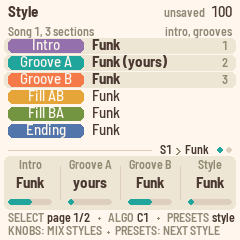

Use the Style page to choose which style plays each of the song's grooves and extras. For example, you can
play Funk's Groove A with Rock's fills.

- On page 1, use **KNOB 1–3** to set the Intro, Groove A and Groove B. They're shown in bold on a panel.
- Turn **SELECT** for page 2, where **KNOB 1–3** set Fill AB, Fill BA and the Ending.
- Each knob lists your edited copies first, such as "Funk (edited)", and then the styles by name.
- **KNOB 4** and **PRESETS** set the song's style, just like **KNOB 1** on Home. They change the grooves that
  play a style and leave your edited ones alone.

## Chords

Polly's grooves are written as if the chord were C major 7. As the band plays, Polly moves every note of every
instrument to fit the chord you're on. You can give it chords in three ways: play them on the keys,
play a progression, or play a song.

### Playing chords

On Home and the Progression page, the keys play chords.

- Hold down three or more different notes. Polly names the chord, and the band follows it. If no progression
  is playing, Home shows the chord's name in large letters.
- The chord keeps playing after you let go, as on an arranger keyboard, so you can play the next one whenever
  you're ready.
- Inversions work. E G C and G C E are both C.
- When the notes could be read two ways, Polly takes the lowest note as the root. A C E G is Am7, C E G A is
  C6, and D F A C is Dm7.
- The lowest note is the bass. If it's the chord's root, 3rd or 5th, you get that chord. Any other note at
  the bottom becomes a slash bass under the chord the upper notes make. D under C E G is C/D, F under C E G is
  C/F, and B♭ under C E G is C/B♭. For C7, put the B♭ above the C: C E G B♭.
- You can leave out the 5th. C E B♭ is also C7.
- Two notes aren't a chord, so they don't change anything.
- If a progression is playing, a chord you play lasts until the progression's next chord change. Home shows it
  at the top right in coral, because it's yours.
- **Writing in time.** When you write chords while a progression plays, or while you record a new one, each
  chord lands on the nearest beat. The first chord of a bar is the one exception. If you play it during the
  bar's first beat, it lands on the downbeat, so a chord that's a little late still counts as being on the one.

### The chord types

Polly knows 25 chord types.

| Major | Dominant | Minor | Other |
| --- | --- | --- | --- |
| maj | 7 | m | aug |
| add9 | 7(9) | madd9 | dim |
| M7 | 7(#9) | m7 | sus4 |
| M7(9) | 7(b9) | m7(9) | 7sus4 |
| 6 | 7(13) | m7(11) | |
| | 7(b13) | m6 | |
| | 7(#11) | mM7 | |
| | 7(#5) | m7(b5) | |

When a beat doesn't have a chord of its own, the Progression page's Type knob shows "–". A progression with
no chords yet plays "–" too, and every instrument follows the root.

### Transpose

Use **KNOB 3** (Transpose) on Home to move everything to another key, from −6 to +5 semitones, as on an arranger
keyboard. The knob shows the key, such as "C" or "D". It moves the progressions, the song, and everything you
play on the keys, whether that's chords, an instrument's notes or a melody. In a song, each section's own Transpose
adds to it.

Home's bars show the chords as you hear them. Polly keeps the chords you write and the notes you record just
as you heard them, so they play back the same, and they move along if you change Transpose later. MIDI in
isn't transposed. The keys' octave (**OCT−** / **OCT+**) is a separate setting.

<a id="progressions-and-the-song"></a>

## Progressions

This chapter shows you how to write and edit progressions. For a walk-through, see the lesson
[102 Your own progressions](docs/course/102-your-own-progressions.md).

### Ready-made progressions

On a new Polly, P1–P8 hold eight factory progressions: Pop, Ballad, Fifties, ii–V–I, Blues, Minor, Flamenco
and Canon. P9–P16 are empty, ready for your own. To play a progression, hold **HOME** and press its white key.

Polly knows 16 ready-made progressions in all, and you can copy any of them into the progression you're on.
Press **SEL** on Home or the Progression page, choose LOAD PROGRESSION, and turn **ALGORITHM** to pick one.
They come in this order:

| 1 to 4 | 5 to 8 | 9 to 12 | 13 to 16 |
| --- | --- | --- | --- |
| 1 Pop (I–V–vi–IV) | 5 Blues (12 bars) | 9 Canon | 13 Jazz (I–VI7–ii–V) |
| 2 Ballad (vi–IV–I–V) | 6 MinBlues (minor blues) | 10 Flamenco (Andalusian) | 14 Vamp (ii–V) |
| 3 Fifties (I–vi–ii–V) | 7 One-four | 11 Mixo (I–♭VII–IV) | 15 Gospel (IV–I) |
| 4 ii–V–I | 8 Minor (i–VI–III–VII) | 12 Doo-wop | 16 Waltz (3/4) |

### Writing a new progression

1. On Home, turn **KNOB 4** (Prog) counterclockwise to "follow", so that the band follows you.
2. Press **REC**, then **PLAY**, and Polly counts in with a bar of clicks. If the band is already playing,
   press only **REC**, and recording starts at the next bar.
3. Play the chords on the keys, in time. Each one lands on the nearest beat.
4. Press **REC** again. Polly saves the bars you played in the first empty progression, such as P9, tells you
   "NEW PROGRESSION P9", and plays it in a loop. If P1–P16 all have chords, Polly says "NO EMPTY PROG", and
   you'll need to clear one first.

### The Progression page (ARP)

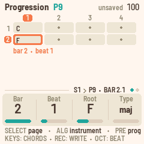

The Progression page shows a progression's bars, with one cell for each beat. Short progressions get taller
cells. The cursor is a thick coral ring, and its bar and beat numbers are coral too. While the band plays, the
beat that's playing is teal.

The page shows the progression that's playing, or the one you picked last. Until you've picked one, it opens
on the first empty progression, so you never write over a factory one.

- Use **KNOB 1** (Bar) and **KNOB 2** (Beat) to move the cursor. When you change the bar, the beat stays the same, and the grid
  scrolls to follow. While you're recording, you can move one bar past the end, and a chord there makes the
  progression longer.
- Use **KNOB 3** (Root) and **KNOB 4** (Type) to change the chord at the cursor. Type starts at "–", which means no
  new chord starts on this beat and the chord before it carries on. So to clear a chord, turn Type down to "–".
  After "–", the types go maj, m, 7, m7, M7, sus4, 7sus4, 6, m6, add9, madd9, M7(9), 7(9), m7(9),
  m7(11), dim, m7(b5), aug, mM7, and then the altered sevenths. The knob stops at both ends.
- Press **OCT−** or **OCT+** to move the cursor one beat.

Turn **SELECT** for page 2:

- **KNOB 1** (Length) sets how many bars the progression has, up to 16 bars of 4 beats. A progression can
  hold 64 beats at most, so with 5, 6 or 7 beats in a bar you get fewer bars.
- **KNOB 2** (Beats) sets the number of beats in a bar, from 2 to 7. Every chord stays where it was, so a chord
  on bar 2, beat 1 is still on bar 2, beat 1.
- **KNOB 3** (Bass) sets the bass note of the chord at the cursor. "–" means the chord's own root.
- **KNOB 4** (Name) gives the progression a name from a list, or its number, such as "P9".

**Writing at the cursor.** While Polly is stopped, press **REC**. Each chord you play goes in at the cursor,
and the cursor moves on one bar. To move by a beat or half a bar instead, change STEP in the **SEL** list.

**The list.** On the Progression page, press **SEL** to open a list with the knobs, the letters of the name, and
these actions:

- CLEAR CHORD clears the chord at the cursor and leaves "·" in its place. The list opens on it, and you can
  undo it in one step.
- STEP sets how far the cursor moves after each chord: a beat, half a bar or a bar. Turn **ALGORITHM** to
  choose.
- LOAD PROGRESSION copies one of Polly's [16 ready-made progressions](#ready-made-progressions) into this one.
- CLEAR PROGRESSION clears the whole progression.

**Shorter, then longer again.** If you shorten a progression, with Length or with fewer Beats, Polly hides
the chords that no longer fit and tells you, for example "2 CHORDS HIDDEN". Hidden chords don't play. They
come back if you lengthen the progression again before you leave the Progression pages. Once you leave,
they're gone and aren't saved. Undo brings back a shortening, chords and all. If you write a chord past
the end, the progression gets longer, into empty bars.

**Copying.** Hold **SAVE** and press white key *n* to copy the progression to P*n*. If P*n* already has
chords, Polly asks first.

### Home's Prog knob

Use **KNOB 4** (Prog) on Home to choose what leads the band.

- At "follow", the band follows your chords.
- At P1–P16, the band plays that progression. If it's already playing, the change happens at the next bar.
- In a song, the knob says "Song", and turning it takes you out of the song.

### The Home page

Home shows the progression as bars, whether you're listening or writing chords. Each cell is a bar with its
chords. The bar that's playing is filled teal, with its beats along the bottom. When a bar has several chords,
the one you're hearing is bright and the others are pale. When Polly is stopped, bar 1 has an ink ring, because
that's where PLAY starts. You see eight bars at once, in two rows of four. A longer progression, such as
the 12-bar blues, scrolls to follow the bar that's playing. The groove's pill sits above the bars, and when a
change is waiting, it says NEXT with the next groove.

In a song, the top line counts the sections and repeats, such as "section 2 of 4 · repeat 1 of 2", and the
bars show that section's progression. The line underneath tells you what's coming next, with its first chord:

- "next: P4 Chorus (Am) · Groove B"
- "next: Fill · P4 Chorus (Am) · Groove B", when a fill plays in the last bar of this section
- "next: P3 Verse again", when the section repeats
- "next: P1 Verse (C) · Groove A" after the last section, when the song is set to play [again](#the-songs-second-page)
- "next: Ending"
- "next: stop"

With no progression playing, Home shows just the chord you're holding, in large letters. It turns teal while
the band plays it. Once the band is playing, the top right counts the groove's bars, such as "groove bar 1.1 /
2", and the line under the chord reminds you that the band follows your chords.

While you're recording chords, the top line shows where you are, such as "REC P9 · bar 3.2". During the
count-in it says "starts at the next bar", and bar 1 counts down the beats in large numbers. Until you play
your first chord, it also reminds you that chords land on the nearest beat. Each chord you write flashes its
bar coral.

## The song

A song is a list of sections. This chapter shows you how to put progressions in order, choose each section's
groove, and play the whole song. For a walk-through, see the lesson
[103 Your song](docs/course/103-your-song.md).

### The Song page (HOME, HOME again)

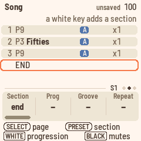

On Home, press **HOME** to open the Song page. Press **HOME** again to go back to Home.

The Song page lists the song's sections from top to bottom. Each row shows:

- the section's number
- its progression, such as "P3 Fifties", or "empty" if the progression has no chords
- an ink **M** if the section mutes an instrument or a melody
- its groove, as a slate A or an amber B, with "+ fill" or "no fill" if you chose one
- how many times it repeats, such as "x2"
- its own transpose, such as "+2" (nothing shows at 0)

You see four sections at a time, and the list only scrolls when the cursor needs it to. Below the last
section is END, where new sections go.

The cursor is the coral ring, and the line above the rows tells you where it is, such as "section 3 of 6".
On END, that line says "a white key adds a section". While the song plays, the section that's playing is
filled teal. If the cursor is on it too, you see the teal fill inside the coral ring.

### Adding sections

Press white key *n* to add a section that plays P*n*. A light coral arrow and a moving line show you where it
will go. It goes above the section at the cursor, or at the end if the cursor is on END. The sections below move
down, and the cursor moves with them, so keys you press one after another go in in that order.

- A new section takes the groove of the nearest section above it that plays the same progression. If there
  isn't one, it starts on Groove A. It plays once, with nothing muted.
- On END, you can also turn **KNOB 2** (Prog) up to add a section that plays P1.
- While the song plays, you can't add a section at or before the one that's playing. Polly says "INSERT
  SECTION · STOP FIRST".
- A song can have up to 32 sections.

### Changing a section

The knobs on page 1 change the section at the cursor:

- **KNOB 1** (Section) moves the cursor. **PRESETS** does the same.
- **KNOB 2** (Prog) sets the section's progression. If you turn it down past P1 to "–", you remove the section (see
  [Removing sections](#removing-sections)).
- **KNOB 3** (Groove) sets the groove, and whether a fill plays at the end of the section. It goes A, A + fill,
  A no fill, B, B + fill, B no fill, and stops at both ends.
  - With **A** or **B**, a fill plays if the next section has a different groove.
  - With **A + fill** or **B + fill**, a fill always plays.
  - With **A no fill** or **B no fill**, a fill never plays.
- **KNOB 4** (Repeat) sets how many times the section plays, from 1 to 8.

Each section has its own groove, so when you change it, other sections that play the same
progression keep theirs.

Under the rows are the mutes of the section at the cursor: D1 D2 PC BA, C1–C4, and then the melodies M1 and
M2 in plum. A filled name plays, and an outlined one is muted. Use black keys 1–8 to mute the section's instruments,
and black keys 9 and 10 to mute its melodies. Press a key again to unmute. On END, the black keys do nothing.
See [Mutes](#mutes).

### Removing sections

Turn **KNOB 2** (Prog) down past P1 to "–". The section is struck through and reads "section removed". You
can mark as many sections as you like. Polly removes them all when you leave the Song pages, and one undo
brings them all back.

- To keep a marked section after all, turn **KNOB 2** back up, and it comes back as it was.
- If the song is playing, it skips marked sections straight away. A marked section that's already playing
  finishes its pass first. The song keeps playing when you leave the Song pages.
- If a marked section has melody notes, Polly asks before removing it, for example "REMOVE SECTION 3 AND
  MELODY?". Press **SEL** to remove it, or press **HOME** to keep all the marked sections.
- If you undo before you leave, the marks are cleared and the sections stay.

### Playing the song

Press **PLAY** on the Song page to play the song from section 1. To start somewhere else, use PLAY FROM
SECTION in the [song's list](#the-songs-actions-sel).

While the song plays:

- The section that's playing shows a small clock instead of its number. The clock fills up as the section
  plays, repeats included. When it's full, the next section starts.
- During the Intro, a fill or the Ending, the line above the sections tells you which one is playing, for example "Intro
  · then section 1", "Fill AB · into section 3" or "Ending · then stop". The Intro and the Ending have their
  own clock at the start of that line.
- A fill takes up the last bar of the section before it, and the band plays it with the mutes of the section
  it leads into. So if a breakdown has the drums muted, they come back for the fill into the next full
  section. The melodies keep the mutes of their own section.

### The song's second page

Turn **SELECT** for page 2:

- **KNOB 1** (Transpose) sets the section's own transpose, from −6 to +5, on top of the song's. **PRESETS**
  steps through the sections.
- **KNOB 2** (Intro) turns the song's Intro on or off.
- **KNOB 3** (Ending) turns the song's Ending on or off.
- **KNOB 4** (At end) sets what happens after the last section. With "stop", the song stops. With "again",
  it goes back to section 1 and keeps looping, without the Ending.

To switch to another song, hold **HOME** and turn **PRESETS**.

### Writing sections while the song plays

You can also build a song by playing it.

1. On the Song page, press **REC**, then **PLAY**. Polly counts in with a bar of clicks.
2. Hold **HOME** and press a white key. Its progression goes into the section that's playing, or into the
   next one if this section is in its last bar. After the last section, Polly adds a new one.
3. Hold **HOME** and press black key 2 or 3 to set the section's groove to A or B.
4. To set the mutes of the section that's playing, use the black keys, or **KNOB 4** on the Band page.
5. Press **REC** again to stop writing. The song keeps playing.

### The song's actions (SEL)

On the Song pages, press **SEL** to open the list. It opens on PLAY FROM SECTION, which plays from the section at the cursor. After it come
these actions:

- INSERT SECTION puts a copy of the section at the cursor above it, without its melody notes.
- DELETE SECTION deletes the section at the cursor, along with its melody notes. If it has any, Polly asks
  first: "SECTION 3 HAS MELODY NOTES: DELETE?".
- CLEAR SECTIONS clears the sections and the melodies, after asking "CLEAR S1'S SECTIONS?". The style, tempo,
  transpose, mutes and progressions stay. The Intro and Ending turn on again, and At end goes back to "stop".
- NEW SONG makes the song as it is on a new Polly, after asking "NEW SONG: CLEAR ALL OF S1?". The song then
  has no sections or melodies, the ready-made progressions, and Pop in every groove at Pop's tempo. Nothing is
  transposed or muted, the Intro and Ending are on, and At end is "stop". The melodies' sounds go back to
  their defaults too. Edited grooves that the song played stay in [memory](#memory) for any song to use,
  until you free them there. One undo brings the whole song back.
- COPY SONG TO copies the song into another one, such as S2. Turn **ALGORITHM** to pick it. If that song has sections,
  Polly asks before replacing it. The melodies aren't copied, and the other song's melodies are cleared.

INSERT SECTION, DELETE SECTION, NEW SONG and COPY SONG TO only work while Polly is stopped. If it's playing,
Polly says "STOP FIRST".

A song with no sections can't play as a song. If you press **PLAY** on the Song page, Polly says "NO SECTIONS
· WHITE KEYS FIRST". If you empty the song you're in, with CLEAR SECTIONS or by deleting its last section,
the band follows your chords again, and Polly says "NO SECTIONS FOLLOWING YOU". After NEW SONG, Prog is on
"follow" too, and the Progression page shows P1.
## Recording an instrument

You can record your own notes into any instrument of a groove. Polly records into the selected instrument
of the groove or extra that's playing, and keeps looping it while you play.

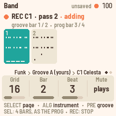

1. Press **SEQ** to open the Band page.
2. Turn **ALGORITHM** to pick the instrument. The keys now play its sound.
3. Press **REC**. A coral dot appears in the header, **REC** lights, and **PLAY** blinks red. The screen
   shows the groove as bars, with the instrument's notes in each, and "REC C1 · starts with PLAY". The bottom
   line says "[REC] stop".
4. Press **PLAY**. The click counts in for one bar while the band waits. The top of the screen says
   "Count-in 4", and bar 1 counts down the beats in large numbers. Then the groove starts, **PLAY** turns red,
   and you play.
5. The groove loops, and each pass adds to what's already there. You hear a new note from the next pass on.
   The screen shows where you are, such as "REC C1 · pass 2 · adding". Under it you'll see the groove's bar
   and, if a progression is playing, the progression's bar: "groove bar 1 / 2 · prog bar 3 / 4".
6. Press **REC** again to stop recording. The groove keeps playing.

### The Band page

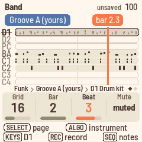

The Band page shows the eight instruments of the groove that's playing, with their notes in ink.

- Drum hits are short ticks.
- A muted instrument is pale, with its name struck through.
- An instrument with no notes is faded.
- The selected instrument's row is darker, with an outline.
- The playhead is a teal line.
- The cursor is a coral line down through the instruments. Its position shows in coral above it, such as
  "bar 2.3".

The groove's pill, such as "Groove A (edited)", is at the top left. To change the groove's length, go to the
Groove length page.

- Turn **KNOB 1** (Grid) to set the grid. See [How recording works](#how-recording-works) below.
- Turn **KNOB 2** (Bar) and **KNOB 3** (Beat) to move the cursor.
- Turn **KNOB 4** (Muted) to mute or unmute the selected instrument. See [Mutes](#mutes).
- Turn **PRESETS** to change what the playing groove plays. It starts with your edited copies, then goes on
  to the styles'. If the band is playing and the groove has unsaved changes, press **SAVE** first.
- To fix a single note, press **SEQ** again. See [Fixing notes](#fixing-notes).

### How recording works

- A woodblock clicks the beats while you record, and always during a count-in. To turn it off, or to have it
  on for recording only (rec) or all the time, use Setup's Click knob.
- When you press **REC** and then **PLAY**, Polly counts in for one bar. You only hear the click while the
  band waits, and the header counts down from "Count-in 4". Recording starts on the band's first beat, and a
  note you play just before it still lands on it. The count-in works the same for everything you record: an
  instrument, a new progression, chords, a melody or sections. To stop during the count-in, press **PLAY**.
  Polly sends MIDI start when the band starts, after the count-in, so a computer recording Polly stays in
  time. When Polly follows MIDI clock, there's no count-in, and recording starts with the clock.
- Use Band's **KNOB 1** (Grid) to move the notes you record to the nearest 8th, 8th triplet, 16th, 16th
  triplet or 32nd. At "off", they stay exactly as you played them. Turn it clockwise for a finer grid: 8,
  8T, 16, 16T, 32, off.
- The first time you record into an empty instrument whose type is Chord 1, Chord 2 or Bass, Polly switches
  it to Parallel and tells you "C1: AS PLAYED". Your notes then play back exactly as you played them, over
  the chord you played them on. Over a different chord, they move with the root by the shorter way and keep
  their shape. For example, a line you played over Am goes up a third over C. The instrument's range also
  opens up to the whole keyboard. You can see and change the type on the Sound page (**EDIT**). If you set it
  back there, Polly won't switch it again.
- An instrument that already has notes, such as a style's comping, keeps its type, and its notes keep
  following the chords. Polly tells you "C1 FOLLOWS CHORDS", and the bottom line offers "[SEL] clear C1 to
  record as played". Anything you record into it follows the chords too.
- If you press **REC** while the band plays, recording starts at the next bar line, wherever the groove is.
  The screen rings that bar and counts down its beats, and a note you play just before the bar line lands on
  it. The passes count from there. So if you start at bar 3 of a 4-bar groove, each pass goes bars 3, 4, 1, 2.
- A groove can be shorter than the progression. Say a style's 2-bar Groove A plays over a 4-bar progression.
  While you record, the bottom line offers "[SEL] make it 4 bars". Press **SEL**, and the groove becomes as
  long as the progression, with its bars repeating into the new ones. You'll also find this in the **SEL**
  list as MATCH PROG LENGTH. Afterwards, what you play over the progression's bar 3 stays with bar 3.
- In a song, a fill takes the last bar of a section if the section has "+ fill", or if the groove changes
  after it (unless the section has "no fill"). That bar plays the fill instead of the groove, so you won't
  hear what you record into the groove's last bar there.
- Outside a song, if you press **REC** before **PLAY**, Polly plays the groove you're recording into right
  away, without the Intro.
- Recording stops when the band changes groove. That includes a fill, an ending, or the next section of a
  song. Polly tells you "RECORD OFF NEW SECTION". To keep recording, play without a song, or on a groove that
  loops.
- A groove holds 600 notes. Once it's full, Polly drops new notes.

### Edited grooves

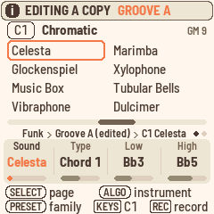

The styles themselves never change. The first time you record into a style's groove or extra, or change its
sound, mixer or length, Polly copies it into a free place in [memory](#memory), and you edit the copy. Polly
tells you, for example "EDITING A COPY · GROOVE A" or "RECORD C1 · GROOVE A (EDITED)". From then on, that
groove plays your edited copy whatever the Style knob says, and the screen marks it "(edited)". That lasts
until you choose BACK TO STYLE. Muting an instrument doesn't make a copy, because mutes belong to the song,
not to the groove.

Edited grooves share memory's 16 places with the melodies. If no place is free, Polly says MEMORY FULL and "NOT
KEPT". Your change still plays, but you'll lose it once you pick something else. If you free a place, the
change moves into it right away, and Polly tells you, for example "GROOVE A KEPT IN MEMORY 14". See
[Memory](#memory).

To copy a groove into a place of your choice, stop first. Then, on the Band or Groove length page, hold
**SAVE** and press white key *n*. Polly copies the groove to place *n* and says, for example, "COPIED TO
MEMORY 7". If the place holds another groove, Polly asks first. A place that holds melodies or progressions
can't take a groove.

### Groove length (SEQ, SELECT)

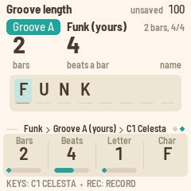

Use this page to set the groove's length and give it a name. Each bar is a cell, with its number at the top
and its beats along the bottom. The bars you could still add, up to 16, are drawn as outlines. The name sits
underneath. The letter you're changing is in a coral box, and the empty spaces after it are dots.

- Turn **KNOB 1** (Bars) to set the length, from 1 to 16 bars.
- Turn **KNOB 2** (Beats) to set the number of beats in a bar, from 2 to 7.
- Turn **KNOB 3** (Place) to pick a letter of the name, and **KNOB 4** (Letter) to change it. A name can
  have up to eight characters: letters, digits, "-" and "#".

When you make a groove longer, the new bars repeat what's there, so the band keeps going. Each instrument
repeats in its own way. A 1-bar drum part repeats bar 1, and a 2-bar bass line repeats bars 1 and 2. When you
make a groove shorter, Polly keeps the notes past the end but doesn't play them. Make it longer again, and they
come back, with nothing repeated over them.

While a progression plays, the groove follows the progression's bar. If you change the length while the
progression is on its bar 3, a 4-bar groove plays its own bar 3. The Band page shows a groove longer than
8 bars one half at a time, such as "bars 9-16 of 16", following the playhead.

### The groove's actions (SEL)

On the Band, Groove length, Sound, Mixer and Notes pages, the **SEL** list opens on actions for the groove
that's playing:

- MATCH PROG LENGTH comes first if the groove is shorter than the progression.
- CLEAR C1 clears the selected instrument's notes.
- CLEAR GROOVE A clears the groove, or the extra that's playing.
- BACK TO STYLE gives the groove back to the style. If the band is playing, save your changes first, or
  Polly says "UNSAVED · SAVE FIRST". Press **SAVE**, or stop.
- MEMORY shows what's using the memory. It's on the Band, Groove length, Sound and Sound 2 pages.

With a melody selected, the list has the melody's actions instead: CLEAR M1 IN SECTION n, CLEAR M1, QUANTISE
M1 IN SECTION n and COPY M1 TO SECTION n. See [Melodies](#more-about-melodies).

Effects are shared by every song, so the Effects list only has its knobs.

## Melodies

Each song has two melodies, **M1** and **M2**. Use them for lines that run through the whole song instead of
looping with a groove. Melodies only play in a song. That means when Home's Prog knob says "Song", or after
you press **PLAY** on the Song page.

Every note belongs to its section. Polly keeps it as you heard it, along with the root of the chord under it.
If you later change that section's chord or Transpose, or the song's Transpose, the melody moves with the
root and keeps its shape. Over the same chord and Transpose, it plays exactly as you played it.

### Recording a melody

1. On the Song page, press **PLAY**.
2. Press **EDIT** and turn **ALGORITHM** past C4 to **M1**. The keys now play its sound. M1 starts out as a
   choir, and M2 as strings.
3. Press **REC**. The click counts in to the next bar line, and the screen says "REC M1 · starts at the next
   bar", counting down the beats in that bar in large numbers. If the Intro is playing, recording waits for
   section 1.
4. Play along. Under "REC M1", the screen shows where your next note will land, such as "song bar 6 · Chorus
   bar 2.1". It also shows the song as one line, with your notes landing on it. See
   [Viewing melodies](#viewing-melodies).
5. Press **REC** again to stop recording, and the song keeps playing. Stopping the song also stops recording.
   Polly says "RECORD OFF SONG STOPPED", so the next PLAY doesn't record over your song.

Your notes go into the section that's playing, on the Band page's grid, and you hear them the next time that
section plays. Recording over a section again adds to what's there, like a punch-in. To replace a section's
melody instead, clear it first and then record. Press **SEL**, and the list opens on CLEAR M1 IN SECTION n.

### Viewing melodies

With M1 or M2 selected, the Sound page shows the song as one line, whether it's playing or not. The view has
three parts.

- The whole song runs across the top. Its sections sit end to end, each as wide as its bars, repeats
  included. Each is named after its progression, such as "Verse" or "Chorus x2". Polly shortens the names of
  narrow sections, and names a run of the same progression only once. Groove A sections are slate and Groove
  B sections amber. The melody's notes are plum ticks along the line, and the other melody's are pale. While
  the song plays, a teal line moves along it. The section you're in has an outline. It's teal while that
  section plays, or coral at the Song page's cursor when Polly is stopped. A short line underneath marks the
  four bars shown below.
- Four bars run underneath, across sections if need be. You see the bar before your place, your place, and
  the two bars after it. A section's first bar shows the section's name and a divider, and the other bars
  show their number within the section. Notes sit by time and pitch, with the other melody's notes pale. The
  bar that's playing is teal, with its beats, and the bar you just recorded into flashes coral.
- A readout above them tells you where you are, such as "song bar 9 · Chorus bar 1". When Polly is stopped,
  it shows the first bar of the section at the Song page's cursor, ringed in coral. That's where PLAY FROM
  SECTION and a punch-in start. While the song plays, it shows the bar and beat in teal, such as "Chorus bar
  3.2". While you record, it shows in coral where your next note will land.

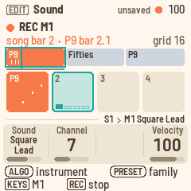

### More about melodies

- To punch in, go to the Song page and turn **KNOB 1** (Section) to move the cursor to the section. Then
  press **EDIT**, **REC** and **PLAY**. After a bar of count-in, the song starts at that section, and
  recording starts on its first downbeat. If you press **REC** while Polly is stopped and following your
  chords, or stopped on a progression, it switches to the song first.
- To record a second melody, turn **ALGORITHM** to M2 and keep recording, now into M2. M1's notes show dimly
  under M2's, so you can play against them.
- To clear a melody, press **SEL** on the Sound page (**EDIT**). The list opens on CLEAR M1 IN SECTION 3, for
  the section that's playing or, if Polly is stopped, the section at the Song page's cursor. Below it, CLEAR
  M1 clears M1 in the whole song. Polly asks before either one.
- To copy a section's melody, choose COPY M1 TO SECTION 3, where 3 is the same section. Turn **ALGORITHM** to
  pick the section to copy from, such as "from 2", and press **SEL** to copy its M1 notes over section 3's.
  If section 3 already has notes, Polly asks first. The copied notes play over section 3's chords as played,
  moved with its root. You can undo the copy in one step.
- To quantize a section, choose QUANTISE M1 IN SECTION 3 in the **SEL** list. It moves that section's M1
  notes to the nearest line of the Band page's grid, which you'll see at the right as 16, 8T and so on. That
  way you can record with the grid off to play freely, then set the grid on the Band page and quantize. One
  undo takes it back.
- A melody has a single Sound page, with the sound's family at the top in plum, such as "M1 Ensemble". Turn
  **KNOB 1** to change the sound, or **PRESETS** to jump to the next family. As with an instrument, the
  family's eight sounds show for a moment, with the current one ringed. **KNOB 1** sets the sound and
  **KNOB 2** the channel. The keys have no velocity, so use **KNOB 4** (Velocity) to set how loud the notes
  you record from now on will play. It starts at 100. A melody always plays as played across the whole
  keyboard, so it has no type, range or high key. The Mixer and Mixer tone pages have a strip for each
  melody, and black keys 9 and 10 select them there.
- To mute a melody in one section, go to the Song page. Black keys 9 and 10 mute M1 and M2 in the section at
  the cursor.
- On Home, in a song, M1 and M2 appear at the right of the "next:" line if they have notes. They're plum,
  turn teal while a note sounds, and are outlined and struck through while muted.
- Melodies only record in a song. If you press REC on a melody while the band follows your chords or plays a
  progression, Polly tells you "MELODIES RECORD IN A SONG".
- Melodies share memory's 16 places. A song's melodies take one place, which holds about 420 notes, and a
  second place if they outgrow it. "MEMORY FULL" or "MELODY FULL" means no place is left. See
  [Memory](#memory).

## Fixing notes

You don't have to record again to fix one wrong note. In **Notes**, you can edit the selected instrument's
notes in the groove that's playing, or a melody's notes along the song.

To open Notes, press **SEQ** for Band, then press **SEQ** again. In Notes, **SEQ** takes you back to Band,
and any other page button leaves it. As on every page, **ALGORITHM** picks whose notes you're editing: D1 to
C4, M1 or M2.

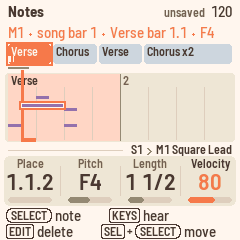

### The Notes page

Notes is a piano roll, with time running from left to right and pitch from bottom to top. A melody's notes
are plum, with the other melody's notes pale underneath. An instrument's notes are ink, and drum hits are
short ticks. For a melody, the song line runs along the top, with the stretch on the screen marked under it.
Each bar shows its number, and a section's first bar shows the section's name.

- The cursor is a coral line on the grid. The grid follows the Band page's Grid setting (8, 8T, 16, 16T or
  32), and uses 32nds if the grid is off. A coral mark along the bottom shows the step the cursor is on.
- The selected note has a coral ring around it.
- The playhead is teal while Polly plays.
- The readout at the top tells you where the cursor is and what the note is, such as "M1 · song bar 1 ·
  Verse bar 1.1 · F4" or "D1 · bar 1.1 · Pedal hat". Drum notes are named after their sound.

### Editing notes

- To select a note, turn **SELECT**. It steps from note to note in time order. In a chord, it takes the
  notes one at a time, lowest first. The cursor follows.
- To move the cursor, turn **KNOB 1** (Place). It moves one grid step at a time, empty places included.
  "1.1.2" means bar 1, beat 1, second step. If a note starts in that step, it's selected. If not, the cursor
  is on an empty place.
- To change the pitch, turn **KNOB 2** (Pitch). For a drum, it changes the sound, such as Snare or Closed
  hat.
- To make the note longer or shorter, turn **KNOB 3** (Length). It moves one grid step at a time, and the
  length shows in beats, such as "1/2" or "1 1/2". For finer steps, hold **SEL** while you turn **KNOB 3**.
- To set how loud the note plays, turn **KNOB 4** (Velocity), from 1 to 127.
- On an empty place, the knobs show "–".
- To move a note, hold **SEL** and turn **SELECT** or **KNOB 1**. The selected note moves one grid step at a
  time and keeps its length and velocity. If you move a melody note past the end of its section, it goes into
  the next section and takes the root of the chord there, as if you'd recorded it there.
- To delete a note, press **EDIT**.
- To add a note, move the cursor to an empty place and play a key. The note goes in there, one grid step
  long. A melody note gets the melody's velocity and the root of the chord sounding there, so it follows chord
  changes like a recorded note. If you hold several keys, they go in as a chord. When you let go, the cursor
  moves on one step, so you can write a line note by note. On an existing note, the keys only play. Notes you
  add to an instrument are stored as if over C major 7, the way the styles store theirs.
- To zoom, turn **PRESETS**. It shows 8, 4, 2 or 1 bars, and down to a single beat for an instrument. Notes
  starts at two bars.
- To erase while recording, hold **EDIT** while Polly plays with **REC** on. Polly erases the notes the
  playhead passes, from the step it's in until you let go, and the readout says "ERASING". The keys keep
  recording while you hold it.
- Every edit is one undo step. To undo, hold **HOME** and press **REC**. To redo, hold **HOME** and press
  **PLAY**. A recording pass, along with anything you erased during it, is one step too.
- Your first edit to a style's groove makes an edited copy, just as recording does ("EDITING A COPY · GROOVE
  A"). A groove holds 600 notes, and Polly says "GROOVE FULL" if you go past that.
- While you record, Notes shows the recording as it happens. The view follows the playhead, and the keys
  record.

### The bass and chord changes

An instrument of type Bass plays the chord's root on its first note after a chord change, whatever note is
written there. For the types, see [types](#sound-edit). In Notes, that's the first note on a bar's first
beat, unless it's written as a C, because the grooves are written in C. The readout marks that note, for
example "F2, heard as the root".

When you change or add such a note, Polly asks you once for that groove: "PLAY THIS BASS AS
WRITTEN?".

- Press **SEL** for yes, and the bass plays every note as written. Its Type becomes Chord 1, and Polly tells
  you "PLAYS AS WRITTEN". One undo takes it back.
- Press **HOME** for no, and the bass keeps playing the root on chord changes.

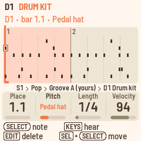
## Sound

Use the sound pages to see and change the groove that's playing, one instrument at a time. Turn **ALGORITHM**
to pick the instrument.

### Sound (EDIT)

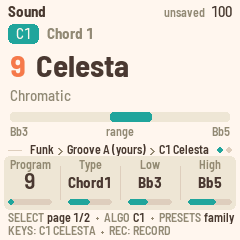

The Sound page works like a browser. At the top you see the sound's General MIDI family of eight, such as
"Chromatic". Below it, the family's sounds are listed in two columns of four, from Celesta to Dulcimer. A coral
ring marks the instrument's sound, and its General MIDI number is at the right in small type, such as "GM 9".
As you turn **KNOB 1**, the ring moves through the family, so you can see where you're going. Under the
sounds, a bar across the whole MIDI keyboard shows the instrument's range, which you set with the Low and High
knobs.

- Turn **KNOB 1** (Sound) to pick one of the 128 General MIDI sounds by name. Turn **PRESETS** to jump a
  family of eight at a time: pianos, organs, guitars, basses and so on. When Polly is stopped, each new sound
  plays a short note from the middle of the instrument's range, so you can hear it. While the band plays, you
  only hear that note for an instrument that's muted or silent in the groove. If you turn fast, it plays a note
  every few steps rather than on every step. Nothing plays while you record, or while a recording is waiting for
  **PLAY**. A drum instrument plays the drum kit, so its page says "Drums" and shows the kit. It has no family,
  range, Low or High.
- Turn **KNOB 2** (Type) to set how the instrument follows the chords. Once Polly has switched it for you, it
  says "as played". See [How recording works](#how-recording-works).
- Turn **KNOB 3** (Low) and **KNOB 4** (High) to set the lowest and highest notes. A note outside that range
  moves by octaves until it fits.

| Type | For | What it does |
| --- | --- | --- |
| Bypass | Drums | Never changes. |
| Parallel | Riffs | Moves with the chord's root and keeps its shape. |
| Chord 1 | Chords, arpeggios | Each note moves to the matching note of the new chord. |
| Chord 2 | Pads | Like Chord 1, but each note stays close to the one before, for smooth voice leading. |
| Bass | Bass lines | Like Chord 1, but the first note after a chord change is the root, or the slash bass, whatever note is written there. |

### Sound 2 (EDIT, SELECT)

- Turn **KNOB 1** (High key) to set the highest root a Chord 1 or Bass line can play from before it drops an
  octave. You can pick any note from C to B, or turn it off. Use it to keep a bass line from climbing out of
  reach as the chords rise. The page draws an octave of keys, with the high key in coral and the roots above it
  shaded. It also says what happens in words, such as "roots above F# drop an octave". Drums have no high key.
- Turn **KNOB 2** (Channel) to set the MIDI channel, from 1 to 15. Drums are on channel 10, and the click uses
  channel 16.

### Mixer (LFO)

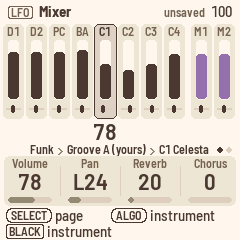

The Mixer has ten strips: the eight instruments, and then the melodies M1 and M2 in plum. Each strip shows its
volume and pan. The selected strip is darker and outlined, and its volume is shown in large numbers under it.
A muted strip is pale. Press black keys 1–10 to select a strip. Then use the knobs to change it:

- **KNOB 1** sets the volume.
- **KNOB 2** sets the pan.
- **KNOB 3** sets the reverb send.
- **KNOB 4** sets the chorus send.

To see every instrument's sends at once, open the Effects page. Instruments on the same channel share these
settings, and D1, D2 and PC are all on channel 10.

### Mixer tone (LFO, SELECT)

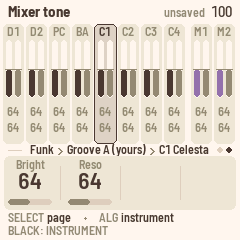

Use this page to make the selected instrument darker or sharper. Turn **KNOB 1** (Bright) to set the filter's
cutoff, which the strip's dark bar shows. Turn **KNOB 2** (Reso) to set the resonance, which the gray bar
shows. Both values appear in large numbers under the strip. At 64 the sound is unchanged, and a line across
the strips marks that point. Turn Bright down to make the sound darker, and turn Reso up to make it more
pronounced.

### Effects (FX)

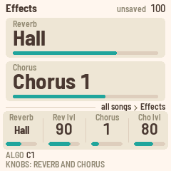

On the Effects page, you set the effects that every instrument shares, in every song.

- Turn **KNOB 1** (Reverb) to pick the reverb: off, L.hall (large hall), Hall, Chamb. (chamber) or Room.
- Turn **KNOB 2** (Level) to set the reverb level.
- Turn **KNOB 3** (Chorus) to pick the chorus, from 1 to 4.
- Turn **KNOB 4** (Level) to set the chorus level.

The page also shows how much each instrument and each melody sends to the effects. The reverb send is a dark
bar, and the chorus send is a gray one. To change the sends, use the Mixer's **KNOB 3** and **KNOB 4**.

### Mutes

Mutes belong to the song, not to the groove, so muting never makes an edited copy.

- Outside a song, when the band follows your chords or plays a progression, use the Band page's **KNOB 4**
  (Muted) to mute the selected instrument. It stays muted in every groove and through fills. The mute is saved
  with the song, and each song has its own.
- In a song, each section has its own mutes. You can set them on the Song page with black keys 1–10 (see
  [Changing a section](#changing-a-section)), or with the Band page's **KNOB 4**, which then reads "Muted in
  2". It mutes the instrument in that one section, and the mute is saved with the song. While the song plays,
  the knob works on the section that's playing, so you hear the change right away. When Polly is stopped, it
  works on the section at the Song page's cursor. Polly tells you what changed, for example "D1 MUTED IN
  SECTION 2" or "D1 PLAYS IN SECTION 2". If the cursor is on END, there's no section, and the knob shows "–".
  During the Intro or the Ending, the knob only mutes the instrument until the first section starts.
- A fill plays with the mutes of the section it leads into. The melodies keep the mutes of their own section.

## Songs and saving

This chapter shows you how to switch songs, save, undo, manage memory and make backups.

### Four songs

Polly holds four songs. Each has its own sections, progressions, melodies, tempo, Transpose, style and mutes.
A song's progressions are saved with the song, so they never use [memory](#memory).

To change songs, hold **HOME** and turn **PRESETS**, on any page. If the band is playing, the new song waits
until you stop, and Polly tells you "SONG S2 WHEN YOU STOP". Polly saves before it loads another song, and
you'll hear the sound pause for a moment while it saves.

To start the song you're on from scratch, use NEW SONG in the Song page's list. See
[The song's actions](#the-songs-actions-sel).

### Saving

- When you have something to save, **SAVE** lights and the header says "unsaved".
- Press **SAVE** to save right away. It saves the songs, the grooves you've changed and the settings.
- Polly also saves by itself while it's stopped. It waits until about four seconds after you last touch it,
  and until the last notes have faded.

Saving pauses the FM-1 for a moment, which is why Polly waits until you stop.

If two grooves in a song play the same edited copy and you changed both, Polly keeps the newest change. It
tells you which one it kept, for example "SHARED GROOVE KEPT GROOVE B".

### Undo

To undo, hold **HOME** and press **REC**. To redo, hold **HOME** and press **PLAY**. Neither one records or
starts playback, and you can undo while the band plays.

The header tells you what was undone, for example "UNDO P9 CHORD", "UNDO SECTION 3", "UNDO TAKE M1", "UNDO
PASS C1", "UNDO CLEAR PROG", "REDO C1 SOUND" or "NOTHING TO UNDO". Whatever comes back flashes coral, and the
cursor jumps to it. On the Progression page it jumps to the chord, and on the Song page to the section. For
melody notes, it jumps to their section.

Undo covers the song you're on:

- its progressions: chords, length, name, loading, clearing and copying
- its sections and settings: style, tempo, Transpose, mutes and the melodies' sounds. NEW SONG is one step,
  and undoing it brings everything back.
- its melody notes: a take is one step, and so is clearing or copying a section's notes
- its grooves as you change them: sounds, mixer, types, CLEAR C1, CLEAR GROOVE A, BACK TO STYLE, and each
  pass of a recording

Everything you change before pausing for about a second counts as one undo step. A whole melody take is one
step, and so is one pass of an instrument recording. Polly keeps up to 32 steps while it's switched on, or
fewer after big ones. Switching songs or switching off clears them.

You can't undo tempo changes made while playing, changes on the Setup and Effects pages, freeing a groove's
place in memory, or a factory reset. Whatever undo brings back is saved like any other change.

### Memory

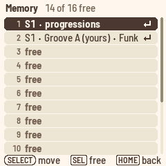

Memory has 16 places, shared by all four songs. They hold your own grooves and the songs' melodies.

Progressions are saved with their song and don't use memory. The four songs share room for about 900 chord
changes. Only beyond that does a song's progressions take a place of memory, and the list then shows "S1:
progressions".

When every place is taken, Polly says MEMORY FULL, and the bottom line offers "[SEL] memory: free one".
Press **SEL** to see what's using the memory. You can also get there by choosing MEMORY at the end of the
**SEL** list on the Band, Groove length or Sound pages.

The list shows one place per line, grouped by song. Song 1's places come first, then Song 2's, and so on, with
the free places last. For example:

- "S1: Groove A (edited) · Funk" is one of your edited grooves. The line tells you which songs play it, which
  groove it plays as, and its name.
- "S1: melodies" holds Song 1's melody notes. A song with very long melodies takes a second place, "S1:
  melodies, part 2".
- "No song: groove (edited)" is an edited groove that no song plays now.
- "free" is a free place.

The list fills the screen. The header shows how much is used, as a gauge and in words, such as "Memory 9 of
16 used". The number at the left of each line matches the white key you'd use with **SAVE** to copy a groove
there from the Band page ("COPIED TO MEMORY 7").

To free a place, stop, select it and press **SEL**. Polly asks before it frees anything.

- An edited groove goes back to the style in the songs that play it. Polly clears its notes, and you can't
  undo this.
- A song's melody notes are cleared.
- A song's progressions go back to the factory ones, after Polly asks "S1'S PROGRESSIONS BACK TO FACTORY?".
  They only appear in the list if they needed a place.

Press **HOME** to go back. If MEMORY FULL left a change playing but not kept, that change moves into the freed
place right away, and Polly tells you, for example "GROOVE A KEPT IN MEMORY 14". The change can be a groove's
sound, a recording or the song's progressions. Melody notes you played while memory was full aren't kept, so
record them again.

### Backup

You can save Polly's songs to a file on your computer and load them back later.

1. Connect the FM-1 to your computer with a USB cable.
2. Open the [Backup page](https://charlesvestal.github.io/fm1-polly/backup/) in Chrome or Edge.
3. Press **Back up** to save a file, or **Restore** to load one.

A backup holds everything Polly keeps:

- the four songs, with their progressions
- the 16 places of memory, with your grooves and melodies
- the settings: Setup, the channels' sounds and Effects

It doesn't include the QY70 styles, which you install again from your ROM, or the button calibration. Polly
can keep playing while you back up, but changes that aren't saved yet only go in if you stop first.

A restore **replaces everything** on Polly with the backup, so stop first. If Polly is playing, it answers
**STOP FIRST**. Polly receives the whole file and checks it before changing anything. Then it asks on its
screen: **RESTORE FROM USB?** Press **SEL** to restore and reload the songs, or **HOME** to keep what you have.
If the cable comes out or the file is damaged, nothing changes. Even if the power cuts out during the restore,
you're left with either the old songs or the new ones, never a mix of both.

You can also back up from a terminal, in this repository:

```sh
pip3 install mido python-rtmidi
python3 tools/polly_backup.py backup my-songs.plb
python3 tools/polly_backup.py restore my-songs.plb
python3 tools/polly_backup.py info my-songs.plb
```

Before a restore, the terminal asks you to confirm. Type y, or add `--yes` to the command. Use `info` to see
what a backup holds.

You can't restore a backup from an older Polly, made before progressions were saved with their songs. Polly
tells you so, and nothing changes.
## Setup and MIDI

Press **GLO** for Setup. This is where you set the clock, MIDI out, the lights and the click.

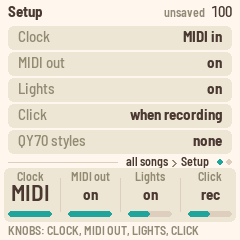

When you open Setup, you see the four knobs listed one per line: Clock, MIDI out, Lights and Click. Turn a
knob and the page tells you in words what the setting does, for example "Click" and "A click on every beat.".
The last line tells you about the QY70 bank.

| Knob | Sets |
| --- | --- |
| **KNOB 1** (Clock) | **MIDI** (the default) keeps Polly's own time, but Polly follows MIDI clock, start and stop whenever they come in. With **internal**, Polly ignores MIDI clock. |
| **KNOB 2** (MIDI out) | With **on** (the default), each instrument goes out over USB on its own channel, with its sound and mixer settings. When Polly keeps its own time, it also sends MIDI clock, start and stop. With **off**, nothing goes out. |
| **KNOB 3** (Lights) | With **on** (the default), the keys light up as you play and the other buttons glow. With **notes**, the keys light up but the buttons don't glow. With **off**, the keys stay dark and only the buttons light. |
| **KNOB 4** (Click) | With **rec** (the default), you hear a woodblock on every beat while you record, higher on the first beat of the bar. With **on**, the click plays whenever Polly plays. With **off**, the click only plays during the count-in. |

The click uses MIDI channel 16, so it goes out over MIDI too. It sits a little below the band in the mix, and
muting instruments doesn't silence it. The click always counts you in before a recording, even when Click is
off. If the band is already playing, the click plays the beats until your recording starts at the next bar
line.

The last line shows the state of the QY70 bank: none, the number of styles, "damaged" or "old format". If it
says "Factory styles: not installed", see [Updating and safety](#updating-and-safety).

**Factory reset** erases everything you've made. Stop Polly first. On Setup, press **SEL** and choose FACTORY
RESET. Polly asks "ERASE ALL SONGS AND MEMORY?". Press **SEL** to erase, or **HOME** to keep everything.
Afterwards, Polly is as it was when new. The four songs are empty, memory's 16 places are free, and Setup and
the mixer are back to their defaults. The QY70 bank stays installed. You can't undo a reset, so
[back up](#backup) first if you might want your songs again.

**USB audio** sets how loud Polly is over the USB cable. On Setup, press **SEL**, turn **SELECT** down to USB
AUDIO, and turn **ALGO**. With **follows knob** (the default), USB audio is as loud as the FM-1 itself, MASTER
knob and all. With **full**, USB audio stays at full level whatever the MASTER knob says, so you can record
over the cable with the speaker turned down.

**Computer audio** lets you hear your computer's sound through the FM-1's speaker and headphones. On Setup,
press **SEL**, turn **SELECT** down to COMPUTER AUDIO, and turn **ALGO**. With **off** (the default), the FM-1
plays only Polly. With **on**, the FM-1 plays what the computer sends to it, mixed with Polly. The MASTER knob
sets its level along with Polly's, whatever USB AUDIO says. The computer's sound never goes into USB audio. When
you record Polly over the cable, you record only Polly, even while the computer plays something back through
the FM-1.

When you plug the FM-1 into a Mac, macOS may pick it as its sound output. With COMPUTER AUDIO off, the
computer then goes quiet. To fix that, pick your usual output in the Sound menu or in System Settings > Sound,
or turn COMPUTER AUDIO on.

**Bluetooth audio** lets you play Polly through Bluetooth headphones or a Bluetooth speaker. On Setup, press
**SEL**, turn **SELECT** down to AUDIO DEVICE, and press **SEL**. Put the headphones or speaker in pairing mode.
Polly looks for devices, and new ones appear in the list as it finds them. Turn **SELECT** to yours and press
**SEL**. The row says "connecting", then "playing", and Polly says "BT AUDIO" and the device's name. Press
**HOME** to go back.

- Use BT AUDIO to turn Bluetooth audio on or off (**ALGO**, or **SEL**). Turning it on connects the last
  device.
- Polly remembers four devices, the last one first. With BT AUDIO on, it connects to the last one again when
  you switch the FM-1 on.
- While Polly plays through Bluetooth, the FM-1's own speaker and headphone output are silent.
- You hear the sound 150 to 300 ms after you play, because the headphones or speaker keep a buffer. That's fine
  for listening, but too late to play in time with the band. Use the FM-1's own output for that.
- When the radio starts, Polly goes silent for a moment while it sets itself up.
- Use LOOK AGAIN to look for devices again. To forget a device, turn **ALGO** to pick it on the FORGET row,
  then press **SEL**. Polly asks first. A device you just disconnected may not answer for a minute or two.

**Bluetooth MIDI** lets you play Polly from a computer, phone or tablet without a cable. The FM-1 shows up there
as a Bluetooth MIDI device, named "FM-1" and four characters. MIDI that comes in over Bluetooth plays Polly's
sounds and clock, like [MIDI in](#setup-and-midi) over USB. Polly's MIDI out stays on USB. BT MIDI is on by
default. To turn it off, open Setup's list with **SEL**, go to BT MIDI and turn **ALGO**. With BT AUDIO and BT
MIDI both off, the radio stays off.

Turn **SELECT** for Status. It shows the processor's load, how many voices are sounding, any audio dropouts
(Xruns), the version, and how much of its memory the synth uses ("Synth 22/32 KB"). It has no knobs.

**MIDI in** lets you play Polly's sounds from another instrument or a computer. MIDI coming in over USB or the
TRS jack plays Polly's sounds on all 16 channels, like a General MIDI sound module, with drums on channel 10.
It plays alongside the arranger and isn't transposed. Controller 74 changes each channel's filter brightness
and controller 71 its resonance, as on the Mixer tone page.

**USB** connects Polly to a computer as a class-compliant MIDI device called "Polly FM-1". The FM-1 has no MIDI
out jack, so MIDI only goes out over USB.

## The QY70 bank

The QY70 came with 128 preset styles. If you have a copy of its main ROM, Polly can build all 128 from it and
play them alongside its own 16. The ROM is a dump of the QY70's chip, and MAME calls the file `qy70main.bin`.
Polly contains none of Yamaha's music. You bring the ROM, and the bank is for your own use.

### Installing on the FM-1

Connect the FM-1 with a USB cable, and run the commands below in a terminal. The tool needs the repository with
its `base/` folder (fm1-base). GitHub's ZIP download leaves that folder out, so clone the repository instead:

```sh
git clone --recursive https://github.com/charlesvestal/fm1-polly
cd fm1-polly
pip3 install mido python-rtmidi
python3 tools/qy70_install.py qy70main.bin
```

The tool builds the bank and asks before writing it. Add `--yes` to skip the question. Writing takes about 30
seconds, and the FM-1 stops playing while it writes. Polly checks everything it receives before using it. If
the cable comes out, you're left with no bank rather than half of one, so just run the tool again. When it's
done, Setup says "128 styles".

### Loading it in the emulator

On the emulator's page, press **Load QY70 ROM**, or drop the file on the box. Your ROM stays on your computer.
The page builds the bank in your browser and keeps it there for your next visit. To remove it, press
**Forget QY70 styles**.

### Playing QY70 styles

Turn Home's **KNOB 1** (Style) past Polly's 16 styles to reach the QY70 styles. The knob's label then reads
"QY style". You can also pick them on the Style pages (**ENV**). You'll hear them play with their own bends,
swells and filter moves, and change grooves and styles without a gap. A song plays one QY70 style at a time.
If you pick a groove from another QY70 style, the song's other QY70 grooves switch to that style too.

### What doesn't carry over

- Polly has one General MIDI drum kit, so the QY70's brush, jazz, room and analog kits all play it.
- XG voice variations play their General MIDI instrument, and sound-effect voices play a General MIDI effect.
- The drum instruments share one pan setting and one set of effects, so pan on the drum channel doesn't carry
  over.
- If you record into a QY70 groove or change it, Polly edits a copy, as it does with its own styles. The copy
  then has the 600-note limit, so Polly leaves out the quietest short notes first, along with the groove's bends
  and controllers. As long as you play QY70 styles as they are, there's no note limit.

### Keeping the bank

The bank is stored in the FM-1's memory, next to your songs. Restoring M-VAVE's firmware wipes it. If Setup
says "none" or "old format" after an update, install the bank again.

The QY70's styles are © Yamaha Corporation. Don't share the bank, or anything built from your ROM.

## Updating and safety

Polly is built on fm1-base and felucca-bsp, which come from Felucca. These safety features come from them, and
they work as they do in the other FM-1 firmwares.

- To put the FM-1 in update mode, hold **REC** while you switch it on. If you installed m-bootloader with the
  web installer, the installer can reach the FM-1 from there, and holding **PLAY** instead opens m-bootloader's
  recovery menu. Without m-bootloader, **REC** starts the chip's own update mode, which only the rescue can
  reach.
- If the FM-1 fails to start twice in a row, it starts in safe mode, with only USB on, so the web installer can
  still reach it. Press **PLAY** to try a normal start again, or **REC** for update mode.
- To go back to M-VAVE's firmware, use the web installer, or M-VAVE's own updater, M-UPGRADE.
- If buttons do the wrong thing, hold **OCT−** and **OCT+** while you switch on, and follow the screen to
  calibrate them.

**The factory styles** are written into the FM-1's memory by the installer, just after the firmware. If that
step didn't finish, Polly says "STYLES MISSING" and "INSTALL AGAIN" when you switch it on. The last line of
Setup says "Factory styles: not installed", and the styles play no notes. Your songs, grooves and melodies
still work. To put the styles back, install Polly again with the web installer.

Your songs and grooves survive a Polly update. Putting M-VAVE's firmware back can wipe them, so make a
[backup](#backup) first. Polly 0.6 keeps your songs in a new way, and Polly 0.5 or older can't find them. If you
want to go back to an older Polly, make a backup first, and restore it afterwards.

## Page by page

This table lists every page and what its controls do. On every page, turn **ALGORITHM** to pick the instrument
(D1 to C4, then the melodies M1 and M2), and turn **SELECT** to move through a button's pages. To change the
song, hold **HOME** and turn **PRESETS**.

| Page | Button | KNOB 1 | KNOB 2 | KNOB 3 | KNOB 4 | PRESETS |
| --- | --- | --- | --- | --- | --- | --- |
| Home | HOME | Style | Tempo | Transpose | Prog | The next progression |
| Song | HOME on Home | Section | Prog | Groove | Repeat | The next section |
| Song 2 | HOME on Home, SELECT | Transpose (the section's) | Intro | Ending | At end | The next section |
| Progression | ARP | Bar | Beat | Root | Type | The next progression |
| Progression 2 | ARP, SELECT | Length | Beats | Bass | Name | The next progression |
| Band | SEQ | Grid | Bar (the cursor) | Beat (the cursor) | Muted | What the groove plays |
| Groove length | SEQ, SELECT | Bars | Beats | Place | Letter | What the groove plays |
| Notes | SEQ, SEQ | Place (the cursor) | Pitch | Length | Velocity | Zoom |
| Sound | EDIT | Sound | Type (a melody: Channel) | Low (drums, a melody: none) | High (drums: none; a melody: Velocity) | Sound family |
| Sound 2 | EDIT, SELECT (not a melody) | High key (drums: none) | Channel | | | |
| Mixer | LFO | Volume | Pan | Reverb | Chorus | |
| Mixer tone | LFO, SELECT | Bright | Reso | | | |
| Effects | FX | Reverb | Level | Chorus | Level | |
| Style | ENV | Intro | Groove A | Groove B | Style | Style |
| Style 2 | ENV, SELECT | Fill AB | Fill BA | Ending | Style | Style |
| Setup | GLO | Clock | MIDI out | Lights | Click | |
| Status | GLO, SELECT | | | | | |

## Screen mirroring

Use screen mirroring to see Polly's screen and panel live on a computer connected by USB. It's handy for
showing Polly on a big screen, or when you teach or film. You can also play Polly's panel from the computer.

1. Plug the FM-1 into the computer.
2. Open the [Mirror page](https://charlesvestal.github.io/fm1-polly/mirror/) in Chrome or Edge.
3. Press **Connect** and allow MIDI with SysEx. The page finds Polly's ports, called *Polly FM-1*. If it
   doesn't, pick them in the In and Out lists.

You can show the screen at two or three times its size (×2, ×3). The panel below it lights up as the FM-1
does. Buttons and keys show their LEDs, held ones are outlined, and a knob you turn flashes and shows how far
it moved. Press **Save PNG** to save a picture of the screen. You can also save one from a terminal with
`python3 tools/polly_mirror.py screen.png`.

Turn on **Control** to play the FM-1 from the page. A button or key on the page stays pressed for as long as
you hold the mouse down, and scrolling over a knob turns it.

You can also control Polly from a terminal with `python3 tools/polly_remote.py`. It takes commands such as
`tap HOME`, `turn K1 3`, `shot s.png` or `run tests/scenarios/home.polly`. A scenario runs its presses, keys,
turns, waits and screenshots, and skips the checks that only the simulator can make. Polly takes these
commands as if they came from its own panel, but only while it's being mirrored. The remote never saves
anything by itself, though a SAVE you send saves, just as the button does. You can only start update mode by
hand.

Use `run ... --fresh` to play the scenario in a test session. Polly stops, saves anything unsaved, and then
starts as a new FM-1 would, with no songs, no edited grooves and the first style. The header says TEST, and
nothing saved during the test is kept. Your own songs come back as they were when the scenario ends, the
mirror stops or the FM-1 restarts.

The mirror costs Polly nothing until a page asks for it. It stops when the page closes, goes quiet for six
seconds, or the cable comes out, and any buttons the computer was holding are released. Notes and clock always
go out first, so if the computer is slow to keep up, the page skips frames and then catches up.

## Screen reader

Polly can tell a screen reader what its screen shows, so you can play it without looking. Plug the FM-1 into
a computer with a USB cable and open the [FM-1 Screen Reader](https://charlesvestal.github.io/fm1-reader/) in
Chrome or Edge. The page speaks with its own voice, or passes the words to your computer's screen reader.

When you open the reader page, you hear the page Polly is on, with its knobs and their values. As you turn a knob, you hear its
new value. Chords and notes are said in full, such as "F sharp minor seven flat five" or "B flat 3". You also
hear the chord your keys play, a list's row and where it is in the list, and the help card when you hold a
button. You hear each question with how to answer it, play and stop, and every message on the screen. While a
song plays, the bars, sections and chords going by aren't read out, so you can listen to the music. To hear
everything, press **Read the whole screen** on the page, or the W key. You then hear the page, the battery, the
progression's chords or the song's sections, and what the keys and encoders do there.

Polly sends nothing until the page asks for it, so a DAW on the same cable never sees a thing.

## Credits

- Polly is built on **fm1-base** and **felucca-bsp** (MPL-2.0), from **Felucca** by Leo Kuroshita of Hügelton
  Instruments. <https://github.com/charlesvestal/fm1-base>, <https://github.com/hugelton/felucca-bsp>,
  <https://github.com/hugelton/Felucca>
- The synth and its General MIDI sounds are **Sonivox EAS** by Sonic Network and the Android Open Source
  Project (Apache-2.0). <https://github.com/EmbeddedSynth/sonivox>
- The drums in Polly's styles come from **the Groove MIDI Dataset** by Jon Gillick, Adam Roberts, Jesse Engel,
  Douglas Eck and David Bamman of Google Magenta, © Google LLC (CC BY 4.0). Polly uses quantized excerpts.
  <https://magenta.tensorflow.org/datasets/groove>
- Running FM-1 firmware in the browser was the idea of **Groove OS** by Peter Gombos.
  <https://www.groove-os.com/>
- **qy100-toolkit** decoded the QY70's pattern format, which helped Polly read the ROM's styles.
  <https://github.com/doffu0000/qy100-toolkit>
- **Pyodide** (MPL-2.0) builds the QY70 bank in the browser.
- The screen's typeface is **Barlow** by the Barlow Project Authors (SIL OFL 1.1).
- The Notes page follows the design of **Melodee** by Kerem Kilic of Ellic Studio (GPL-3.0), which also runs
  on Felucca. Polly takes its piano roll and its way of working with notes. SELECT walks through the notes and
  the knobs edit them, holding EDIT deletes or erases, and holding a button while you turn SELECT moves a note.
  <https://github.com/keremimo/melodee>

Polly is inspired by the Yamaha QY70 and isn't affiliated with Yamaha. "M-VAVE" and "FM-1" are trademarks of
their owners. Polly is GPL-3.0-only (see LICENSING.md).
