# Polly manual

Polly turns the M-VAVE FM-1 into a pocket arranger, inspired by the Yamaha QY70. A style plays a band of
eight instruments, and the chords you play steer the band. Hold a chord, and the bass, the guitars and the
strings follow. Write a few bars of chords, and Polly plays a whole song from them.

The sounds are the 128 General MIDI instruments and a drum kit, from Sonivox EAS. You hear them from the
speaker and the headphone jack. MIDI coming in plays them too.

New to Polly? Start with the [quick start](QUICKSTART.md), then the [course](docs/course/README.md): short
lessons with a video each. This manual is the reference.

- [Cheat sheet](#cheat-sheet)
- [Getting around](#getting-around)
- [Styles and grooves](#styles-and-grooves)
- [Chords](#chords)
- [Progressions and the song](#progressions-and-the-song)
- [Recording an instrument](#recording-an-instrument)
- [Melodies](#melodies)
- [Fixing notes](#fixing-notes)
- [Sound](#sound)
- [Songs and saving](#songs-and-saving)
- [Setup and MIDI](#setup-and-midi)
- [The QY70 bank](#the-qy70-bank)
- [Updating and safety](#updating-and-safety)
- [Credits](#credits)
- [Page by page](#page-by-page)
- [Screen mirroring](#screen-mirroring)

## Cheat sheet

This page has the words Polly uses, the common tasks and the buttons. The rest of the manual uses the same
words.

### The words

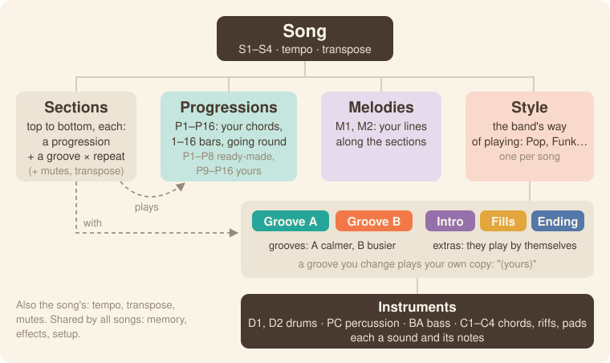

```
Song (S1–S4)
├─ Sections        each plays a progression with a groove, a set number of times
├─ Progressions    P1–P16
├─ Melodies        M1, M2
└─ Style           Groove A, Groove B, Intro, Fills, Ending
   └─ Instruments  D1, D2, PC, BA, C1–C4
```

- **Song** (S1–S4): one piece of music. Each song has its own style, progressions, sections, melodies, tempo
  and transpose.
- **Section**: a part of the song, such as a verse or a chorus. A section plays one progression with one
  groove, a set number of times. A song is a list of sections, played from top to bottom.
- **Progression** (P1–P16, or "Prog" where the screen is short): a row of chords, 1 to 16 bars long, that
  plays in a loop. P1–P8 come ready-made. P9–P16 are for your own.
- **Chord**: one chord in a progression.
- **Melody** (M1, M2): a line you record along the whole song, section by section.
- **Style**: the band's way of playing, such as Pop or Funk. Each song has one style.
- **Groove**: how the band plays a section. **Groove A** is calmer and **Groove B** is busier.
- **Intro, Fill, Ending**: the style's extras. The band plays them by itself. The Intro plays at the start
  and the Ending at the end. A Fill plays between grooves, or when you ask for one.
- **Instrument**: one player in the band. D1 and D2 are drums, PC is percussion and BA is bass. C1–C4 play
  chords, riffs and pads. Each instrument has a sound and its own notes.
- **Sound**: what an instrument or a melody plays with. It's one of the 128 General MIDI sounds, or the
  drum kit.
- **(yours)**: once you change a groove, it plays your own copy. The screen then shows
  "Pop · Groove A (yours)". BACK TO STYLE gives the groove back to the style.
- **Tempo**: the song's speed, in BPM.
- **Transpose**: moves everything up or down in pitch, including the keys you play. The song has a
  transpose, and each section can add its own on top.
- **Repeat**: how many times a section plays.
- **Mute**: silences an instrument or a melody. A section's mutes last only for that section.
- **Free**: no progression is playing, so the band follows the chords you play. Home's **KNOB 4** (Prog)
  shows "–".
- **Memory**: 16 places that keep your grooves, melodies and progressions. The four songs share them.
- **Undo / Redo**: take back a change, or bring it back.
- **Click**: the woodblock that counts the beats while you record.
- **Backup**: your songs, kept in a file on a computer.
- **Mirror**: Polly's screen, shown on a computer. For testing, you can also play the panel from there.

### How do I…

White keys are counted from the left, 1 to 16. Black keys are counted the same way, 1 to 11. "Hold
**HOME**" means keep it pressed while you press the next thing.

| How do I… | Do this |
| --- | --- |
| pick a style | Press **HOME** and turn **KNOB 1**. |
| play a progression | Hold **HOME** and press white key *n*. P*n* plays in a loop. While playing, it starts at the next bar. |
| change the groove | Hold **HOME** and press black key 2 for Groove A or 3 for Groove B. Black key 4 plays a fill, 1 the Intro and 5 the Ending. |
| write a progression | Press **HOME** and turn **KNOB 4** anticlockwise to "–" (free). Press **REC**, then **PLAY**. After a bar of clicks, play one chord per bar, then press **REC** again. |
| go to bar 1, beat 3 | Press **ARP**. Turn **KNOB 1** (Bar) to 1 and **KNOB 2** (Beat) to 3. **OCT−** and **OCT+** step one beat back or forward. |
| fix a chord | Press **ARP**. Move to the chord with **KNOB 1** (Bar) and **KNOB 2** (Beat). Turn **KNOB 3** (Root) or **KNOB 4** (Type). For its bass note, turn **SELECT** to page 2 and turn **KNOB 3** (Bass). |
| delete a chord | Press **ARP** and move to the chord with **KNOB 1** and **KNOB 2**. Press **SEL**. The list opens on CLEAR CHORD. Press **SEL** again. |
| lengthen a progression | Press **ARP**, turn **SELECT** to page 2 and turn **KNOB 1** (Length). |
| add a section to the song | Press **HOME** until you're on the Song page (on Home, press it once more). Press white key *n*. This adds a section that plays P*n*. |
| play from section 3 | On the Song page, turn **KNOB 1** (Section) to 3 and press **SEL**. The list opens on PLAY FROM SECTION 3. Press **SEL** again. |
| change an instrument's sound | Press **EDIT**, turn **ALGORITHM** to the instrument and turn **KNOB 1** (Sound). |
| mute an instrument | Press **SEQ**, turn **ALGORITHM** to the instrument and turn **KNOB 4** (Mute). Turn it again to unmute. To mute it in one section only, press its black key on the Song page. |
| record a melody | On the Song page, press **PLAY**. Press **EDIT** and turn **ALGORITHM** past C4 to M1. Press **REC**, play, and press **REC** again. |
| fix one wrong note | Press **SEQ** twice to open Notes. Turn **ALGORITHM** to the instrument or melody. Turn **SELECT** to the note, which is ringed in coral. Turn **KNOB 2** (Pitch). **EDIT** deletes the note. |
| undo or redo | Hold **HOME** and press **REC** to undo, or **PLAY** to redo. |
| save | Press **SAVE**. Polly also saves by itself when stopped. |
| back up | On a computer, run `python3 tools/polly_backup.py backup my-songs.plb`. |

### The buttons

| Control | What it does |
| --- | --- |
| **PLAY** | Starts and stops. On the Song page, it plays the song. |
| **REC** | Records what the keys play on this page: chords, an instrument, a melody or sections. |
| **SEL** | Shows this page as a list, with its actions. When Polly asks a question, **SEL** means yes. |
| **HOME** | Opens Home. On Home, opens the Song page. Hold **HOME** for the shortcuts. When Polly asks a question, **HOME** means no. |
| **ARP** | Opens Progression, where you edit chords. |
| **SEQ** | Opens Band, the groove's notes instrument by instrument. Press it again for Notes, where you fix single notes. |
| **EDIT** | Opens Sound, the instrument's sound and range. |
| **LFO** | Opens the Mixer. |
| **FX** | Opens Effects: reverb and chorus. |
| **ENV** | Opens Style, which sets the style each groove and extra plays. |
| **GLO** | Opens Setup. Page 2 is Status. |
| **SAVE** | Saves. Hold it and press a white key to make a copy. |
| **OCT−** / **OCT+** | Move the keys down or up an octave. |
| **SELECT** | Turns to a button's next page. In a list, it moves up and down. |
| **ALGORITHM** | Picks the instrument, or a melody. |
| **PRESETS** | Steps to the next one of whatever the page shows. |
| **KNOB 1–4** | Set the four values at the bottom of the screen. |

The two lines at the bottom of the screen always show what each control does on the page you're on. Hold
any button for a second, and a card explains what it does there. [Getting around](#getting-around) has the
details.

## Getting around

This chapter explains the panel, the screen and the lights.

### The panel

The [cheat sheet](#the-buttons) lists every button. This table has the details for the controls that do
more, and the [page by page](#page-by-page) table shows every page.

| Control | What it does |
| --- | --- |
| **PLAY** | Starts and stops. On a Song page, it plays the song from section 1. If a progression is playing, the song starts at the next bar. With **REC** on, it plays a bar of clicks first (the count-in). Press it again to stop. |
| **REC** | Records what the keys play here. On Home and Progression, it writes chords into the progression. On Home while free, it starts a new progression. On Band and Sound, it records the selected instrument, or a melody in a song. On Song, it writes sections. |
| **SEL** | Shows the page as a list. The list opens on the page's first action, such as LOAD PROGRESSION, PLAY FROM SECTION or CLEAR C1. Turn **SELECT** up to reach the page's values and MORE. The list covers the knobs. The bottom line shows what **SELECT**, **ALGORITHM**, **SEL** and **HOME** do in it. |
| **HOME** | Opens Home. Press it again on Home for the Song page, and again to go back. Turn **SELECT** on the Song page for its second page. |
| **HOME**, held | Shows the shortcuts on screen. Press white key 1–16 for a progression, or black key 1–5 for a groove or an extra. Turn **SELECT** to set the tempo, or **PRESETS** to change the song. Press **REC** to undo, or **PLAY** to redo. |
| **SEQ** | Band: the groove's notes. Page 2 is Groove length. Press **SEQ** again on either page for Notes, the note editor. **SEQ** in Notes goes back to Band. |
| **EDIT** | Sound. Page 2 is Sound 2, with the high key and the channel. A melody has the Sound page only. |
| **SAVE** | Saves. Hold it and press a white key *n* to copy the progression to P*n* (on Home or Progression), or the groove to place *n* in memory (on Band). If that place already has chords or notes, Polly asks first. |
| **SELECT** | Turns to the button's next or previous page. In a list, it moves up and down. |
| **ALGORITHM** | Picks the instrument, on any page: D1, D2, PC, BA, C1, C2, C3, C4, then the melodies M1 and M2. |
| **PRESETS** | Depends on the page. On Home and Progression, it steps to the next progression. With **HOME** held, it changes the song. |
| **OCT−** / **OCT+** | Move the keys down or up an octave, from −3 to +3. On Progression, they move the cursor one beat back or forward. |
| Keys | Play chords on Home and Progression. Play the selected instrument on Band and Sound. Add sections on Song. |
| Any button, held a second | Shows a card that explains what the button does on this page. |

### Pages and dots

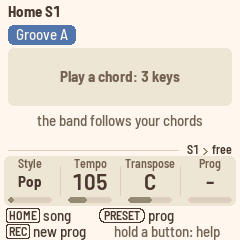

Each page button lights while you're on one of its pages. Pressing it always opens its first page. Some
buttons have two pages. Turn **SELECT** for the next page. The dots over the knobs show which page you're on.

**HOME** switches between Polly's two places: Home, where you play and write progressions, and the Song
page, where you put them in order. Press **HOME** to go to Home, and press it again to go to the Song page.
The Song page has two pages of its own; turn **SELECT** for the second.

The screen has five bands, from top to bottom.

- **The header** shows the page's name. On Home, it shows the song instead ("Home S1"). The tempo is at the
  right, except on Home, where **KNOB 2** shows it. When MIDI clock sets the tempo, the header shows "ext".
  A coral dot means Polly is recording, and "unsaved" means there's something to save. The header never
  repeats what a knob already shows.
- **The middle** shows what the page is about.
- **The tag line**, just above the knobs, shows where you are, from the song down. For example, it shows
  "S1 › Pop › Groove A › C1 Acoustic Grand" on Band, Sound and Mixer. It shows "S1 › P9 Verse" on
  Progression, and "S1" on Song and on Home in a song. When free, it shows "S1 › free". With a melody, it
  shows "S1 › M1 Square Lead". If the line is too long, the first steps drop off. Your place inside the
  page, such as a bar or a section, is marked by the cursor, not by the tag line.
- **The knobs** strip shows what **KNOB 1–4** do here, with their values. The knob you turned last is coral.
  A page with no knobs, like Status, has no strip.
- **The two bottom lines** name each control as a pill, like the labels printed on the panel. After each
  pill comes what the control does here.

The first part of the bottom lines covers the three encoders, in round pills. It shows what turning
**SELECT**, **ALGORITHM** (ALGO) and **PRESETS** (PRESET) changes. For example: "[SELECT] page · [ALGO]
instrument · [PRESET] section".

- SELECT turns the button's pages, and the dots show which one you're on. When a button has only one page,
  SELECT isn't listed.
- On Home, the line starts with "[HOME] song": press **HOME** there for the Song page.
- ALGO picks the instrument or melody the keys play. The line lists it on the pages that show an
  instrument: Band, Groove length, Sound and the two Mixer pages.
- PRESET steps through the progressions on Home and Progression, the sections on Song, the grooves on
  Band, the sound families on Sound, and the styles on Style.
- While you hold **HOME**, the line shows "[SELECT] tempo · [PRESET] song".

The second part covers the keys and buttons, in square keycaps. It shows what they do here, for example
"[KEYS] chords · [REC] write · [OCT] cursor", "[KEYS] C1 · [REC] record" or "[WHITE] progression · [BLACK]
mutes". While something records, it shows "[REC] stop". Two controls held together show as
"[HOME]+[KEYS] sections". On pages where the keys do nothing (Effects, Style, Setup and Status), only the
encoders' part shows. When everything fits on one line, there is only one line.

A few screens are different:

- The very first screen shows "[REC] new prog · hold a button: help".
- In a list, only the list's line shows: "[SELECT] move · [SEL] do it · [HOME] back".
- A question shows "[SEL] yes · [HOME] no".
- While a help card is up, the line shows "let go: nothing changes".

**Messages** such as "SAVED" or "NEXT GROOVE B" replace the header for a second or so.

**The cursor and the playhead.** The cursor marks where the knobs and keys write. It's a thick coral
outline:

- On Progression, it surrounds a chord's cell, with the bar and beat numbers on coral.
- On Song, it surrounds a section, with "section 3 of 6" beside it.
- On Band, it's a line down through the instruments, with "bar 2.3" on coral above it.
- On Sound with M1 or M2, it surrounds a melody's section and that section's first bar.

What's playing is filled teal. On Band, the playhead is a teal line. You can see both at once: a coral
outline around a teal fill means the cursor is on the beat that's playing.

Whatever you change flashes coral for half a second where it lands. That includes a chord, a section, an
instrument's row, a bar of notes you just recorded, and whatever undo or redo brings back. On Notes, only
the notes you changed flash, with a small mark on the song line. That way, the selected note's ring stays
clear while you turn a knob.

**The colours** each mean one thing.

- **Teal** means sounding now: the bar, beat, section or progression that's playing, and the playhead.
  Nothing else is teal.
- **Coral** means you: the cursor, an edit's flash, the knob you turned, REC, a chord you play over a
  progression, questions and messages.
- **Ink** and its greys are for everything that stays put: names, values, a list's selection, and the ink
  ring that marks where PLAY starts.
- **Slate** and **amber** are Groove A and Groove B, on their pills. The extras (Intro, Fills, Ending) have
  outlined pills.
- **Plum** is for the melodies.

### The instruments

A groove has eight instruments, named as on the QY70:

| Instrument | Usually plays |
| --- | --- |
| D1, D2 | Drums |
| PC | Percussion |
| BA | Bass |
| C1–C4 | Chords, riffs and pads |

Turn **ALGORITHM** to pick an instrument, on any page. The screen shows its name and sound. The keys play
that instrument's sound, and **REC** records into it. At first this is C1, a piano. After C4 come the song's
two melodies, M1 and M2. See [Melodies](#melodies).

### The keys

The 27 keys run from F3 to G5 at octave 0. **OCT−** and **OCT+** move them an octave at a time. The FM-1's
keys don't sense how hard you press, so every note plays at the same velocity.

### The lights

- **PLAY** is green while playing, and red while recording.
- **REC** lights while recording.
- **SAVE** lights while something isn't saved.
- The button of the page you're on is lit.
- Keys light while you hold them.
- While you hold **HOME**, a black key lights for the groove or extra that's playing, or the one coming
  next. A white key lights for the progression that's playing.
- With Lights set to "on" in Setup, the other buttons glow dimly, so you can find them in the dark.

## Styles and grooves

A **style** is the band's way of playing. Here you pick a style, switch between its grooves, and set the
tempo. Each style has two grooves and the extras that go around them.

| Part | What it does |
| --- | --- |
| Intro | Plays once at the start, then Groove A. |
| Groove A | The calmer groove. Plays in a loop. |
| Groove B | The busier groove. Plays in a loop. |
| Fill AB | One bar that leads from Groove A into Groove B. |
| Fill BA | One bar that leads from Groove B back to Groove A. |
| Ending | Plays once, then stops. |

Polly has 16 styles of its own: Pop, Funk, Rock, Ballad, Bossa, Swing, Shuffle, Reggae, Hip hop, House,
Disco, Country, Gospel, Waltz, Latin and Ambient. Their drums are real drummers' performances from the
Groove MIDI Dataset. If you install a [QY70 bank](#the-qy70-bank), the QY70's 128 preset styles follow them
on the Style knob, with "QY" before their names.

### Picking a style

On Home, turn **KNOB 1**. The knob shows the style. You can change the style while playing. Each of the
four songs has its own style, so each song can sound different.

Each style has its own tempo. Picking a style sets that tempo, until you set the song's tempo yourself.
After that, the tempo stays yours. When you pick a style, Polly shows that it kept your tempo, for example
"TEMPO KEPT 84 (HOUSE 122)". To use the style's tempo instead, press **SEL**. The list opens on STYLE TEMPO
122. Press **SEL** again. From then on, picking a style sets the tempo again.

**A groove you've changed stays yours.** Once you record into a groove or an extra, or change its sound, it
plays [your own copy](#yours-your-own-copy) instead of the style's. Its pill shows this on Home and Band:
"Groove A (yours)". The Style knob shows "House (yours)", and the Style page shows "Pop (yours)".

Turning the Style knob changes only the grooves that still play the style. Yours stay as they are. So you
can keep your Groove A and try the band around it in Funk, then in Rock. When the knob comes to rest, Polly
asks "GROOVE A IS YOURS: KEEP IT?" or "2 GROOVES ARE YOURS: KEEP THEM?". Press **SEL** to keep them. Press
**HOME** to play the new style's grooves instead, as with BACK TO STYLE. Your copies stay in memory.

To give a groove back to the style, play it, or pick it with **HOME** and its black key. Then press **SEL**
on the Band page and choose BACK TO STYLE (see [the groove's actions](#the-grooves-actions-sel)). Your copy
stays in memory, so you can pick it again later.

### Changing grooves

Hold **HOME** and press a black key:

| Black key | Plays |
| --- | --- |
| 1 | Intro |
| 2 | Groove A |
| 3 | Groove B |
| 4 | Fill |
| 5 | Ending |

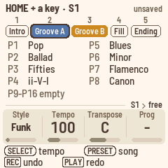

While you hold **HOME**, the screen shows the five, each under its black key's number. It also shows, in
large type, the progressions that have chords. The empty ones share a line underneath ("P9–P16 empty").

- What plays now is teal. A groove gets a teal ring. A progression gets its number on teal and its name in
  teal.
- What you asked for is coral: a coral ring, or a number on coral. It starts at the next bar.
- When stopped, where PLAY will start is ink: an ink ring, or a number on ink.

While playing, the change waits for the next bar. Until then, Home shows NEXT and the groove. While
stopped, you choose what PLAY starts with, and Polly shows it ("FIRST GROOVE B").

**Fills**

- You don't need to choose which fill. From Groove A, Fill AB plays and leads into Groove B. From Groove B,
  Fill BA plays and leads back to Groove A.
- Asking for a fill during a fill adds another bar of fill.
- The Intro and the Ending can't take a fill. They play out, and Polly shows "NO FILL".
- If a style has no Fill BA, Fill AB plays instead, and the other way round.

**Starting and ending**

- PLAY starts on Groove A. The Intro plays first in two cases: when you start a song from a stop and the
  song's Intro is on, or when you pick the Intro (**HOME** + black key 1) before you press **PLAY**.
- The Ending plays once, then stops. Without an Ending, Polly stops at the bar line. After it stops, the
  pages show what PLAY will start with again. In a song, that's section 1's groove. Otherwise it's Groove A,
  never the Ending.

### Intros and endings hold a chord

The Intro and the Ending play over one held chord, as on the QY70. They carry their own lead-in and closing
cadence. The chord on their first beat lasts until they end. A chord you play on the keys still changes it
at once.

### Tempo

Turn **KNOB 2** on Home. Or hold **HOME** and turn **SELECT**, on any page. The tempo runs from 40 to 240
BPM, and it shows at the top right of the screen. When Polly follows MIDI clock, it shows "ext" instead.

## Chords

Polly's grooves are written as if the chord were C major 7. As the band plays, Polly moves every note of
every instrument to fit the current chord. You can give it chords in three ways: play them on the keys,
play a progression, or play a song.

### Playing chords

On Home and Progression, the keys play chords.

- Hold three or more different notes. Polly names the chord, and the band follows. When free, the chord's
  name shows in large type on Home.
- The chord stays after you let go, as on an arranger keyboard. Play the next one whenever you like.
- Inversions work. E G C and G C E are both C.
- When the notes could be read two ways, Polly takes the lowest note as the root. A C E G is Am7, C E G A is
  C6, and D F A C is Dm7.
- The lowest note is the bass. If it's the chord's root, 3rd or 5th, you get that chord. Any other note at
  the bottom becomes a slash bass under the chord the upper notes make. D under C E G is C/D. F under C E G
  is C/F. B♭ under C E G is C/B♭. For C7, put the B♭ above the C: C E G B♭.
- A chord can leave out its 5th. C E B♭ is also C7.
- Two notes are not a chord, so nothing changes.
- Over a progression, a chord you play lasts until the progression's next chord change. Home shows it at the
  top right, in coral, because it's yours.
- **Writing in time.** When you write chords while a progression plays, or during a new progression's take,
  each chord lands on the nearest beat. There's one exception. A bar's first chord, played within the bar's
  first beat, lands on the downbeat. So a chord played a little late on the one still counts as the one.

**The chord types.** There are 25, plus "---" for no chord.

| Major | Dominant | Minor | Other |
| --- | --- | --- | --- |
| maj | 7 | m | aug |
| add9 | 7(9) | madd9 | dim |
| M7 | 7(#9) | m7 | sus4 |
| M7(9) | 7(b9) | m7(9) | 7sus4 |
| 6 | 7(13) | m7(11) | --- |
| | 7(b13) | m6 | |
| | 7(#11) | mM7 | |
| | 7(#5) | m7(b5) | |

With "---", there's no chord, and every instrument just moves with the root.

### Ready-made progressions

P1–P8 start as eight factory progressions: Pop, Ballad, Fifties, ii–V–I, Blues, Minor, Flamenco and Canon.
P9–P16 start empty, for your own. To play a progression, hold **HOME** and press its white key.

Polly knows 16 ready-made progressions in all. To copy one into the current progression, press **SEL** on
Home or Progression and choose LOAD PROGRESSION. Here they are in that list's order:

| | | | |
| --- | --- | --- | --- |
| 1 Pop (I–V–vi–IV) | 5 Blues (12 bars) | 9 Canon | 13 Jazz (I–VI7–ii–V) |
| 2 Ballad (vi–IV–I–V) | 6 MinBlues (minor blues) | 10 Flamenco (Andalusian) | 14 Vamp (ii–V) |
| 3 Fifties (I–vi–ii–V) | 7 One-four | 11 Mixo (I–♭VII–IV) | 15 Gospel (IV–I) |
| 4 ii–V–I | 8 Minor (i–VI–III–VII) | 12 Doo-wop | 16 Waltz (3/4) |

### Transpose

Home's **KNOB 3** (Transpose) moves everything to another key, from −6 to +5 semitones, as on an arranger
keyboard. It moves the progressions, the song, and what you play on the keys: chords, an instrument's notes
and a melody. In a song, each section's own Transpose adds to it.

Home's bars show the chords as you hear them. Chords you write and notes you record are kept as you heard
them. They play back the same, and they move with Transpose if you change it later. MIDI in isn't
transposed. The keys' octave (**OCT−** / **OCT+**) is a separate setting.

## Progressions and the song

Here you write and edit progressions, and build them into a song. For the whole path, step by step, see
the course: [102 Your own progressions](docs/course/102-your-own-progressions.md) and
[103 Your song](docs/course/103-your-song.md).

### The Progression page (ARP)

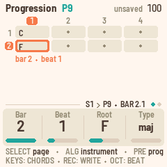

The Progression page shows a progression's bars, with one cell per beat. A short progression gets taller
cells. The cursor is a thick coral ring, with its bar and beat numbers on coral. While playing, the beat
that's playing is teal.

The page shows the progression that's playing, or the last one you picked. Before you've picked one, it
shows the first empty progression, so you never write over a factory one.

- **KNOB 1** (Bar) and **KNOB 2** (Beat) move the cursor. Bar keeps the beat, and the grid scrolls to
  follow. While **REC** writes, you can move one bar past the end. A chord there makes the progression
  longer.
- **KNOB 3** (Root) and **KNOB 4** (Type) change the chord at the cursor. Type starts at "–" (no chord
  there: turning down to it clears the chord), then runs maj, m, 7, m7, M7, sus4, 6, the ninths, dim, aug and
  the altered sevenths. It stops at both ends.
- **OCT−** and **OCT+** move the cursor one beat.

Turn **SELECT** for page 2:

- **KNOB 1** (Length) sets how many bars the progression has.
- **KNOB 2** (Beats) sets the beats in a bar. Each chord stays in its bar. A chord on bar 2, beat 1 is still
  on bar 2, beat 1.
- **KNOB 3** (Bass) sets the bass note of the chord at the cursor.
- **KNOB 4** (Name) picks a name from a list, or the progression's own number, such as "P9".

**Writing at the cursor.** When stopped, press **REC**. Each chord you play goes in at the cursor, and the
cursor moves on one step. A step is a bar, unless you choose a beat or half a bar with STEP in the **SEL**
list.

**The list.** On Progression, **SEL** opens a list. It holds the knobs and the name's letters, then these
actions:

- CLEAR CHORD clears the chord at the cursor, leaving "·". The list opens on it. It's one undo step.
- STEP sets how far the cursor moves after each chord: beat, half or bar. Turn **ALGORITHM** to choose.
- LOAD PROGRESSION copies any of Polly's 16 ready-made progressions into this one.
- CLEAR PROGRESSION clears the whole progression.

**Shorter, then longer again.** When you make a progression shorter, with Length or with fewer Beats, the
chords that no longer fit are hidden. Polly shows "2 CHORDS HIDDEN". Hidden chords don't play. They come
back if you make the progression longer again while you're still on the Progression pages. Once you leave,
they're gone, and they're never saved. Undo brings back a shortening, chords and all. A chord written past
the end grows the progression into empty bars.

### Home's Prog knob

Home's **KNOB 4** (Prog) chooses what steers the band.

- "–" is free. The band follows your chords.
- P1–P16 plays that progression. While playing, it starts at the next bar.
- In a song, the knob shows "Song". Turning it leaves the song.

### The Song page (HOME, HOME again)

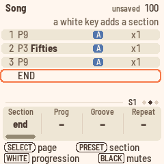

The Song page lists the song's sections, from top to bottom. Each row shows:

- the section's number
- its progression, such as "P3 Fifties"
- its groove: a slate A or an amber B, with "+ fill" when a fill leads into the next section
- its repeat, such as "x2"
- its own transpose, such as "+2". Nothing shows at 0.

Press a white key to write a section. On END, the key adds a new section. On an existing section, it
changes that section's progression. A new section starts on the same groove as the last section above it
that plays the same progression. Otherwise it starts on Groove A.

Under the rows are the mutes of the section at the cursor: D1 D2 PC BA, C1–C4, then the melodies M1 and M2
in plum. A filled name plays, and an outlined name is muted. Black keys 1–8 mute the section's
instruments, and black keys 9 and 10 mute its melodies.

Above the sections, "section 3 of 6" shows where the cursor is. The cursor is the coral ring. On END, the
line shows "a white key adds a section". While the song plays, the section that's playing is filled teal.
When the cursor follows it, the teal fill sits inside the ring. In place of its number, a small clock fills
as the section plays, repeats included. When the clock is full, the next section starts. During the Intro, a
fill or the Ending, the line above the sections shows it: "Intro · then section 1", "Fill AB · into section 3"
or "Ending · then stop". The Intro and the Ending have a clock of their own at the start of that line.

The knobs on page 1:

- **KNOB 1** (Section) moves the cursor.
- **KNOB 2** (Prog) sets the section's progression.
- **KNOB 3** (Groove) sets the groove: A, A + fill, B or B + fill. When you switch between A and B, the
  other sections that play the same progression on the same groove follow, and keep their fills.
- **KNOB 4** (Repeat) sets how many times the section plays, from 1 to 8.

Turn **SELECT** for page 2:

- **KNOB 1** (Transpose) sets the section's own transpose, from −6 to +5, on top of the song's. **PRESETS**
  steps through the sections.
- **KNOB 2** (Intro) turns the song's Intro on or off.
- **KNOB 3** (Ending) turns the song's Ending on or off.
- **KNOB 4** (At end) sets what happens after the last section: "stop", or "again" to go back to section 1.
  With "again", the song keeps looping and the Ending doesn't play.

To change the song itself, hold **HOME** and turn **PRESETS**.

### Home

Home shows the progression as bars, whether you're listening or writing chords. Each cell is a bar, with its
chords. The bar that's playing is filled teal, with its beats along the bottom. In a bar with several
chords, the one sounding is bright and the others are pale. When stopped, bar 1 has an ink ring, because
PLAY starts there. Eight bars show at once, in two rows of four. A longer progression, like the 12-bar
blues, scrolls to the bar that's playing. Above the bars is the groove's pill. When a change is waiting, it
shows NEXT and the next groove.

In a song, the top line counts "section 2 of 4 · repeat 1 of 2", and the bars are the section's
progression. The line under it shows what comes next, with its first chord. For example:

- "next: P4 Chorus (Am) · Groove B"
- "next: Fill · P4 Chorus (Am) · Groove B", when a fill plays in this section's last bar
- "next: P3 Verse again"
- "next: Ending"
- "next: stop"

When free, the chord shows alone in large type. It's teal while the band plays it. While playing, "groove
bar 1.1 / 2" shows at the top right, and "the band follows your chords" shows under the chord.

While **REC** writes chords, or during a new progression's take, the top line shows "REC P9 · bar 3.2".
Before PLAY's first bar, it shows "starts at the next bar", with the count-in's beats left large in bar 1.
Until you play the first chord, it also shows "chords land on the nearest beat". Each chord you write
flashes its bar coral.

### The style's grooves and extras (ENV)

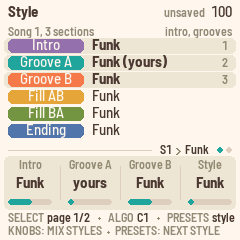

The Style page sets which style plays each of the song's grooves and extras. So you can play Funk's Groove
A with Rock's fills.

- On page 1, **KNOB 1–3** set the Intro, Groove A and Groove B. They show on a panel, in bold.
- Turn **SELECT** for page 2. There, **KNOB 1–3** set Fill AB, Fill BA and the Ending.
- Each knob goes through your own copies first ("Funk (yours)"), then the styles by name.
- **KNOB 4** and **PRESETS** set the song's style, like Home's **KNOB 1**. They change what plays a style,
  not what is yours.

## Recording an instrument

You can record your own notes into any instrument of a groove. Polly records into the selected instrument
of the groove or extra that's playing, while it loops.

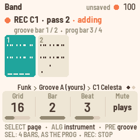

1. Press **SEQ** to open the Band page.
2. Turn **ALGORITHM** to pick the instrument. The keys play its sound.
3. Press **REC**. A coral dot shows in the header and **PLAY** turns red. The screen shows the groove as
   bars, with the instrument's notes in each, and "REC C1 · starts with PLAY". The footer shows "[REC] stop".
4. Press **PLAY**. The click counts in one bar while the band waits: "Count-in 4" at the top, and the beats
   left large in bar 1. Then the groove starts. Play. The groove loops, and each pass adds to what's there (overdub). You hear a new
   note from the next pass on. The screen shows where you are: "REC C1 · pass 2 · adding". Under it,
   "groove bar 1 / 2 · prog bar 3 / 4" shows the groove's bar, and the progression's bar if one is playing.
5. Press **REC** again to stop recording. The groove keeps playing.

### The Band page

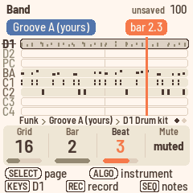

The Band page shows the eight instruments of the groove that's playing, with their notes in ink.

- A drum's hits are short ticks.
- A muted instrument is pale, with its name struck through.
- An instrument with no notes is faded.
- The selected instrument's row is darker and outlined.
- The playhead is a teal line.
- The cursor is a coral line down through the instruments, with its place on coral above it ("bar 2.3").

The groove's pill is at the top left, such as "Groove A (yours)". The groove's length is on the Groove
length page.

- **KNOB 1** (Grid) sets the grid. See *The grid* below.
- **KNOB 2** (Bar) and **KNOB 3** (Beat) move the cursor.
- **KNOB 4** (Mute) mutes the selected instrument. Its values are "muted" and "plays".
- To fix a single note, press **SEQ** again. See [Fixing notes](#fixing-notes).

### Good to know

- **The click.** A woodblock counts the beats while you record. It always clicks during a count-in. Setup's
  Click knob sets it to off, rec or on.
- **REC, then PLAY** plays one bar of count-in first. Only the click plays, and the band waits at its start.
  The header shows "Count-in 4", counting down. Recording starts on the band's first beat. A note played
  just before it lands on it. This works for every kind of recording: an instrument, a new progression,
  chords, a melody or sections. Press **PLAY** during the count-in to stop. MIDI start goes out when the band
  starts, after the count-in, so a computer recording Polly stays in time. When Polly follows MIDI clock,
  there's no count-in: the clock's start is the start.
- **The grid.** Band's **KNOB 1** (Grid) moves the notes you record to the nearest 8th, 8th triplet, 16th,
  16th triplet or 32nd. "off" leaves them as you played them. Clockwise is finer: 8, 8T, 16, 16T, 32, off.
- **As played.** The first time you record into an empty instrument of type Chord 1, Chord 2 or Bass, Polly
  switches it to Parallel and shows "C1: AS PLAYED". Each note then plays back as you played it, over the
  chord you played it on. Over another chord, it moves with the root and keeps its shape, by the shorter
  way. For example, a line played over Am goes up a third over C. The instrument's range opens to the whole
  keyboard. The Sound page (**EDIT**) shows the type. You can set it back there, and Polly won't switch it
  again.
- **An instrument that already has notes,** such as a style's comping, keeps its type, so its notes still
  follow the chords. Polly shows "C1 FOLLOWS CHORDS", and the footer shows "[SEL] clear C1: plays as
  played". What you record there follows the chords too.
- **REC while playing** starts at the next bar line, wherever the groove is. The screen rings that bar and
  counts down the beats in it. A note played just before the bar line lands on it. The passes count from
  there. If you start at bar 3 of a 4-bar groove, a pass is bars 3, 4, 1, 2.
- **A groove shorter than the progression**, such as a style's 2-bar Groove A over a 4-bar progression:
  REC's footer shows "[SEL] 4 bars, as the prog". Press **SEL** to make the groove as long as the
  progression. Its bars repeat into the new ones. The **SEL** list has this too, as BARS AS THE PROG. After
  that, what you play over the progression's bar 3 stays with bar 3.
- **In a song, a fill takes a section's last bar.** This happens when the section has "+ fill", or when the
  groove changes after it. That bar plays the fill, not the groove. So you won't hear what you record into
  the groove's last bar there.
- **Press REC before PLAY** outside a song, and the groove you're recording into plays at once, without the
  Intro.
- **A change of groove ends the take.** That includes a fill, an ending, or a song's next section. Polly
  shows "RECORD OFF THE BAND MOVED ON". To record, play without a song, or on a groove that loops.
- **A groove holds 600 notes.** After that, new notes are dropped.

### (yours): your own copy

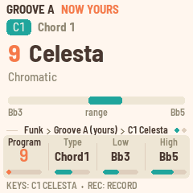

The styles themselves never change. The first time you record into a style's groove or extra, or change
its sound, mixer or length, Polly copies it into a free place in [memory](#memory). It shows "GROOVE A NOW
YOURS" or "RECORD C1 GROOVE A (YOURS)". From then on, that groove plays your copy, with "(yours)" on the
screen, whatever the Style knob says. This lasts until you choose BACK TO STYLE. Muting an instrument
doesn't make a copy, because mutes belong to the song, not the groove.

Your copies share the 16 places of memory with the melodies and the songs' own progressions. When no place
is free, Polly shows MEMORY FULL and "not kept". Your change still plays, but it's lost once you pick
something else. Free a place (see [Memory](#memory)), and the change is kept there at once: "GROOVE A KEPT
IN MEMORY 14". You can also hold **SAVE** and press a white key on the Band page to keep a copy in that
place.

On the Band page, **PRESETS** picks what the playing groove plays: your copies first, then the styles'.

### Groove length (SEQ, SELECT)

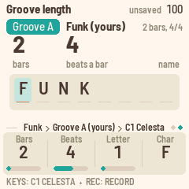

This page sets the groove's length and its name. It shows the bars as a picture: one cell per bar, with its
number at the top and its beats along the bottom. The bars it could still have, up to 16, are outlines.
Under them is the name. The letter that Place points at sits in a coral box, and the free places after it
show as dots.

- **KNOB 1** (Bars) sets the length, from 1 to 16 bars.
- **KNOB 2** (Beats) sets the beats per bar, from 2 to 7.
- **KNOB 3** (Place) picks a letter of the name, and **KNOB 4** (Letter) changes it. A name has up to eight
  characters: letters, digits, "-" and "#".

When you make a groove longer, the new bars repeat the groove. Each instrument repeats in its own way. A
1-bar drum part repeats bar 1, and a 2-bar bass line repeats bars 1 and 2. So the band keeps going. When
you make a groove shorter, the notes past the end are kept but not played. Make it longer again and they
come back, and nothing is repeated over them.

While a progression plays, the groove follows the progression's bar. If you change the length at the
progression's bar 3, a 4-bar groove plays its bar 3. The Band page shows a groove longer than 8 bars one
half at a time ("bars 9-16 of 16"), following the playhead.

### The groove's actions (SEL)

On the Band, Sound and Mixer pages, the **SEL** list opens on actions for the groove that's playing:

- BARS AS THE PROG comes first, when the groove is shorter than the progression.
- CLEAR C1 clears the selected instrument's notes.
- CLEAR GROOVE A clears the groove, or the extra that's playing.
- BACK TO STYLE gives the groove back to the style. While the band plays, it needs your changes saved first.
  Otherwise Polly shows "UNSAVED · SAVE FIRST": press **SAVE**, or stop.
- MEMORY shows what fills the memory. It's on SEQ and EDIT only.

With a melody selected, the actions are the melody's: CLEAR M1 IN SECTION n, CLEAR M1, QUANTISE M1 IN
SECTION n and COPY M1 TO SECTION n.

Effects is shared by every song, so its list holds only its knobs.

To copy the groove into a place in memory, hold **SAVE** and press a white key on the Band page.

## Melodies

Each song has two melodies, **M1** and **M2**. Use them for lines that run through the whole song, rather
than looping with a groove. Melodies play only in a song: with Home's Prog knob on "Song", or after
**PLAY** on the Song page.

Each note belongs to its section. Polly keeps it as you heard it, along with the root of the chord under
it. If you change that section's chord or Transpose, or the song's Transpose, the melody moves with the root
and keeps its shape. Over the same chord at the same Transpose, it plays exactly as you played it.

**Record a melody over your song:**

1. On the Song page, press **PLAY**.
2. Press **EDIT** and turn **ALGORITHM** past C4 to **M1**. The keys play its sound, a square lead. M2's
   sound is strings.
3. Press **REC**. The click counts in to the next bar line. The screen shows "REC M1 · starts at the next
   bar", with the beats left shown large in that bar. During the Intro, recording waits for section 1. Play
   along. Under "REC M1", the screen shows where the next note lands: "song bar 6 · Chorus bar 2.1". It
   also shows the song as one line, with your notes landing on it. See *Where it is* below.
4. Press **REC** again to stop recording. The song keeps playing. Stopping the song also stops recording,
   and Polly shows "RECORD OFF SONG STOPPED". That way, the next PLAY doesn't record over your song.

Notes go into the section that's playing, at their place on the Band page's grid. You hear them the next
time that section plays. Recording over a section again (a punch-in) adds notes to what's there. To replace
a section's melody, clear it first, then record. Press **SEL**, and the list opens on CLEAR M1 IN SECTION n.

**Where it is.** With M1 or M2 selected, the Sound page shows the song as one line, whether it's playing or
not. It has three parts.

- **The whole song** runs across the top. Its sections sit end to end, each as wide as its bars, repeats
  included. Each is named after its progression ("Verse", "Chorus x2"). Names are shortened when a section
  is narrow, and a run of the same progression is named once. Groove A sections are slate, and Groove B
  sections amber. The melody's notes are plum ticks along it, and the other melody's are pale. While the
  song plays, a teal line runs through it. The section you're in is outlined. The outline is teal while the
  section plays, or coral for the Song page's cursor when stopped. A short line underneath marks the four
  bars shown below.
- **Four bars** run under it, across sections: the bar before your place, your place, and two bars after.
  A section's first bar carries its name and a divider. The other bars carry their number within the
  section. Notes are placed by time and pitch, with the other melody's pale. The bar that's playing is teal,
  with its beats. Notes you just recorded flash their bar coral.
- **One readout** sits above them, such as "song bar 9 · Chorus bar 1". When stopped, it shows the first
  bar of the section at the Song page's cursor, ringed in coral. That's where PLAY FROM SECTION and a
  punch-in start. While playing, it shows the bar and beat in teal ("Chorus bar 3.2"). While recording, it
  shows in coral where the next note lands.

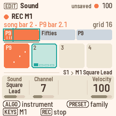

**More about melodies:**

- **Punch in.** On the Song page, move the cursor to the section with **KNOB 1** (Section). Then, on
  **EDIT**, press **REC** and **PLAY**. After a bar of count-in, the song starts at that section.
  REC's screen rings it, and recording starts on its first downbeat. When stopped, pressing **REC** while free or on a progression
  switches to the song first.
- **A second melody.** Turn **ALGORITHM** to M2, and recording continues into it. M1's notes show dimly
  under M2's, so you can play against them.
- **Clear.** On **EDIT**, the **SEL** list opens on CLEAR M1 IN SECTION 3. That's the section playing, or
  else the section at the Song page's cursor. Below it is CLEAR M1, which clears the whole song's M1. Each
  asks first.
- **Copy a section's melody.** Choose COPY M1 TO SECTION 3, where 3 is the same section. Turn **ALGORITHM**
  to pick the section to copy from ("from 2"). Press **SEL** to copy its M1 notes over section 3's. If
  section 3 already has notes, Polly asks first. The copied notes play as played over section 3's chords,
  moved with its root. It's one undo step.
- **Quantise.** QUANTISE M1 IN SECTION 3, in the **SEL** list, moves that section's M1 notes to the nearest
  line of the Band page's grid. The grid shows at the right, as 16, 8T and so on. You can record with the
  grid off to play freely, then quantise afterwards. **HOME** + **REC** undoes it in one step.
- **Sound.** A melody's Sound is a single page, with the sound's family at the top ("M1 Synth Lead", in
  plum). Turning **KNOB 1**, or **PRESETS** to jump a family, shows the family's eight sounds for a moment,
  with the sound ringed, as for an instrument. **KNOB 1** sets the sound and **KNOB 2** the channel.
  **KNOB 4** (Velocity) sets how hard the notes you record from now on will play. You need it because the
  keys have no velocity. It starts at 100. A melody always plays "as played" over the whole keyboard, so it
  has no type, range or high key. The Mixer and Mixer tone pages have a strip for each melody. Black keys 9
  and 10 select M1 and M2 there.
- **Mutes.** On the Song page, black keys 9 and 10 mute M1 and M2 in the section at the cursor.
- **On Home**, in a song, M1 and M2 sit at the right of the "next:" line if they have notes. They're plum,
  teal while a note sounds, and outlined and struck through while muted.
- **Outside a song.** While the band plays free or a progression, REC on a melody shows "MELODIES RECORD
  IN A SONG".
- **Deleting a section** that has melody notes asks first ("SECTION 3 HAS MELODY NOTES: DELETE?").
- **Memory.** Melody notes share the 16 places of memory. A song's melodies take one place, which holds
  about 420 notes, and a second place when they outgrow it. "MEMORY FULL" or "MELODY FULL" means no place
  is left. See [Memory](#memory).

## Fixing notes

You don't have to record again to fix one wrong note. **Notes** is a note editor. It edits the selected
instrument's notes in the groove that's playing, or a melody's notes along the song.

To open Notes, press **SEQ** for Band, then press **SEQ** again. **SEQ** in Notes goes back to Band, and any
other page button leaves it. **ALGORITHM** picks whose notes you edit, as on every page: D1 to C4, M1 or M2.

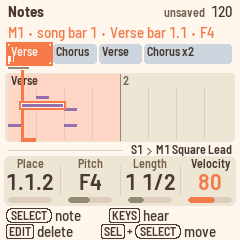

Notes shows a piano roll. Time runs from left to right, and pitch from bottom to top. A melody's notes are
plum, with the other melody's pale underneath. An instrument's notes are ink, and drum hits are short
ticks. For a melody, the song line runs along the top, with the stretch on screen marked under it. Bars
carry their number, and a section's first bar carries its name.

**What you see:**

- **The cursor** is a coral line at a place on the grid. The grid is the Band page's Grid setting: 8, 8T,
  16, 16T or 32. With the grid off, Notes uses 32nds. The cursor's step is marked in coral along the
  bottom.
- **The selected note** is ringed in coral.
- **The playhead** is teal, while playing.
- **The readout** above shows where the cursor is, and the note. For example, "M1 · song bar 1 · Verse bar
  1.1 · F4", or "D1 · bar 1.1 · Pedal hat". Drum notes are named by their sound.

**What you can do:**

- **Select a note.** **SELECT** steps from note to note in time order. It takes a chord's notes one at a
  time, lowest first. The cursor follows.
- **Move the cursor.** **KNOB 1** (Place) moves the cursor one grid step per detent, through empty places
  too. "1.1.2" means bar 1, beat 1, second step. The first note that starts in that step is selected. If
  there's none, the cursor is on an empty place.
- **Change pitch.** **KNOB 2** (Pitch) changes the selected note's pitch. For a drum, it changes the sound:
  Snare, Closed hat and so on.
- **Bass notes on a chord change.** A style's bass plays the chord's root on the first note after each chord
  change, whatever that note is written as. So when you change the pitch of a bass note on a beat, Polly asks
  "BASS PLAYS THE ROOT HERE. AS WRITTEN?" once for that groove. **SEL** (yes) makes the bass play every note
  as written: its Type becomes Chord 1 (see [Sound](#sound-edit)), and **HOME** + **REC** undoes it. **HOME**
  (no) keeps the rule, and the readout says so by the note: "F2, root on changes".
- **Change length.** **KNOB 3** (Length) changes the note's length, one grid step per detent. The length
  shows in beats ("1/2", "1 1/2"). Hold **SEL** for finer steps.
- **Change velocity.** **KNOB 4** (Velocity) sets how hard the note plays.
- Over an empty place, the knobs show "–".
- **Move a note.** Hold **SEL** and turn **SELECT** or **KNOB 1**. The selected note moves one grid step per
  detent, and keeps its length and velocity. A melody note moved past the end of its section goes into the
  next section. It takes the root of the chord there, as if you'd recorded it there.
- **Delete a note.** Press **EDIT**.
- **Enter a note.** On an empty place, play a key. The note goes in there, one grid step long. A melody note
  gets the melody's velocity and the root of the chord sounding there, so it follows chord changes like a
  recorded note. Keys held together go in as a chord. When you let go, the cursor moves one step on, so you
  can write a line note by note. On an existing note, the keys only play. Notes you enter on an instrument
  are stored as if over C major 7, the way the styles store theirs.
- **Zoom.** **PRESETS** shows 8, 4, 2 or 1 bars. For an instrument, you can zoom down to one beat. Notes
  starts at two bars.
- **Erase while recording.** With **REC** on and playing, hold **EDIT**. The notes the playhead passes are
  erased, starting from the step it's in, until you let go. The readout shows "ERASING". The keys still
  record meanwhile.
- **Undo.** Every edit is one step. Hold **HOME** and press **REC** to undo, or **PLAY** to redo. A
  recording pass, together with its erasing, is one step too.
- **Your copy.** Your first edit to a style's groove makes it yours first, just as recording does ("GROOVE
  A NOW YOURS"). A groove holds 600 notes. Past that, Polly shows "GROOVE FULL".
- **While recording**, Notes shows the recording. The window follows the playhead, and the keys record.

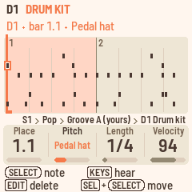

## Sound

The sound pages show and change the groove that's playing, one instrument at a time. **ALGORITHM** picks
the instrument.

### Sound (EDIT)

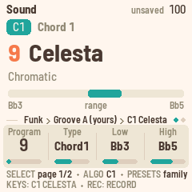

The Sound page works like a browser. At the top is the sound's General MIDI family of eight, such as
"Chromatic". Below it are the family's sounds in two columns of four, from Celesta to Dulcimer. The sound
the instrument plays is ringed in coral, with its General MIDI number in small type at the right ("GM 9").
As you turn **KNOB 1**, the ring moves through the family, so you can see where you're going. Under the
sounds, a bar over the whole MIDI keyboard shows the range the instrument plays in. The Low and High knobs
set its ends.

- **KNOB 1** (Sound) picks one of the 128 General MIDI sounds, by name. **PRESETS** jumps a family of eight:
  pianos, organs, guitars, basses and so on. A drum instrument plays the drum kit. Its page shows "Drums"
  and the kit, with no family, range, Low or High.
- **KNOB 2** (Type) sets how the instrument follows the chords. It shows "as played" once Polly has
  switched it (see [Good to know](#good-to-know)).
- **KNOB 3** (Low) and **KNOB 4** (High) set the lowest and highest notes. A note outside them moves by
  octaves until it fits.

| Type | For | What it does |
| --- | --- | --- |
| Bypass | Drums | Never changes. |
| Parallel | Riffs | Moves with the chord's root and keeps its shape. |
| Chord 1 | Chords, arpeggios | Each note moves to the matching note of the new chord. |
| Chord 2 | Pads | Like Chord 1, but each note stays close to the one before, for smooth voice leading. |
| Bass | Bass lines | Like Chord 1, and the first note after a chord change is the root, or the slash bass, whatever it's written as. |

### Sound 2 (EDIT, SELECT)

- **KNOB 1** (High key) sets the highest root before a Chord 1 or Bass line drops an octave: C to B, or off.
  This keeps a bass line from climbing out of reach as the chords rise. The page draws an octave of keys,
  with the high key in coral and the roots above it shaded ("roots above F#: an octave down"). Drums have no
  high key.
- **KNOB 2** (Channel) sets the MIDI channel, from 1 to 16. Drums are on 10.

### Mixer (LFO)

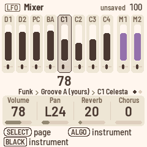

The Mixer has ten strips: the eight instruments, then the melodies M1 and M2 in plum. Each strip shows its
volume and pan. The selected strip is darker and outlined, with its volume shown large under it. A muted
strip is pale. Black keys 1–10 select a strip. For the selected one:

- **KNOB 1** sets the volume.
- **KNOB 2** sets the pan.
- **KNOB 3** sets the reverb send.
- **KNOB 4** sets the chorus send.

The Effects page shows every instrument's sends. Instruments on the same channel share these settings. D1,
D2 and PC are all on channel 10.

**Mute.** The Band page's **KNOB 4** mutes or unmutes the selected instrument. A mute belongs to the song.
The instrument stays muted in every groove and through fills. The mute is saved with the song, and each
song has its own mutes. Muting never makes a groove yours.

### Mixer tone (LFO, SELECT)

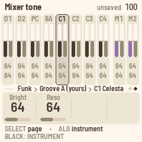

For the selected instrument, **KNOB 1** (Bright) sets the filter's cutoff, shown as the strip's dark bar.
**KNOB 2** (Reso) sets its resonance, shown as the grey bar. The two numbers show large under the strip. At
64, the sound is unchanged, and a line across the strips marks that point. Lower Bright sounds darker.
Higher Reso sounds more pronounced.

### Effects (FX)

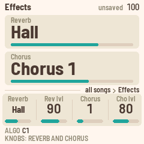

The Effects page sets the effects that all instruments share, in every song.

- **KNOB 1** (Reverb) picks the reverb: Off, Large hall, Hall, Chamber or Room.
- **KNOB 2** (Level) sets the reverb level.
- **KNOB 3** (Chorus) picks the chorus, from 1 to 4.
- **KNOB 4** (Level) sets the chorus level.

The page also shows how much each instrument of the groove, and each melody, sends to the effects. The dark
bar is the reverb send and the grey bar is the chorus send. The Mixer's **KNOB 3** and **KNOB 4** set them.

## Songs and saving

Here you switch songs, save, undo, manage memory and back up your work.

### Four songs

Polly holds four songs. Each has its own sections, progressions, melodies, tempo, Transpose, style and
mutes.

To change songs, hold **HOME** and turn **PRESETS**, on any page. While playing, the new song waits until
you stop, and Polly shows "SONG S2 after the stop". That's because loading a song saves first, and saving
pauses the sound for a moment.

### Saving

- **SAVE** lights, and "unsaved" shows in the header, while something isn't saved.
- Press **SAVE** to save now. It saves the songs, the grooves you've changed and the settings.
- Polly also saves by itself after about four seconds at rest. At rest means stopped, with no key or button
  held, and the last notes faded.

Saving pauses the FM-1 for a moment, which is why Polly waits until you stop.

If two grooves in a song play the same copy of yours, and both were changed, the newest change is kept.
Polly shows "SHARED GROOVE KEPT GROOVE B".

### Undo

Hold **HOME** and press **REC** to undo. Hold **HOME** and press **PLAY** to redo. Neither one records or
starts playback. Undo works while playing.

The header shows what was undone, for example "UNDO P9 CHORD", "UNDO SECTION 3", "UNDO TAKE M1", "UNDO PASS
C1", "UNDO CLEAR PROG", "REDO C1 SOUND" or "NOTHING TO UNDO". What came back flashes coral. On Progression,
the cursor goes to the chord. On Song, the cursor goes to the section. For melody notes, it goes to their
section.

Undo covers the song you're on:

- its progressions: chords, length, name, loading, clearing and copying
- its sections and settings: style, tempo, Transpose, mutes and the melodies' sounds
- its melody notes: a take is one step, and so is clearing or copying a section's notes
- its grooves as you change them: sounds, mixer, types, CLEAR C1, CLEAR GROOVE A, BACK TO STYLE, and each
  pass of a recording

One undo step is whatever you changed before pausing for about a second. A whole melody take is one step,
and so is one pass of an instrument recording. Polly keeps up to 32 steps while it's switched on, or fewer
after big ones. Switching songs or switching off starts afresh.

Undo doesn't cover tempo changes made while playing, or the Setup and Effects pages. Whatever undo brings
back is saved like any other change.

### Memory

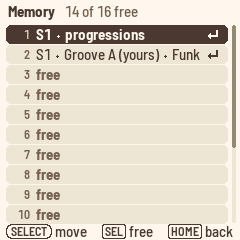

Memory has 16 places. They hold your grooves (yours), the songs' melodies, and each song's own
progressions once they differ from the factory ones.

When the places are full, Polly shows MEMORY FULL, and the footer shows "[SEL] memory: free one". Press
**SEL** then to see what fills them. You can also choose MEMORY at the end of the **SEL** list on SEQ or
EDIT.

The list shows one place per line, numbered, with the songs first. For example:

- "S1 · Groove A (yours) · Funk" is a groove of yours. The line shows the songs playing it, what they play
  it as, and its name.
- "no song · groove (yours)"
- "S2 · melodies 1/2"
- "S1 · progressions"
- "free"

The list covers the whole screen, and the header counts the free places. The numbers match the white keys
that **SAVE** copies a groove to on SEQ ("COPIED TO MEMORY 7").

To free a place, stop, select it and press **SEL**. Polly asks first.

- A groove of yours goes back to the style in the songs that play it. Its notes are cleared, and this can't
  be undone.
- A song's melody notes are cleared.
- A song's progressions go back to the factory ones ("S1'S PROGRESSIONS BACK TO FACTORY?").

**HOME** goes back. If MEMORY FULL left a change playing but not kept, the change takes the freed place at
once ("GROOVE A KEPT IN MEMORY 14"). That change can be a groove's sound, a recording or the song's
progressions.

### The song's actions (SEL)

On the Song pages, the **SEL** list opens on PLAY FROM SECTION, for the section at the cursor. Then come
INSERT SECTION, DELETE SECTION, CLEAR SONG and COPY SONG TO.

- A section's melody notes go with it. If it has any, DELETE SECTION asks first.
- CLEAR SONG clears the melodies too.
- COPY SONG TO ("S2") doesn't copy the melodies.

A song with no sections never plays as a song. **PLAY** on the Song page shows "NO SECTIONS · WHITE KEYS
FIRST". If you empty a song while you're in it, with CLEAR SONG or by deleting its last section, it goes
free, and Polly shows "NO SECTIONS: FREE".

### Backup

You can keep Polly's songs in a file on your computer and put them back later, over USB. From this
repository:

```sh
pip3 install mido python-rtmidi
python3 tools/polly_backup.py backup my-songs.plb
python3 tools/polly_backup.py restore my-songs.plb
```

A backup holds everything Polly keeps:

- the four songs
- the 16 places of memory, with your grooves, melodies and the songs' progressions
- the settings: Setup, the channels' sounds and Effects

It doesn't hold the QY70 styles, which you install again from your ROM. It doesn't hold the button
calibration either. Polly keeps playing while you back up. Stop first if you want changes that aren't saved
yet in the file too.

A restore **replaces everything** with the backup. Stop first. If Polly is playing, it answers **STOP
FIRST**. The computer asks first too: type y (or add `--yes` to the command). Polly receives the whole file and checks it before anything changes. Then it asks on its screen:
**RESTORE FROM USB?** Press **SEL** to restore and reload the songs, or **HOME** to keep what you have. A
cut cable or a damaged file changes nothing. Even a power cut during the write leaves either the old songs
or the new ones, never a mix.

To see what a backup holds, run `python3 tools/polly_backup.py info my-songs.plb`.

## Setup and MIDI

Press **GLO** for Setup. Here you set the clock, MIDI out, the lights and the click.

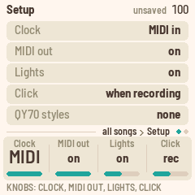

The page explains the knob you turned last, in words ("Click: a click on every beat."). Below that is the
QY70 bank's line.

| Knob | Sets |
| --- | --- |
| **KNOB 1** Clock | **MIDI** (the default): Polly keeps its own time, and follows MIDI clock, start and stop whenever they come in. **internal**: Polly ignores MIDI clock. |
| **KNOB 2** MIDI out | **on** (the default): the instruments go out over USB on their channels, with their sounds and mixer settings. MIDI clock, start and stop go out too, while Polly keeps time. **off**: nothing goes out. |
| **KNOB 3** Lights | **on**: keys light as you play, and the other buttons glow. **notes**: keys light, with no glow. **off**: neither. |
| **KNOB 4** Click | **rec** (the default): a woodblock on every beat while you record, higher on the first beat of the bar. **on**: whenever Polly plays. **off**: only during the count-in. |

The click is on MIDI channel 16, so it goes out over MIDI too. It sits a little under the band, and
instrument mutes don't silence it. REC's count-in always clicks, even with Click off. The count-in is the
bar of clicks before PLAY starts a recording, or the beats before a take starts at the next bar line while
playing.

The last line shows the QY70 bank: none, the number of styles, "damaged" or "old format".

**Factory reset.** On Setup, press **SEL** and choose FACTORY RESET. Polly asks "ERASE ALL SONGS AND
MEMORY?". Press **SEL** to erase, or **HOME** to keep everything. Stop first. Afterwards Polly is as new: the
four songs empty, the 16 places of memory free, and Setup and the mixer at their defaults. The QY70 bank
stays installed. A reset can't be undone, so [back up](#backup) first if you might want your songs again.

Turn **SELECT** for Status. It shows the processor's load, the voices sounding and the version. It has no
knobs.

**MIDI in.** MIDI coming in over USB or the TRS jack plays Polly's sounds on all 16 channels, like a
General MIDI sound module, with drums on channel 10. It plays alongside the arranger, and it isn't
transposed. Controllers 74 (brightness) and 71 (resonance) move each channel's filter, as the Mixer tone
page does.

**USB.** The FM-1 shows up as a class-compliant MIDI device named "Polly FM-1". The FM-1 has no MIDI out
jack, so MIDI out is USB only.

## The QY70 bank

The QY70 came with 128 preset styles. If you have its main ROM, Polly can build all 128 from it and play
them next to its own 16. The ROM is a dump of the chip, the file MAME calls `qy70main.bin`. Polly contains
none of Yamaha's music. You bring the ROM, and the bank is for your own use.

### On the FM-1

Connect the FM-1 over USB, and run this from the repository:

```sh
pip3 install mido python-rtmidi
python3 tools/qy70_install.py qy70main.bin
```

The tool builds the bank and asks before writing. Add `--yes` to skip the question. Writing takes about 30
seconds, and the FM-1 stops playing meanwhile. Polly checks everything it was sent before it uses it. So a
cut cable leaves no bank, never half of one. Just run the tool again. When it's done, Setup shows "128
styles".

### In the browser

On the emulator's page, press **Load QY70 ROM**, or drop the file on the box. Your ROM stays on your
computer. The page builds the bank in your browser and keeps it there for your next visit. **Forget QY70
styles** removes it.

### Playing them

The QY70 styles follow Polly's 16 on the Style knob, marked "QY". The Style knob is Home's **KNOB 1**, and
you can also pick them on the Style pages (**ENV**). They play with their own bends, swells and filter
moves, and they change grooves and styles without a gap. A song plays one QY70 style at a time. If you pick
a groove from another QY70 style, the song's other QY70 grooves move with it.

### What doesn't carry over

- **Drum kits.** Polly has one General MIDI kit. The QY70's brush, jazz, room and analog kits all play it.
- **XG voices.** Variations play their General MIDI instrument. Sound-effect voices play a General MIDI
  effect.
- **Pan on the drum channel.** The drum instruments share one pan and one set of effects.
- **Editing.** Recording into a QY70 groove, or changing it, makes it yours, as with Polly's own styles.
  Then the 600-note limit applies, and the quietest short notes go first. Its bends and controllers are left
  out. Played as they are, QY70 styles have no note limit.

### Keeping it

The bank lives in the FM-1's memory, next to your songs. Restoring M-VAVE's firmware wipes it. If Setup
shows "none" or "old format" after an update, install it again.

The QY70's styles are © Yamaha Corporation. Don't share the bank, or anything built from your ROM.

## Updating and safety

These features come from Felucca, the platform Polly is built on. They work as in the other FM-1 firmwares.

- **Update mode.** Hold **OCT−** and **OCT+** for 5 seconds. The screen counts down, then the FM-1 restarts,
  ready for an update. Let go before then to cancel.
- **Safe mode.** If the FM-1 fails to start twice in a row, it starts in safe mode, with only USB on, so the
  web installer can reach it. **PLAY** tries a normal start again.
- **Back to M-VAVE's firmware.** The web installer can put the original firmware back. M-VAVE's own updater,
  M-UPGRADE, works too.
- **Button calibration.** Hold **OCT−** and **OCT+** while you switch on, then follow the screen. You only
  need this if buttons do the wrong thing.

Your songs and grooves survive a Polly update. Putting M-VAVE's firmware back can wipe them, so make a
[backup](#backup) first.

## Credits

- **Felucca** by Leo Kuroshita (Hügelton Instruments): the platform under Polly (GPL-3.0), by way of X0X and
  FoMni. <https://github.com/hugelton/Felucca>
- **Sonivox EAS** (Sonic Network, The Android Open Source Project): the synth and its General MIDI sound set
  (Apache-2.0). <https://github.com/EmbeddedSynth/sonivox>
- **The Groove MIDI Dataset** by Jon Gillick, Adam Roberts, Jesse Engel, Douglas Eck and David Bamman (Google
  Magenta), © Google LLC: the drum performances in Polly's styles (CC BY 4.0), excerpted and quantised.
  <https://magenta.tensorflow.org/datasets/groove>
- **Groove OS** by Peter Gombos: the idea of running FM-1 firmware in the browser.
  <https://www.groove-os.com/>
- **qy100-toolkit**: its decoding of the QY70's pattern format helped read the ROM's styles.
  <https://github.com/doffu0000/qy100-toolkit>
- **Pyodide** (MPL-2.0) builds the QY70 bank in the browser.
- **Barlow** (The Barlow Project Authors, SIL OFL 1.1): the screen's typeface.
- **Melodee** by Kerem Kilic (Ellic Studio, keremimo), GPL-3.0, also on Felucca: the design of Notes. That
  includes its piano roll and its way of working with notes. SELECT walks the notes, the knobs edit, EDIT
  deletes or erases while held, and a held button with SELECT moves a note.
  <https://github.com/keremimo/melodee>

Polly is inspired by the Yamaha QY70. It is not affiliated with Yamaha. "M-VAVE" and "FM-1" are trademarks
of their owners. Polly is GPL-3.0 (see LICENSING.md).

## Page by page

This table lists every page and what its controls do. On every page, **ALGORITHM** picks the instrument
(D1 to C4, then the melodies M1 and M2), and the encoders' line shows it where an instrument is on screen.
On every page, holding **HOME** and turning **PRESETS** picks the song. **SELECT** turns a button's pages.

| Page | Button | KNOB 1 | KNOB 2 | KNOB 3 | KNOB 4 | PRESETS |
| --- | --- | --- | --- | --- | --- | --- |
| Home | HOME | Style | Tempo | Transpose | Prog | The next progression |
| Song | HOME on Home | Section | Prog | Groove | Repeat | The next section |
| Song 2 | HOME on Home, SELECT | Transpose (the section's) | Intro | Ending | At end | The next section |
| Progression | ARP | Bar | Beat | Root | Type | The next progression |
| Progression 2 | ARP, SELECT | Length | Beats | Bass | Name | The next progression |
| Band | SEQ | Grid | Bar (the cursor) | Beat (the cursor) | Mute | What the groove plays |
| Groove length | SEQ, SELECT | Bars | Beats | Place | Letter | What the groove plays |
| Notes | SEQ, SEQ | Place (the cursor) | Pitch | Length | Velocity | Zoom |
| Sound | EDIT | Sound | Type (a melody: Channel) | Low (drums, a melody: none) | High (drums: none; a melody: Velocity) | Sound family |
| Sound 2 | EDIT, SELECT (not a melody) | High key (drums: none) | Channel | | | |
| Mixer | LFO | Volume | Pan | Reverb | Chorus | |
| Mixer tone | LFO, SELECT | Bright | Reso | | | |
| Effects | FX | Reverb | Level | Chorus | Level | |
| Style | ENV | Intro | Groove A | Groove B | Style | Style |
| Style 2 | ENV, SELECT | Fill AB | Fill BA | Ending | Style | Style |
| Setup | GLO | Clock | MIDI out | Lights | Click | |
| Status | GLO, SELECT | | | | | |

## Screen mirroring

Polly can show its screen and panel live on a computer, over the USB cable. Use it to show Polly to others,
such as when teaching, filming or on a big screen. For testing, you can also control Polly from it.

1. Plug the FM-1 into the computer.
2. Open `web/mirror/index.html` in Chrome or Edge. These browsers have Web MIDI.
3. Press **Connect** and allow MIDI with SysEx. Polly is picked automatically, because its ports are called
   *Polly FM-1*. If not, pick them in the In and Out lists.

The screen shows at two or three times its size (×2, ×3). The panel below it lights as the FM-1 does. Lit
buttons and keys show their LEDs, and the ones held are outlined. A knob you turn flashes with the detents it
moved. **Save PNG** saves the screen. `python3 tools/polly_mirror.py screen.png` does the same without a
browser.

**Control** is for testing. It lets the panel on the page play the FM-1. Press a button or a key on the
page, and it stays held while you hold it. Scroll over a knob to turn it.

`python3 tools/polly_remote.py` does the same from a script, with commands such as `tap HOME`, `turn K1 3`,
`shot s.png` or `run tests/scenarios/home.polly`. A scenario runs its presses, keys, turns, waits and
screenshots. Checks that only the simulator can make are skipped. Polly takes these commands as if from its
own panel, and only while it's mirrored. It never writes anything by itself, but a SAVE you send saves, as
the button does. Update mode can only be started by hand.

`run ... --fresh` plays the scenario in a test session. Polly stops, saves what you haven't saved yet, then
starts as a new FM-1 would: no songs, no grooves of yours, the first style. The header shows TEST, and
nothing it saves reaches the flash. When the scenario ends, the mirror stops or the FM-1 restarts, your own
songs come back as they were.

The mirror costs nothing until a page asks for it. It stops when the page closes, goes quiet for six
seconds, or the cable comes out, and the computer's hold on the panel is released. Notes and clock go out
first. When the computer is slow to keep up, the page skips frames, then catches up by itself.
