# Polly manual

Polly turns the M-VAVE FM-1 into a pocket arranger, inspired by the Yamaha QY70. A style plays a band
of eight tracks, and the chords you give it steer the band. Hold a chord and the bass, the guitars and
the strings follow. Write a few bars of chords and a whole song plays.

Its sounds are the 128 General MIDI instruments and a drum kit, from Sonivox EAS. They play through the
speaker and the headphone jack, and MIDI coming in plays them too.

- [Quick start](#quick-start)
- [Getting around](#getting-around)
- [Styles and sections](#styles-and-sections)
- [Chords](#chords)
- [Writing a song](#writing-a-song)
- [Recording a part](#recording-a-part)
- [Sound](#sound)
- [Songs and saving](#songs-and-saving)
- [Setup and MIDI](#setup-and-midi)
- [The QY70 bank](#the-qy70-bank)
- [Updating and safety](#updating-and-safety)
- [Credits](#credits)
- [Page by page](#page-by-page)

## Quick start

1. Switch on. You're on the Song page. Turn **KNOB 1** to pick a style.
2. Press **PLAY**. The Intro plays, then Main A.
3. Tap **SEL**: CHORD lights. Hold three or more keys and the band plays that chord. It keeps the
   chord after you let go.
4. Hold **SEL** and press a black key: 1 Intro, 2 Main A, 3 Main B, 4 Fill, 5 Ending. The section
   changes at the next bar.
5. Hold **SEL** and press a white key: one of 16 chord progressions plays at once, round and round.
6. Turn **SELECT** for the tempo.
7. Press **SAVE**. It's lit while something isn't saved. Polly also saves by itself once you stop.

## Getting around

### The panel

| Control | What it does |
| --- | --- |
| PLAY | Start and stop |
| REC | Record into the selected track. On the Chords page: record chords |
| SEL tap | CHORD on or off: the keys enter chords, or play the selected track |
| SEL held | The shortcuts, on screen: + black key 1–5 a section, + white key 1–16 a progression, + PRESETS the song |
| HOME | Song page |
| SEQ | Pattern, then Pattern setup |
| EDIT | Track, then Track keys |
| FX | Mixer, then Mixer tone, then Master FX |
| LFO | Chords |
| ENV | Arrange, then the song's patterns (two pages) |
| ARP | Templates, then Copy template |
| GLO | Setup, then Panel |
| SAVE | Save. Held: the jobs |
| SELECT | Tempo, 40 to 240 BPM |
| ALGORITHM | The track, on any page: D1, D2, PC, BA, C1, C2, C3, C4 |
| PRESETS | Depends on the page (Song page: the style). With SEL held: the song |
| KNOB 1–4 | The four values at the bottom of the screen |
| OCT− / OCT+ | Move the keys down or up an octave, −3 to +3 |
| Keys | Play the selected track, or enter chords (CHORD on) |

### Pages and dots

Each page button lights while you're on one of its pages. Some buttons have two or three pages: press
the button again for the next one. The dots after the page's name show which one you're on.


The screen has three bands:

- **The header**: the page's name and dots, the tempo on the right ("ext" when MIDI clock drives it),
  a red dot while recording, CHORD while the keys enter chords, and "unsaved" when there's something
  to save. On the Song page it also shows the song and its style.
- **The middle**: what the page is about.
- **The knobs**: what KNOB 1–4 do here, with their values. The knob you turned last shows in coral.

**Messages** such as "SAVED" or "NEXT Main B" take over the header for a second or so.

### The tracks

A pattern has eight tracks, named as on the QY70:

| Track | Usually |
| --- | --- |
| D1, D2 | Drums |
| PC | Percussion |
| BA | Bass |
| C1–C4 | Chords, riffs and pads |

ALGORITHM picks the track on any page. The screen says its name and sound. The keys play that track's
sound (C1 at first, a piano), and REC records into it.

### The keys

The 27 keys run from F3 to G5 at octave 0. OCT− and OCT+ move them an octave at a time. They play at a
fixed velocity, because the FM-1's keys don't sense how hard you press.

### The lights

- **PLAY** is green while playing, and red while recording.
- **REC** lights while recording, **SEL** while CHORD is on, and **SAVE** while something isn't saved.
- The button of the page you're on is lit.
- Keys light while you hold them.
- While you hold SEL, the black key of the section playing (or coming next) lights, and the white key
  of the progression playing.
- With Lights "on" (Setup), the other buttons glow dimly, so you can read them in the dark.

## Styles and sections

A **style** is six patterns, one for each **section**:

| Section | What it does |
| --- | --- |
| Intro | Plays once at the start, then Main A |
| Main A | The main groove. Loops |
| Main B | A busier groove. Loops |
| Fill AB | One bar, from Main A into Main B |
| Fill BA | One bar, from Main B back to Main A |
| Ending | Plays once, then stops |

Polly has 16 styles of its own: Pop, Funk, Rock, Ballad, Bossa, Swing, Shuffle, Reggae, Hip hop, House,
Disco, Country, Gospel, Waltz, Latin and Ambient. Their drums are real drummers' performances from the
Groove MIDI Dataset. With a [QY70 bank](#the-qy70-bank) installed, the QY70's 128 preset styles follow
them on the Style knob, with "QY" before their names.

### Picking a style

On the Song page, turn **KNOB 1** (or PRESETS). The header shows the style. On a song with no chords
written yet, the tempo changes to the style's own. Once you've written chords, the tempo stays yours.

You can change the style while playing. If you've changed one of its patterns and not saved it, Polly
says "UNSAVED SAVE FIRST": save, then turn again.

Each song has its own style, so each of the four songs can sound different.

### Changing sections

Hold **SEL** and press a black key:

| Black key | Section |
| --- | --- |
| 1 | Intro |
| 2 | Main A |
| 3 | Main B |
| 4 | Fill |
| 5 | Ending |

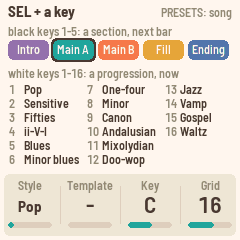

While playing, the change waits for the next bar. The Song page shows NEXT and the section until then.
While stopped, you choose the section PLAY starts with ("FIRST Main B").

**The fill rules:**

- Fill picks the right fill for you: Fill AB from Main A (it then goes on to Main B), Fill BA from
  Main B (it then goes back to Main A).
- A fill asked for during a fill adds another bar of fill.
- There's no fill in the Intro or the Ending: they play out ("NO FILL").
- If a style has no Fill BA, Fill AB plays instead, and the other way round.

**Starting and ending:**

- PLAY starts with the Intro when the style has one, and goes on to Main A. In a song, the mark on
  its first bar decides.
- The Ending plays once and stops. Without an Ending, Polly stops at the bar line.

### Intros and endings hold a chord

The Intro and the Ending play over one held chord, the QY70's way: they carry their own lead-in and
cadence. The chord on the section's first beat stays until it ends. A chord you play on the keys still
changes it at once.

### Tempo

Turn **SELECT**: 40 to 240 BPM. The tempo is shown at the top right. When Polly follows MIDI clock, it
shows "ext" instead.

## Chords

Polly's patterns are written as if the chord were C major 7. As it plays, it moves every note of every
track to fit the chord of the moment. There are three ways to give it chords: play them, pick a
progression, or write a song.

### Playing chords (CHORD)

Tap **SEL**. It lights, and CHORD shows in the header. Now the keys enter chords instead of playing
notes.

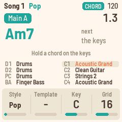

- Hold three or more different notes. Polly names the chord, shows it big on the Song page, and the
  band follows.
- The chord stays after you let go (fingered, as on an arranger keyboard). Play the next one whenever
  you like.
- Inversions work: E G C and G C E are both C. When the notes could be read two ways, the lowest note
  is taken as the root: A C E G is Am7, C E G A is C6, D F A C is Dm7.
- The lowest note is the bass. When it's the root, 3rd or 5th of the chord, you get that chord. Any other
  note at the bottom becomes a slash bass under the chord the notes above it make: D under C E G is
  C/D, F under C E G is C/F, B♭ under C E G is C/B♭. (For C7, put B♭ above the C: C E G B♭.)
- A chord may leave out its 5th: C E B♭ is C7 too.
- Two notes are not a chord: nothing changes.
- Playing a chord ends a progression that was playing.

Tap SEL again for the keys to play the selected track.

**The chord types** (25, plus "---", no chord):

| Major | Dominant | Minor | Other |
| --- | --- | --- | --- |
| maj | 7 | m | aug |
| add9 | 7(9) | madd9 | dim |
| M7 | 7(#9) | m7 | sus4 |
| M7(9) | 7(b9) | m7(9) | 7sus4 |
| 6 | 7(13) | m7(11) | --- |
| | 7(b13) | m6 | |
| | 7(#11) | mM7 | |
| | 7(#5) | m7(b5) | |

"---" is no chord: every track just moves with the root. You can pick it on the Chords page.

### Progressions (templates)

Polly has 16 chord progressions. Hold **SEL** and press a white key to play one at once. It loops until
you play a chord, pick another, or write a song.

| | | | |
| --- | --- | --- | --- |
| 1 Pop (I–V–vi–IV) | 5 Blues (12 bars) | 9 Canon | 13 Jazz (I–VI7–ii–V) |
| 2 Sensitive (vi–IV–I–V) | 6 Minor blues | 10 Andalusian | 14 Vamp (ii–V) |
| 3 Fifties (I–vi–ii–V) | 7 One-four | 11 Mixolydian (I–♭VII–IV) | 15 Gospel (IV–I) |
| 4 ii–V–I | 8 Minor (i–VI–III–VII) | 12 Doo-wop | 16 Waltz (3/4) |

They are written in C. **Key** (Song page KNOB 3, also on Templates and Setup) moves them to another
key, from −6 to +5 semitones (F♯ below C to F above it). Key moves the progressions only: songs are
written at real pitch.

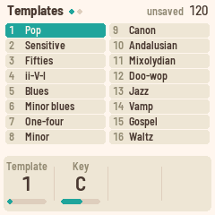

The Song page's KNOB 2 picks a progression too. The ARP button's Templates page lists them all: turn
KNOB 1 to browse. While playing you hear each one as you turn. While stopped, PLAY starts the one under
the cursor.

## Writing a song

A song is up to 64 bars. Each bar can mark a section, and each beat can hold a chord. A song with
bars plays its own chords and sections. Polly has four songs.

### The Chords page (LFO)

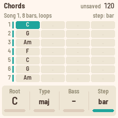

The song's bars, one row each, four beats a row. A dot means "no change": the chord before goes on.
The coloured stripe on the left is the section in effect.

- **PRESETS** moves the cursor.
- **KNOB 1** root, **KNOB 2** type, **KNOB 3** slash bass. Turn KNOB 2 below "maj" for "same" (no
  change).
- **KNOB 4** the step the cursor moves by: a beat, half a bar or a bar.
- **With CHORD on**, play a chord: it's written at the cursor, and the cursor moves on a step when you
  let go of all the keys. Add a note while still holding and the same beat is rewritten.

Writing past the song's end makes the song longer.

**Recording chords.** On the Chords page, press **REC**. CHORD turns on by itself. Press PLAY and play
chords along: each lands on the song's nearest beat. An empty song gets eight bars, looping, so there's
room to play into. Press REC again, or leave the page, to stop. While stopped, chords you play go in at
the cursor instead.

### Copying a progression into the song (ARP, ARP)

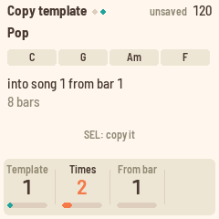

The quickest start. Press ARP twice for Copy template.

- **KNOB 1** the progression, **KNOB 2** how many times (1 to 8), **KNOB 3** (or PRESETS) the bar it
  starts at.
- Tap **SEL** to copy it in. Each of its chords goes on the first beat of a bar, in the current Key.

### The Arrange page (ENV)

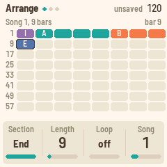

The song's 64 bars, eight to a row, coloured by section. A letter marks a bar where a section starts
(I, A, B, AB, BA, E).

- **PRESETS** moves the cursor a bar.
- **KNOB 1** the section mark at the cursor's bar ("-": none, the section before goes on).
- **KNOB 2** the song's length, in bars. 0 means no song: Polly plays freely, following your chords and
  progressions.
- **KNOB 3** Loop: on, the song goes round; off, it stops at its end.
- **KNOB 4** the song, 1 to 4.

PLAY starts the song at bar 1. A section asked for with SEL + a black key wins over the song's mark at
that bar.

### The song's patterns (ENV, ENV)

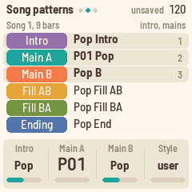

Every song chooses a pattern for each of its six sections. Press ENV again for Intro, Main A and Main B
(KNOB 1–3); once more for Fill AB, Fill BA and Ending. Each knob goes through the user patterns P01 to
P16, then the styles' patterns for that section by name ("Funk A", "Funk B"). So you can play Funk's
Main A with Rock's fills.

**KNOB 4** (and PRESETS) sets all six from one style, like the Song page's KNOB 1.

### Back to the song

Picking a progression (SEL + a white key, or the Song page's KNOB 2) sets the song aside and plays the
progression. The song comes back when you press PLAY on the Chords or Arrange pages, leave the
Templates pages, change the song or edit it.

## Recording a part

Polly records into the selected track of the section playing, as a loop.


1. Press **SEQ** for the Pattern page. It shows the eight tracks of the section playing, with their
   notes, and the playhead.
2. Turn **ALGORITHM** to pick the track. The keys play its sound.
3. Press **REC**. The red dot shows in the header and PLAY turns red.
4. Press **PLAY** and play. The pattern loops, and each pass adds to what's there (overdub). You hear
   a new note from the next pass.
5. Press **REC** again to stop recording. The pattern plays on.

Good to know:

- **The grid** (Pattern page KNOB 1, also Song page KNOB 4) moves notes to the nearest 8th, 8th
  triplet, 16th, 16th triplet or 32nd, or "off" for none.
- **Notes follow the chords.** What you play is stored as if over C major 7, so it follows later
  chords like the style's own parts.
- **Press REC before PLAY** and, with no song, the section you're recording into plays at once,
  without the Intro.
- **A section change ends the take**: a fill, an ending, or a song's mark. Polly says "RECORD OFF
  section ended". Record with no song, or on a section that loops.
- **A pattern holds 600 notes.** Past that, new notes are dropped.

### Your own patterns (copy-on-write)

The styles can't be changed. The first time you record into a style's section, or change it (its
sound, its mixer, its length, even a mute), Polly copies it into a free **user pattern** of the song's own, and
says so: "RECORD C1 into new P01" or "NEW PATTERN P01". From then on that section plays your copy.

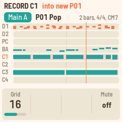

There are 16 user patterns, P01 to P16, shared by the four songs. A free one is one that no song plays
and that holds no notes. When none is free, Polly says **NO FREE PATTERN** "not kept": your change
plays, but it isn't kept once another pattern is picked. Use the Copy pattern job to keep it.

The Pattern page's **PRESETS** picks the pattern for the section playing: P01 to P16, then the styles'.

### Pattern setup (SEQ, SEQ)

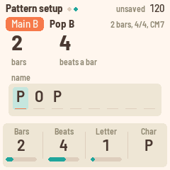

- **KNOB 1** bars, 1 to 8. **KNOB 2** beats a bar, 2 to 7. Notes past a shortened length are kept,
  just not played.
- **KNOB 3** picks a letter of the name, **KNOB 4** changes it. Names are eight letters, digits, "-"
  and "#".

### The pattern's jobs (hold SAVE)

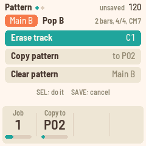

On the Pattern, Track, Mixer and Master FX pages, hold **SAVE** for the jobs. They act on the section
playing. **KNOB 1** picks the job, **KNOB 2** where a copy goes. Tap **SEL** to do it, **SAVE** to
cancel.

| Job | What it does |
| --- | --- |
| Erase track | Removes the selected track's notes |
| Copy pattern | Copies the pattern, as it is now, into P01–P16. Only while stopped |
| Clear pattern | Removes every note, keeps the sounds |

Erase and Clear on a style's section first give it a user pattern, as recording does.

## Sound

The sound pages show and change the section playing, track by track: ALGORITHM picks the track.

### Track (EDIT)

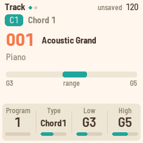

- **KNOB 1** the instrument: the 128 General MIDI programs. **PRESETS** jumps a family of eight
  (pianos, organs, guitars, basses...). A drum track plays the drum kit.
- **KNOB 2** the type: how the track follows the chords.
- **KNOB 3, KNOB 4** the low and high limits. A note outside them moves by octaves until it fits.

| Type | For | What it does |
| --- | --- | --- |
| Bypass | Drums | Never changes |
| Parallel | Riffs | Moves with the chord's root, keeping its shape |
| Chord 1 | Chords, arpeggios | Each note moves to the matching note of the new chord |
| Chord 2 | Pads | As Chord 1, and each note stays close to the one before, for smooth voice leading |
| Bass | Bass lines | As Chord 1, and the first note after a chord change is the root (or the slash bass) |

### Track keys (EDIT, EDIT)

- **KNOB 1** high key (C to B, or off): the highest root before a Chord 1 or Bass part drops an octave,
  so a bass line doesn't climb out of reach as the chords rise.
- **KNOB 2** the MIDI channel, 1 to 16. Drums are on 10.

### Mixer (FX)


Eight strips. For the selected track: **KNOB 1** volume, **KNOB 2** pan, **KNOB 3** reverb send,
**KNOB 4** chorus send. Tracks on the same channel share these (D1, D2 and PC are all on 10).

**Mute:** the Pattern page's KNOB 4 mutes or unmutes the selected track.

### Mixer tone (FX, FX)


**KNOB 1** Bright (the filter's cutoff) and **KNOB 2** Reso (its resonance) for the selected track. 64
is the instrument as it is. Lower Bright is darker; higher Reso is more pronounced.

### Master FX (FX, FX, FX)

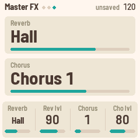

The effects all the tracks share: **KNOB 1** the reverb (Off, Large hall, Hall, Chamber, Room),
**KNOB 2** its level, **KNOB 3** the chorus (1 to 4), **KNOB 4** its level.


## Songs and saving

### Four songs

Polly keeps four songs. Each has its own chords, sections, length, loop and style (its six patterns).

To change songs, hold **SEL** and turn **PRESETS**, on any page, or turn **KNOB 4** on the Arrange
page. While playing, the new song waits until you stop ("SONG 2 after the stop"): loading a song saves
first, and saving pauses the sound for a moment.

### Saving

- **SAVE** lights, and "unsaved" shows in the header, while something isn't saved.
- Press **SAVE** to save now: the songs, the user patterns you've changed and the settings.
- Polly also saves by itself after about four seconds at rest: stopped, no key or button held, and
  the last notes faded.

Saving pauses the FM-1 for a moment, which is why it waits until you stop.

If two sections of a song play the same user pattern and both were changed, the newest change is kept,
and Polly says "SHARED PATTERN kept Main B".

### The song's jobs (hold SAVE)

On the Chords and Arrange pages, hold **SAVE** for the song's jobs. **KNOB 1** picks, **KNOB 2** the
song a copy goes to, **SEL** does it, **SAVE** cancels.

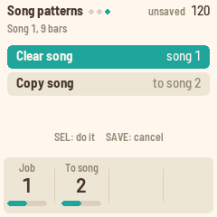

| Job | What it does |
| --- | --- |
| Clear song | Removes its chords and sections. Its patterns stay |
| Copy song | Copies it to another song. Its user patterns are copied into free ones, so the two songs don't share them. Only while stopped |

## Setup and MIDI

Press **GLO** for Setup.


| Knob | Sets |
| --- | --- |
| KNOB 1 Clock | **MIDI in** (the default): Polly keeps its own time, and follows MIDI clock, start and stop whenever they come in. **internal**: it ignores MIDI clock |
| KNOB 2 MIDI out | **on** (the default): the tracks go out over USB on their channels, with their sounds and mixer, and MIDI clock with start and stop while Polly keeps time. **off**: nothing goes out |
| KNOB 3 Key | The progressions' key (as on the Song page) |
| KNOB 4 Lights | **on**: keys light as you play, and the other buttons glow. **notes**: keys light, no glow. **off**: neither |

The last row shows the QY70 bank: none, the number of styles, "damaged" or "old format".

Press GLO again for the Panel: the processor's load, the voices sounding and the version.

**MIDI in** (USB and the TRS jack) plays Polly's sounds on all 16 channels, as a General MIDI sound
module, drums on channel 10. It plays alongside the arranger. Controllers 74 (brightness) and 71
(resonance) move each channel's filter, as the Mixer tone page does.

**USB:** the FM-1 shows up as a class-compliant MIDI device named "Polly FM-1". The FM-1 has no MIDI
out jack: MIDI out is USB only.

## The QY70 bank

The QY70 came with 128 preset styles. If you have its main ROM (a dump of the chip, the file MAME calls
`qy70main.bin`), Polly can build all 128 from it and play them next to its own 16. Polly contains none
of Yamaha's music: you bring the ROM, and the bank is for your own use.

### On the FM-1

Connect the FM-1 over USB and run, from this repository:

```sh
pip3 install mido python-rtmidi
python3 tools/qy70_install.py qy70main.bin
```

It builds the bank, asks before writing (`--yes` skips the question), and writes it in about 30
seconds. The FM-1 stops playing meanwhile. Polly checks everything it was sent before it uses it, so a
cut cable leaves no bank, never half of one: just run it again. Setup then shows "128 styles".

### In the browser

On the emulator's page, press **Load QY70 ROM** (or drop the file on the box). Your ROM stays on your
computer: the page builds the bank in your browser and keeps it there for your next visit. **Forget
QY70 styles** removes it.

### Playing them

The QY70 styles follow Polly's 16 on the Style knob (Song page KNOB 1, PRESETS, or the song's
patterns pages), marked "QY". They play with their own bends, swells and filter moves, and change
sections and styles without a gap. A song plays one QY70 style at a time: picking a section from
another one moves the song's other QY70 sections with it.

### What doesn't carry over

- **Drum kits.** Polly has one General MIDI kit. The QY70's brush, jazz, room and analog kits all play
  it.
- **XG voices.** Variations play their General MIDI instrument, and sound-effect voices a General MIDI
  effect.
- **Pan on the drum channel.** The drum tracks share one pan and one set of effects.
- **Editing.** Recording into or changing a QY70 section makes it a user pattern, as with Polly's own
  styles. Then the 600-note limit applies (the quietest short notes go first), and its bends and
  controllers are left out. Played as they are, QY70 styles have no note limit.

### Keeping it

The bank lives in the FM-1's memory next to your songs. Restoring M-VAVE's firmware wipes it. If
Setup shows "none" or "old format" after an update, install it again.

The QY70's styles are © Yamaha Corporation. Don't share the bank or anything built from your ROM.

## Updating and safety

These come from Felucca, the platform Polly is built on, and work as in the other FM-1 firmwares:

- **Update mode:** hold OCT− and OCT+ for 5 seconds. The screen counts down, then the FM-1 restarts
  ready for an update. Let go before then to cancel.
- **Safe mode:** if the FM-1 fails to start twice in a row, it starts in safe mode with only USB on, so
  the web installer can reach it. PLAY tries a normal start again.
- **Back to M-VAVE's firmware:** the web installer can put the original firmware back. M-VAVE's own
  updater, M-UPGRADE, works too.
- **Button calibration:** hold OCT− and OCT+ while switching on, then follow the screen. Only needed if
  buttons do the wrong thing.

Your songs and patterns stay through a Polly update.

## Credits

- **Felucca** by Leo Kuroshita (Hügelton Instruments): the platform under Polly (GPL-3.0), by way of
  X0X and FoMni. <https://github.com/hugelton/Felucca>
- **Sonivox EAS** (Sonic Network, The Android Open Source Project): the synth and its General MIDI
  sound set (Apache-2.0). <https://github.com/EmbeddedSynth/sonivox>
- **The Groove MIDI Dataset** by Jon Gillick, Adam Roberts, Jesse Engel, Douglas Eck and David Bamman
  (Google Magenta), © Google LLC: the drum performances in Polly's styles (CC BY 4.0), excerpted and
  quantised. <https://magenta.tensorflow.org/datasets/groove>
- **Groove OS** by Peter Gombos: the idea of running FM-1 firmware in the browser.
  <https://www.groove-os.com/>
- **qy100-toolkit**: its decoding of the QY70's pattern format helped read the ROM's styles.
  <https://github.com/doffu0000/qy100-toolkit>
- **Pyodide** (MPL-2.0) builds the QY70 bank in the browser.
- **Barlow** (The Barlow Project Authors, SIL OFL 1.1): the screen's typeface.

Polly is inspired by the Yamaha QY70; it is not affiliated with Yamaha. "M-VAVE" and "FM-1" are
trademarks of their owners. Polly is GPL-3.0 (see LICENSING.md).

## Page by page

ALGORITHM picks the track on every page. SEL held + PRESETS picks the song on every page.

| Page | Button | KNOB 1 | KNOB 2 | KNOB 3 | KNOB 4 | PRESETS |
| --- | --- | --- | --- | --- | --- | --- |
| Song | HOME | Style | Template | Key | Grid | Style |
| Pattern | SEQ | Grid | | | Mute | The section's pattern |
| Pattern setup | SEQ ×2 | Bars | Beats | Letter | Character | The section's pattern |
| Track | EDIT | Program | Type | Low | High | Program family |
| Track keys | EDIT ×2 | High key | Channel | | | |
| Mixer | FX | Volume | Pan | Reverb | Chorus | |
| Mixer tone | FX ×2 | Bright | Reso | | | |
| Master FX | FX ×3 | Reverb | Reverb level | Chorus | Chorus level | |
| Chords | LFO | Root | Type | Bass | Step | Cursor |
| Arrange | ENV | Section | Length | Loop | Song | Cursor (a bar) |
| Song patterns | ENV ×2 | Intro | Main A | Main B | Style | Style |
| Song patterns | ENV ×3 | Fill AB | Fill BA | Ending | Style | Style |
| Templates | ARP | Template | Key | | | Template |
| Copy template | ARP ×2 | Template | Times | From bar | | From bar |
| Setup | GLO | Clock | MIDI out | Key | Lights | |
| Panel | GLO ×2 | | | | | |
| Jobs | SAVE held | Job | Copy to | | | |

Other buttons by page:

| Page | Button | Does |
| --- | --- | --- |
| Templates | PLAY (stopped) | Starts the progression under the cursor |
| Chords | REC | Records chords into the song |
| Chords, Arrange | PLAY | Brings the song back after a progression, and starts |
| Copy template | SEL | Copies the progression into the song |
| Jobs | SEL / SAVE | Do it / cancel |
| Pattern to Master FX | SAVE held | The pattern's jobs |
| Chords, Arrange | SAVE held | The song's jobs |
