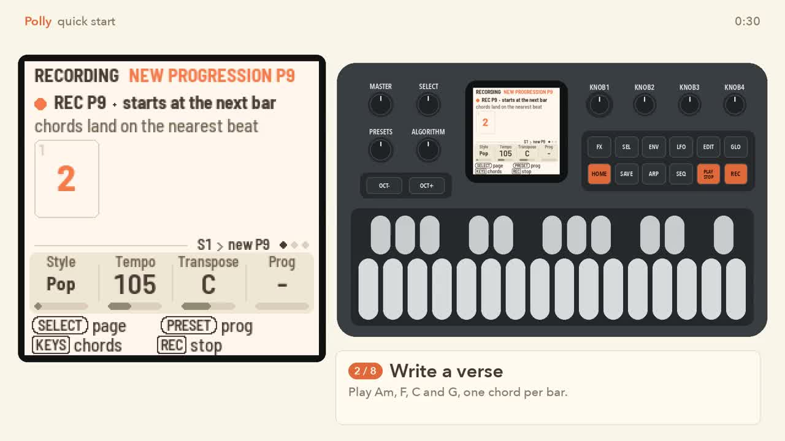
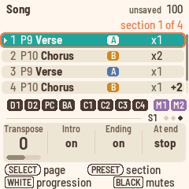

# Polly quick start

Polly turns your M-VAVE FM-1 into a pocket arranger. You play chords, and a band of eight instruments plays
along. This page takes you from switching on to your first song in a few minutes.

## Install

Install Polly with the web installer (`web/polly_installer.html`, in Chrome or Edge). Or install it over USB
from this repository with `python3 tools/fm1_install.py polly.fwsc`. Charge the FM-1 first, and keep the
computer awake and the USB cable in until the install is done.

## The controls you need

- **KNOB 1–4**: set the four values shown at the bottom of the screen. Each knob's name is shown there too.
- **PLAY**: starts and stops.
- **REC**: starts recording. Press it again to stop.
- **HOME**: opens the Home page, where you pick a style and play. Press it again for the Song page, where
  you build a song. Hold it for shortcuts, which show on the screen.
- **SELECT** (the encoder): turn it to move to a button's next page.
- **SEL** (the button): opens a list of what you can do on this page. When Polly asks a question, **SEL**
  means yes and **HOME** means no.
- **ARP**: opens the Progression page, the chord editor, where you fix, name and lengthen progressions.
- **EDIT** and **ALGORITHM**: **EDIT** opens the Sound page. **ALGORITHM** (the encoder) picks which
  instrument or melody you're working on.
- **SAVE**: saves. Polly also saves by itself when stopped.
- **The keys**: white keys are counted from the left, 1 to 16. Black keys are counted the same way, 1 to 11.

Not sure what a button does? Hold it for a second, and a card explains it.

## Three words first

- A **style** is a band: drums, bass, chords and more, with two grooves, A (plainer) and B (busier).
- A **progression** is a row of chords, one or more per bar, that the band plays in a loop. There are 16,
  P1 to P16. P1–P8 come ready-made. P9–P16 start empty, for your own.
- A **song** is a list of **sections**. Each section plays one progression with one groove.

## Write a song

You'll write a verse and a chorus, build a song from them, and play it.

*The eight steps below, from a fresh start. Each step pauses so you can follow along.*

1. **Pick a style.** Switch on. You're on the Home page. Turn **KNOB 1** (Style) to pick a style, such as
   Pop or Funk. Press **PLAY**, then play a chord with three keys or more. The band follows your chord.
2. **Write a verse.** Press **REC** to record a progression. Play Am, F, C and G, one chord per bar, then
   press **REC** again to stop. Your chords are saved as progression P9, the first of the empty ones you can
   write into, and the band plays them in a loop.
3. **Name it.** Press **ARP** to open the Progression page, the chord editor. Turn **SELECT** to page 2. Turn
   **KNOB 4** (Name) to "Verse".
4. **Write a chorus.** Press **HOME** to go back to the Home page. Turn **KNOB 4** (Prog, the progression the
   band plays) anticlockwise, past P1, to "–". The band is free again and follows your hands. Press **REC**,
   play C, G, Am and F, then press **REC**. That's P10, the next empty one. Name it "Chorus" the same way as
   in step 3.
5. **Build the song.** Press **HOME** twice: once for Home, again for the Song page. On this page each white key
   adds a section that plays that progression: white key 9 adds P9, white key 10 adds P10. Press white keys
   9, 10, 9 and 10. You now have four sections: verse, chorus, verse, chorus.
6. **Make the chorus bigger.** Turn **KNOB 1** (Section) to choose section 2, the first chorus. Turn
   **KNOB 3** (Groove) to B, the busier groove. Turn **KNOB 1** to section 4 and **KNOB 3** to B too.
7. **Play the song.** Press **PLAY** on the Song page. The song takes over at the next bar. You hear your
   sections with fills between them, then an Ending.
8. **Save.** Press **SAVE**, or just stop. Polly saves by itself.

*A finished song, playing section 1. This one also has a repeat (x2) and a transpose (+2).*

Made a mistake? Hold **HOME** and press **REC** to undo. Hold **HOME** and press **PLAY** to redo.

## Where to go next

- [The course](docs/course/README.md): ten short lessons, each with a video, from playing live to MIDI.
- [Cheat sheet](MANUAL.md#cheat-sheet): the words, the common tasks and every button on one page.
- [The manual](MANUAL.md): every page, knob and setting.
