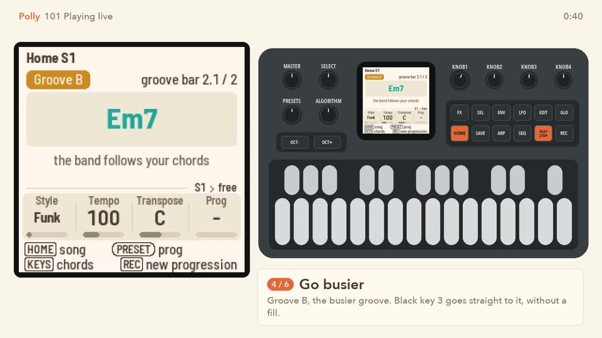
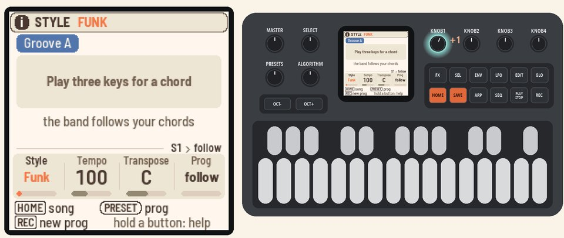
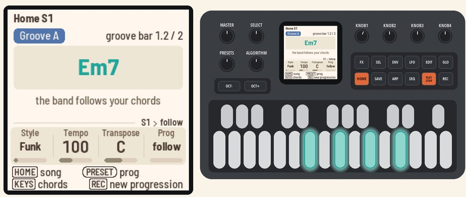
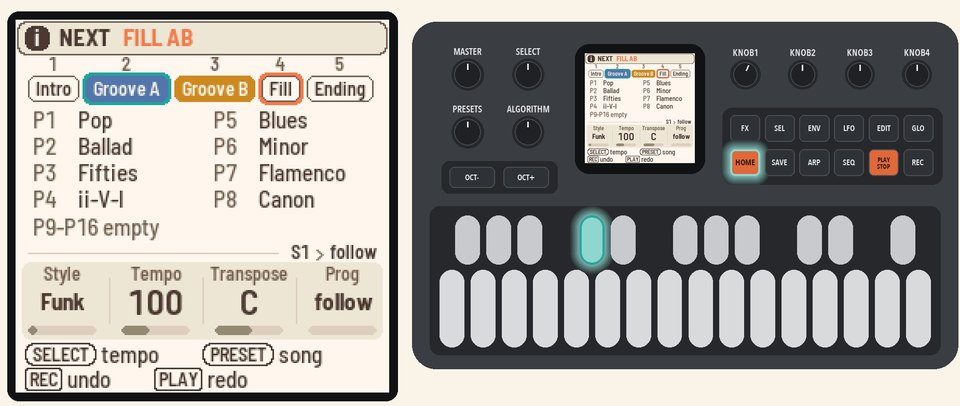
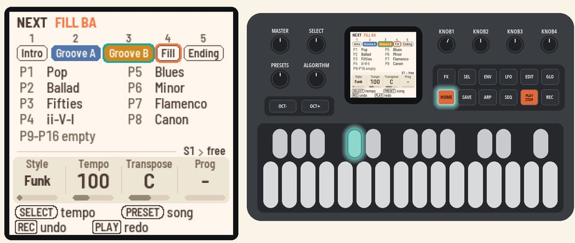
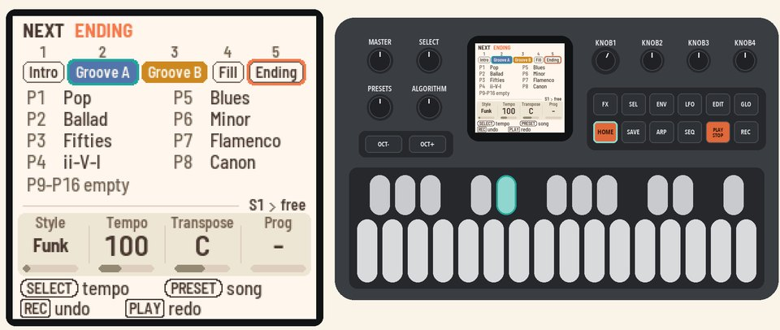

# 101 Playing live

Pick a style, play chords, and the band follows.

<table>
<tr><td width="38%" valign="top"><h3>1. Pick a style</h3>On Home, turn <b>KNOB 1</b> (Style). Try Funk.</td><td></td></tr>
<tr><td width="38%" valign="top"><h3>2. Play</h3>Press <b>PLAY</b>, then hold three keys or more. Polly names the chord and the band follows it.  The chord stays when you let go, so play the next one whenever you like. Try Em7 and A7, two bars each.</td><td></td></tr>
<tr><td width="38%" valign="top"><h3>3. Go busier</h3>Hold <b>HOME</b> and press black key 4. At the next bar, a fill plays, then the busier groove, Groove B.</td><td></td></tr>
<tr><td width="38%" valign="top"><h3>4. Come back down</h3>Hold <b>HOME</b> and press black key 4 again. A fill plays, then Groove A again.</td><td></td></tr>
<tr><td width="38%" valign="top"><h3>5. End it</h3>Hold <b>HOME</b> and press black key 5. The Ending plays, then Polly stops by itself.</td><td></td></tr>
</table>

## More in the manual

[Picking a style](../../MANUAL.md#picking-a-style), [Playing chords](../../MANUAL.md#playing-chords) (every
chord Polly knows), [Changing grooves](../../MANUAL.md#changing-grooves) (the Intro and the other black keys),
[Tempo](../../MANUAL.md#tempo).

Next: [102 Your own progressions](102-your-own-progressions.md)
