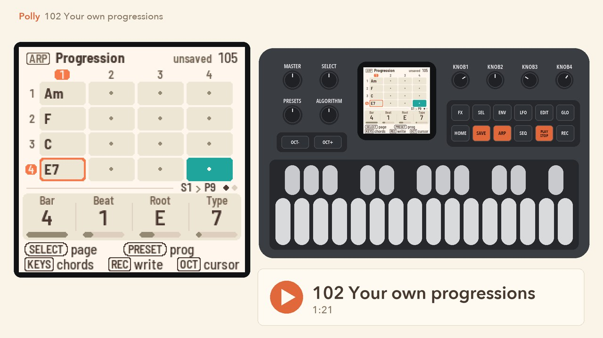
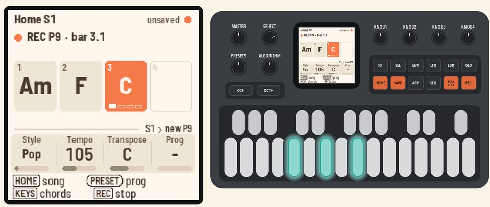
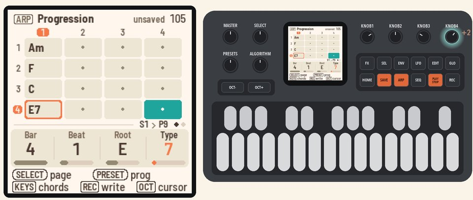
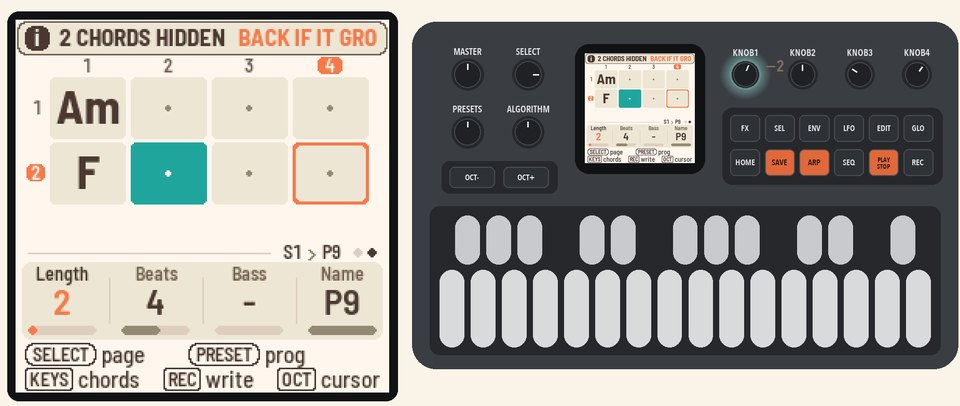
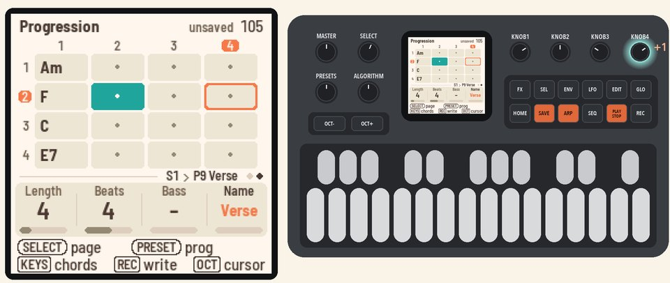
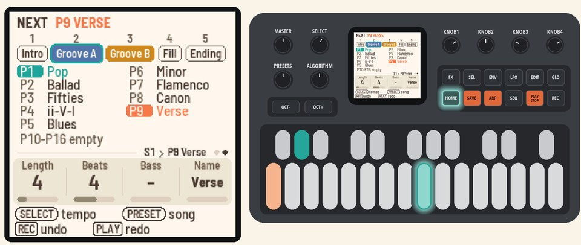

# 102 Your own progressions

Record your own chords, fix one, change the length, name it, and switch progressions from any page.

<table>
<tr><td width="38%" valign="top"><h3>1. Record a progression</h3>Start with a new song: press <b>HOME</b> for the Song page, press <b>SEL</b>, turn <b>SELECT</b> to NEW SONG and press <b>SEL</b> twice. Press <b>HOME</b> to go back.  On the Home page, press <b>PLAY</b>, then <b>REC</b>. A click counts in to the next bar.  Play Am, F, C and G, one chord per bar, then press <b>REC</b> again. Your chords become P9, the first empty progression, and the band plays them in a loop.</td><td></td></tr>
<tr><td width="38%" valign="top"><h3>2. Fix a chord</h3>Press <b>ARP</b> for the Progression page, the chord editor. Turn <b>KNOB 1</b> (Bar) to bar 4.  Turn <b>KNOB 3</b> (Root) to E and <b>KNOB 4</b> (Type) to 7. G becomes E7.</td><td></td></tr>
<tr><td width="38%" valign="top"><h3>3. Change the length</h3>Turn <b>SELECT</b> to page 2, then turn <b>KNOB 1</b> (Length) to 2. The band plays Am and F, and Polly hides the other two chords.  Turn <b>KNOB 1</b> back to 4. The hidden chords come back.</td><td></td></tr>
<tr><td width="38%" valign="top"><h3>4. Name it</h3>Turn <b>KNOB 4</b> (Name) to Verse.</td><td></td></tr>
<tr><td width="38%" valign="top"><h3>5. Switch progressions</h3>Hold <b>HOME</b> and press white key 1. P1, the first ready-made progression, plays from the next bar.  Hold <b>HOME</b> and press white key 9. Your Verse comes back at the next bar. This works on every page.</td><td></td></tr>
</table>

## More in the manual

[Chords](../../MANUAL.md#chords) (every chord type), [Progressions](../../MANUAL.md#progressions),
[The Progression page (ARP)](../../MANUAL.md#the-progression-page-arp) (writing while stopped, the step, the list),
[Home's Prog knob](../../MANUAL.md#homes-prog-knob).

Next: [103 Your song](103-your-song.md)
