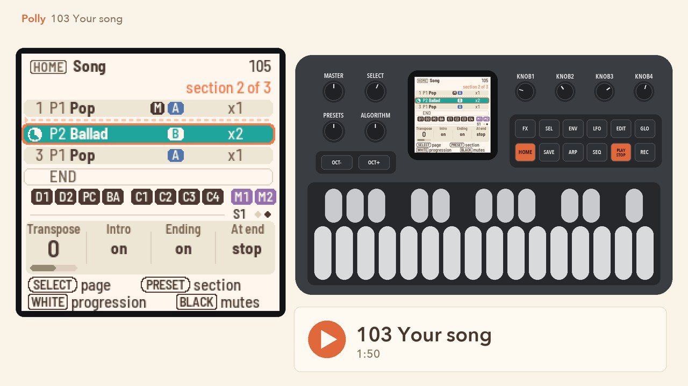
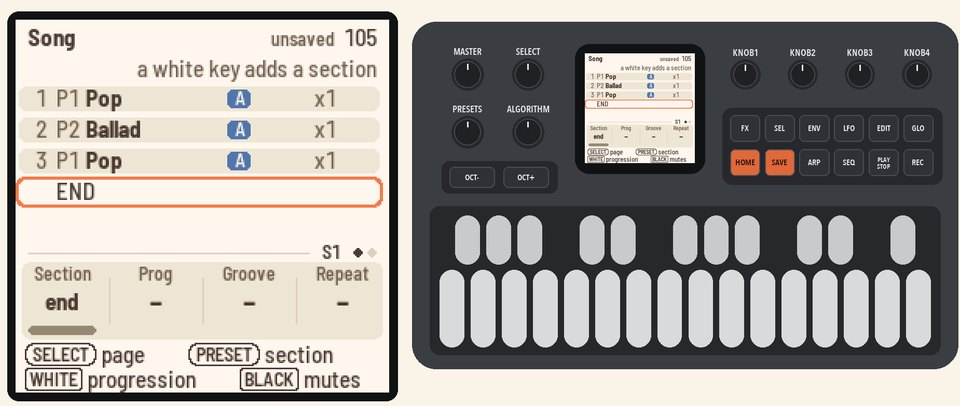
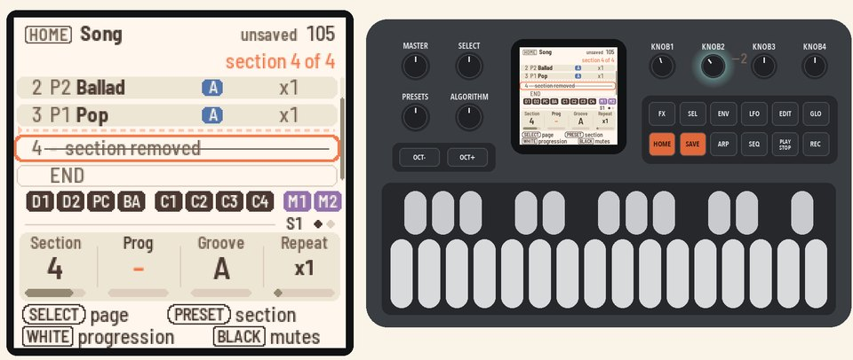
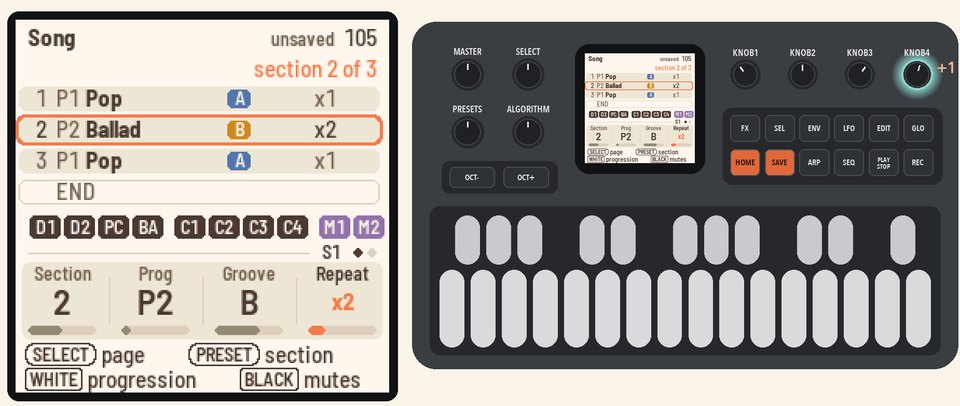
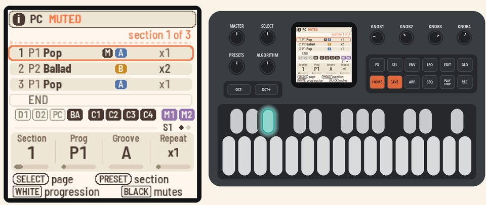
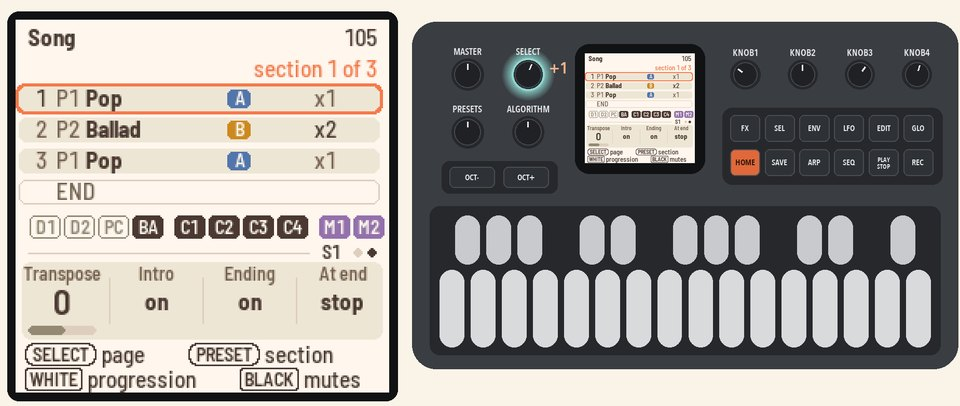
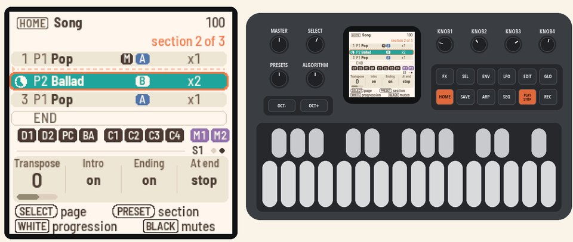

# 103 Your song

Build a song from two progressions, remove a section, shape the others, and play it.

<table>
<tr><td width="38%" valign="top"><h3>1. Add sections</h3>On Home, press <b>HOME</b> for the Song page. Press white keys 1, 2, 1 and 2.  Each key adds a section that plays its progression: P1 Pop, P2 Ballad, P1 Pop, P2 Ballad.</td><td></td></tr>
<tr><td width="38%" valign="top"><h3>2. Remove a section</h3>Turn <b>KNOB 1</b> (Section) to section 4. Turn <b>KNOB 2</b> (Prog) down, past P1, to "–". The section is struck through: "section removed". It goes when you leave the Song page.  Press <b>HOME</b> for the Home page, and <b>HOME</b> again for the Song page. Section 4 is gone.</td><td></td></tr>
<tr><td width="38%" valign="top"><h3>3. Shape a section</h3>Turn <b>KNOB 1</b> (Section) to section 2.  Turn <b>KNOB 3</b> (Groove) to B, the busier groove, and <b>KNOB 4</b> (Repeat) to x2.</td><td></td></tr>
<tr><td width="38%" valign="top"><h3>4. Mute an instrument</h3>Turn <b>KNOB 1</b> (Section) to section 1. Press black keys 1, 2 and 3. D1, D2 and PC, the drums, rest in that section.</td><td></td></tr>
<tr><td width="38%" valign="top"><h3>5. Intro and ending</h3>Turn <b>SELECT</b> to page 2. <b>KNOB 2</b> (Intro) and <b>KNOB 3</b> (Ending) are on.  <b>KNOB 4</b> (At end) is on stop: the song stops after the Ending.</td><td></td></tr>
<tr><td width="38%" valign="top"><h3>6. Play the song</h3>Press <b>PLAY</b>. The Intro plays first, and its clock fills at the top.  Then each section plays in turn, and its clock fills as it plays. After section 3, the Ending plays and the song stops.</td><td></td></tr>
</table>

## More in the manual

[The Song page (HOME, HOME again)](../../MANUAL.md#the-song-page-home-home-again) (every knob, the mutes, the
clocks).

Next: [104 Changing styles](104-changing-styles.md)
