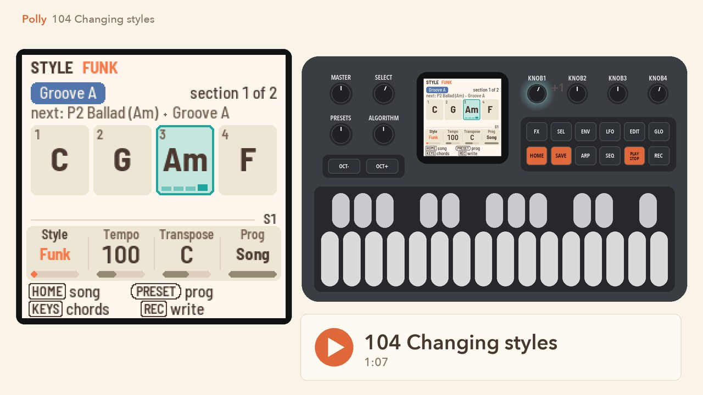
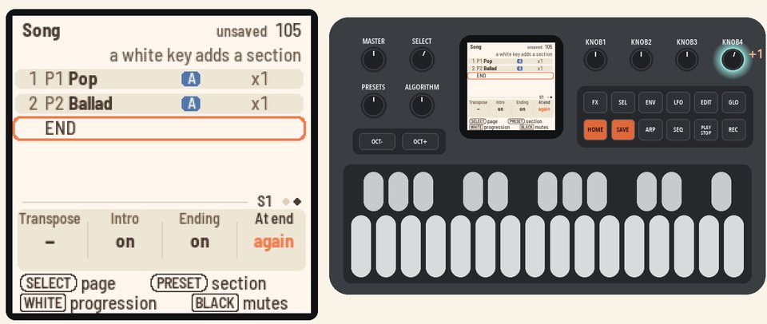
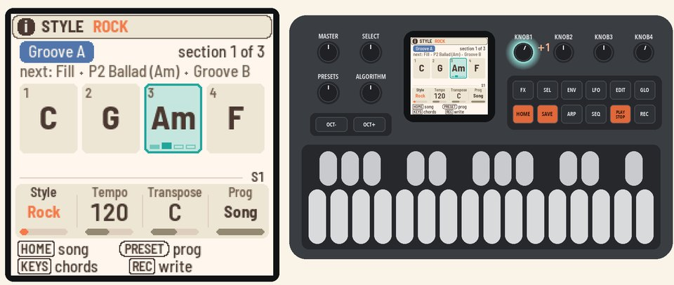
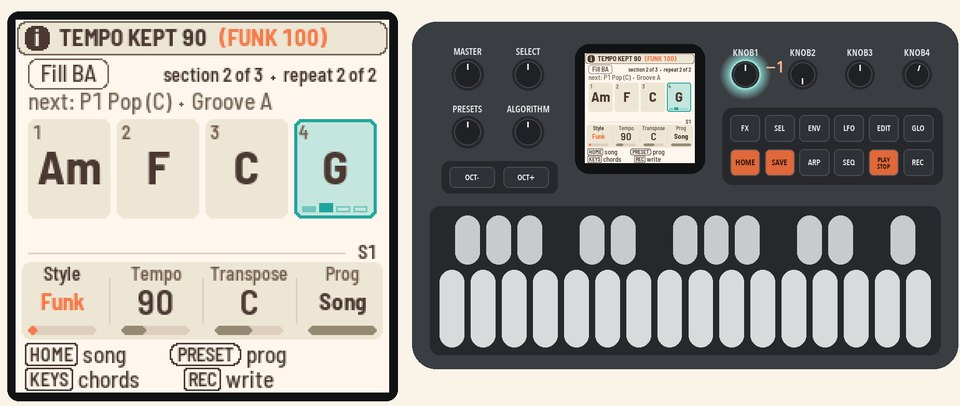
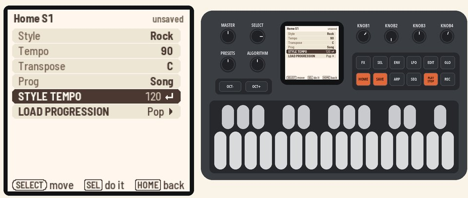

# 104 Changing styles

Play your song in another style, and choose its tempo.

Picks up where [103](103-your-song.md) left off, on page 2 of the Song page with your song of three sections. Any song works.

<table>
<tr><td width="38%" valign="top"><h3>1. Loop the song</h3>On page 2 of the Song page, turn <b>KNOB 4</b> (At end) to "again". Press <b>PLAY</b>, and the song plays over and over.</td><td></td></tr>
<tr><td width="38%" valign="top"><h3>2. Change the style</h3>Press <b>HOME</b> for the Home page. Turn <b>KNOB 1</b> (Style) to Rock.  The song keeps its sections and chords, but now it has Rock's band and tempo.</td><td></td></tr>
<tr><td width="38%" valign="top"><h3>3. Set your own tempo</h3>Turn <b>KNOB 2</b> (Tempo) to 90. Turn <b>KNOB 1</b> (Style) back to Funk.  Funk's band comes in, but your tempo stays at 90.</td><td></td></tr>
<tr><td width="38%" valign="top"><h3>4. Use the style's tempo</h3>Press <b>SEL</b>, and the list opens on STYLE TEMPO 100. Press <b>SEL</b> again to use it.  From now on, each style brings its own tempo again. Turn <b>KNOB 1</b> to Pop, and the tempo goes to 105.  Press <b>PLAY</b> to stop.</td><td></td></tr>
</table>

## More in the manual

For how a style sets the tempo, and what happens to grooves that are yours, see
[Picking a style](../../MANUAL.md#picking-a-style). See also [Your own copy (yours)](../../MANUAL.md#your-own-copy-yours)
and [Tempo](../../MANUAL.md#tempo).

Next: [105 Recording a melody](105-recording-a-melody.md)
