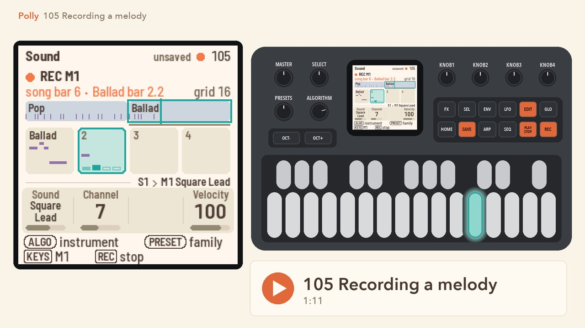
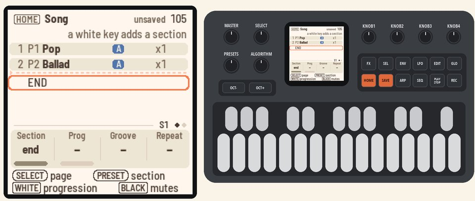
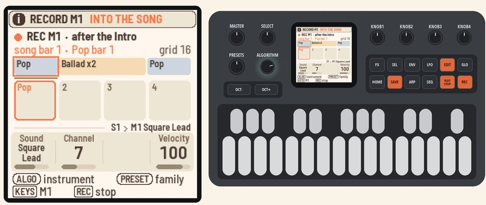
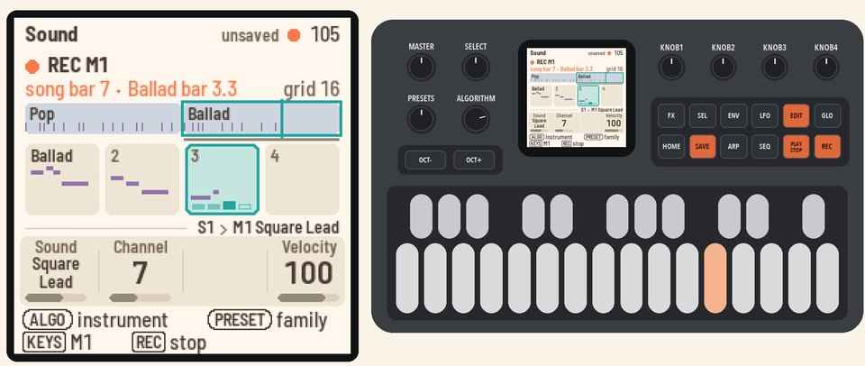
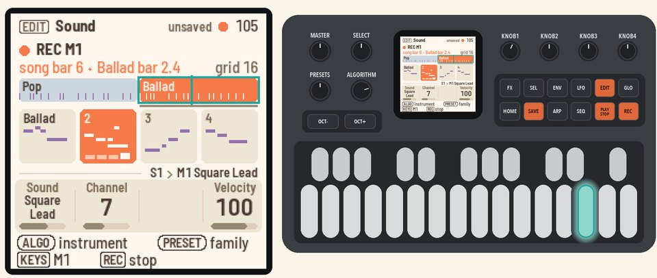
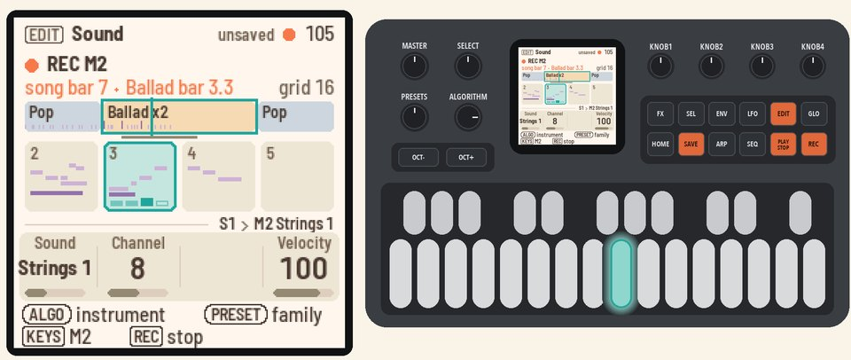

# 105 Recording a melody

Record a melody along a short song, punch in on a section, and add a second melody.

<table>
<tr><td width="38%" valign="top"><h3>1. Make a short song</h3>On Home, press <b>HOME</b> for the Song page. Press white key 1, then white key 2. The song now has two sections: P1 Pop and P2 Ballad.</td><td></td></tr>
<tr><td width="38%" valign="top"><h3>2. Arm M1</h3>Press <b>PLAY</b>. Press <b>EDIT</b>, turn <b>ALGORITHM</b> past C4 to M1, and press <b>REC</b>. Recording waits for the Intro to end.</td><td></td></tr>
<tr><td width="38%" valign="top"><h3>3. Play a line</h3>Play a line across both sections. The whole song runs along the top as one line, with four bars below it. Your notes land on both.  Press <b>REC</b> again to stop recording. The Ending plays, then the song stops.</td><td></td></tr>
<tr><td width="38%" valign="top"><h3>4. Punch in</h3>Press <b>HOME</b> twice for the Song page, and turn <b>KNOB 1</b> (Section) to section 2. Press <b>EDIT</b>, then <b>REC</b> and <b>PLAY</b>. The click counts in one bar, then the song starts at section 2. Play a few notes, then press <b>REC</b> and <b>PLAY</b>.</td><td></td></tr>
<tr><td width="38%" valign="top"><h3>5. A second melody</h3>Turn <b>ALGORITHM</b> to M2. Press <b>REC</b> and <b>PLAY</b>, and after the count-in play a second line. M1's notes show pale under it. Press <b>REC</b> and <b>PLAY</b> to stop.</td><td></td></tr>
</table>

## More in the manual

[Melodies](../../MANUAL.md#melodies) (where it is, clearing and copying a section's melody, a melody's sound),
[The Song page](../../MANUAL.md#the-song-page-home-home-again), [Good to know](../../MANUAL.md#good-to-know)
(the grid, quantise).

Next: [106 Your own grooves](106-your-own-grooves.md)
