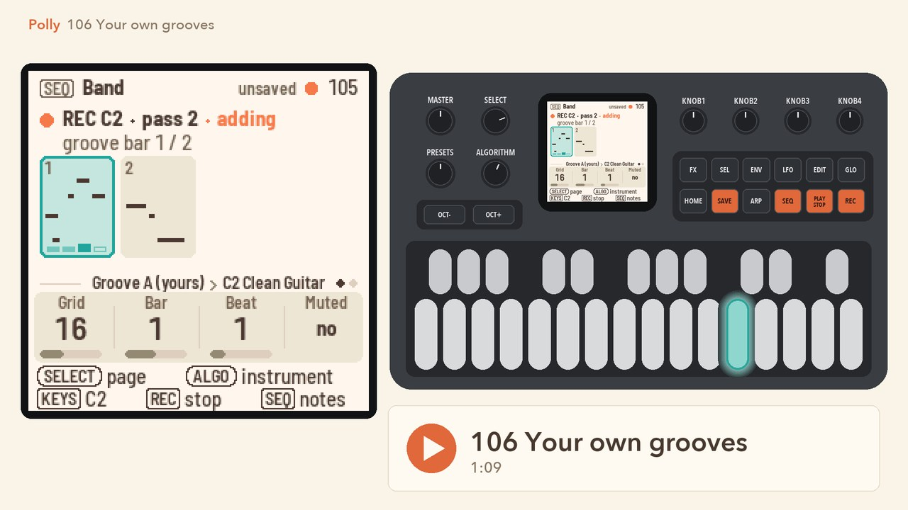
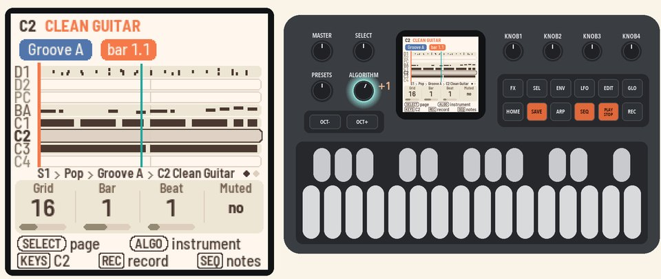
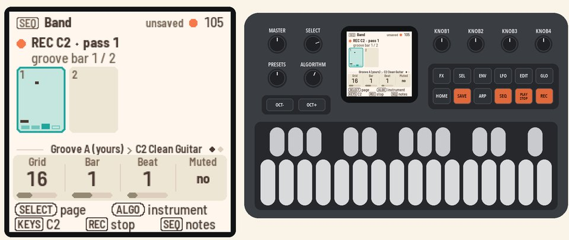
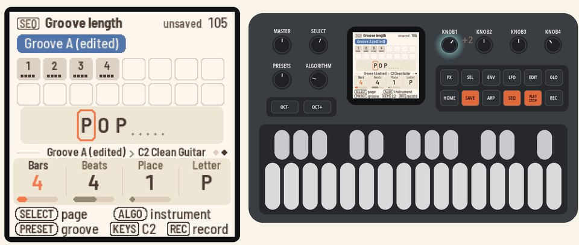
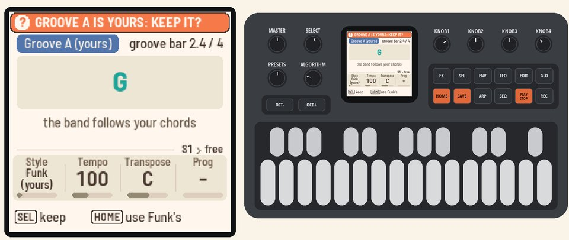
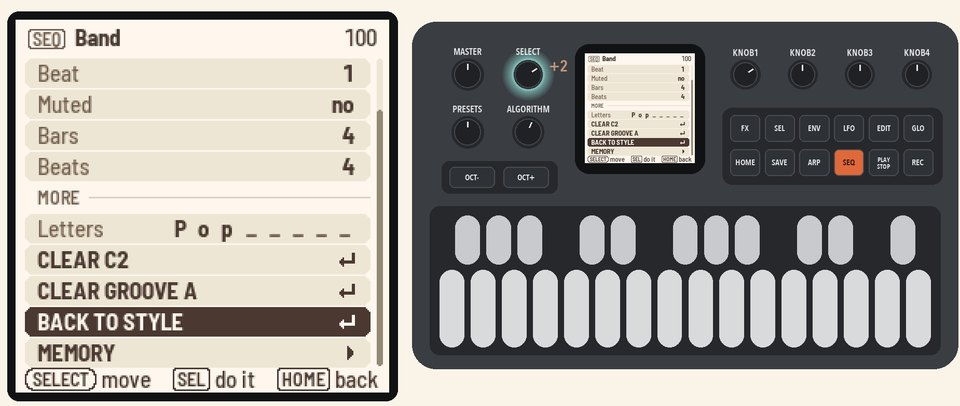

# 106 Your own grooves

Record an instrument into the style's groove, and the groove becomes yours.

<table>
<tr><td width="38%" valign="top"><h3>1. Pick an instrument</h3>Press <b>PLAY</b>. Press <b>SEQ</b> for the Band page, and turn <b>ALGORITHM</b> to C2. The keys play its sound.</td><td></td></tr>
<tr><td width="38%" valign="top"><h3>2. Record</h3>Press <b>REC</b>. Groove A is now your own copy, and its name says Groove A (yours). Play from the next bar.  The groove loops, and each pass adds to what you played. Press <b>REC</b> again to stop recording.</td><td></td></tr>
<tr><td width="38%" valign="top"><h3>3. Make it longer</h3>Turn <b>SELECT</b> to the Groove length page. Turn <b>KNOB 1</b> (Bars) to 4. The new bars repeat the groove.</td><td></td></tr>
<tr><td width="38%" valign="top"><h3>4. Change the style</h3>Press <b>HOME</b> and turn <b>KNOB 1</b> (Style) to Funk. Polly asks "GROOVE A IS YOURS: KEEP IT?"  Press <b>SEL</b> to keep it. Your Groove A plays with Funk's band.</td><td></td></tr>
<tr><td width="38%" valign="top"><h3>5. Back to the style</h3>Press <b>PLAY</b> to stop. Press <b>SEQ</b>, then <b>SEL</b>. Turn <b>SELECT</b> to BACK TO STYLE and press <b>SEL</b>. Groove A plays Funk's groove again, and your copy stays in memory.</td><td></td></tr>
</table>

## More in the manual

[Recording an instrument](../../MANUAL.md#recording-an-instrument), [The Band page](../../MANUAL.md#the-band-page),
[(yours): your own copy](../../MANUAL.md#yours-your-own-copy),
[Groove length](../../MANUAL.md#groove-length-seq-select), [The groove's actions](../../MANUAL.md#the-grooves-actions-sel),
[Picking a style](../../MANUAL.md#picking-a-style) (keeping your grooves), [Memory](../../MANUAL.md#memory) (copying a
groove into a place with **SAVE**).

Next: [107 Fixing notes](107-fixing-notes.md)
