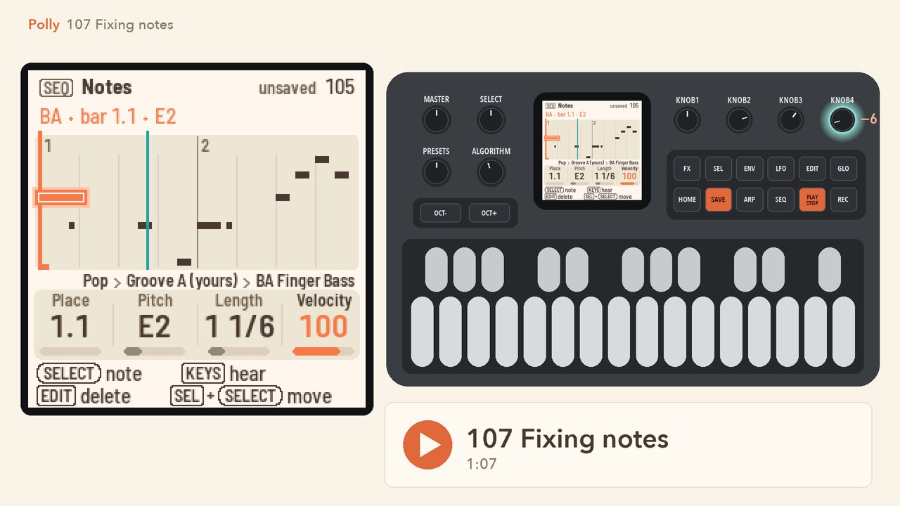
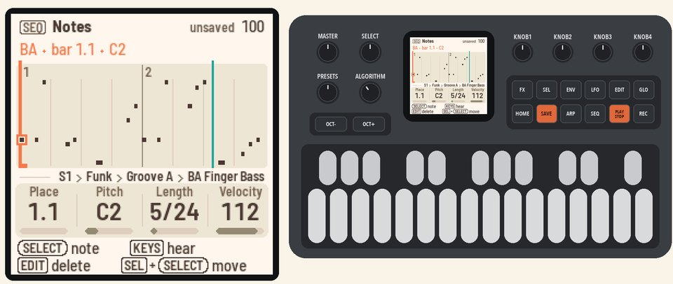
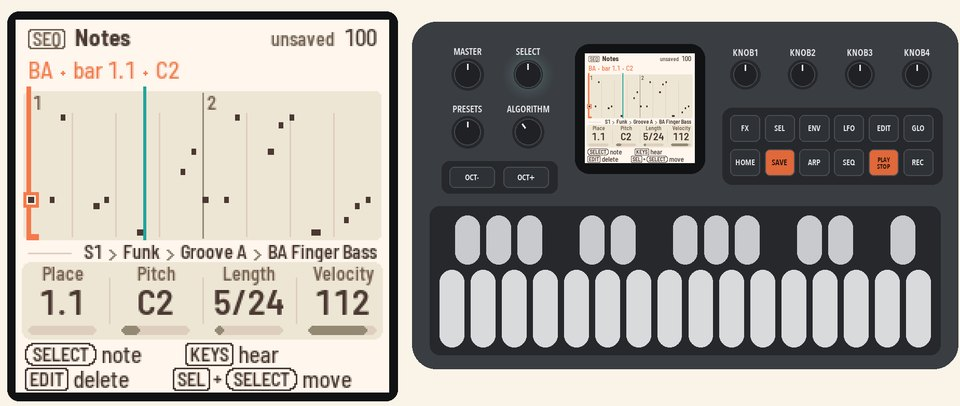
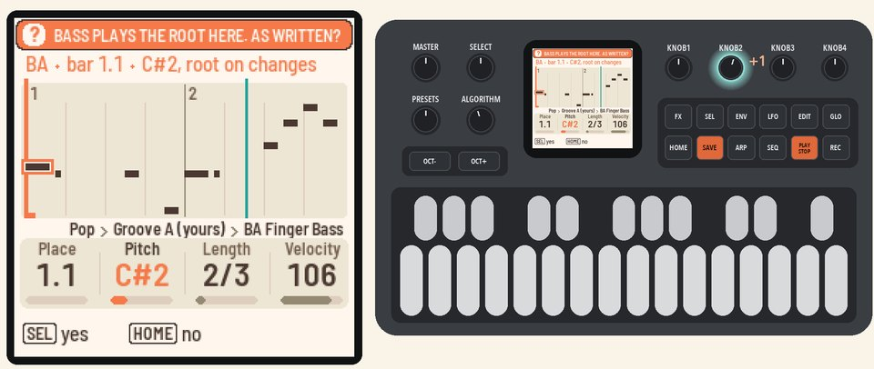
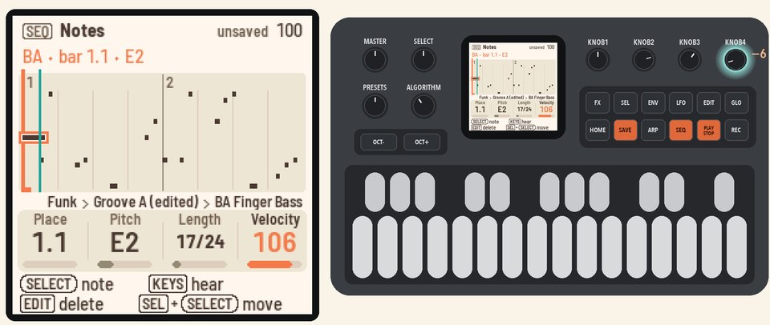
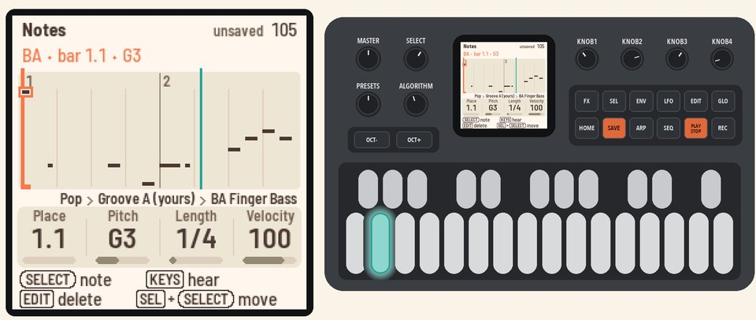
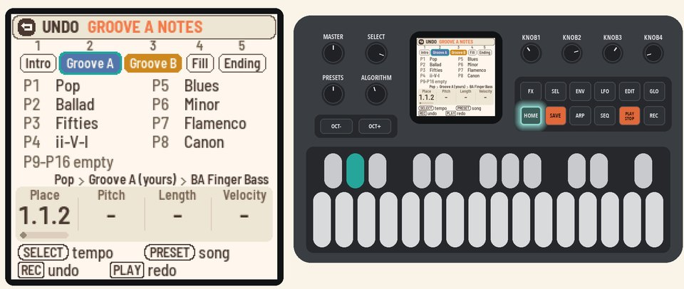

# 107 Fixing notes

Change, move, delete and enter single notes, without recording again.

<table>
<tr><td width="38%" valign="top"><h3>1. Open Notes</h3>Start with a new song: press <b>HOME</b> for the Song page, press <b>SEL</b>, turn <b>SELECT</b> to NEW SONG and press <b>SEL</b> twice. Press <b>HOME</b> to go back.  Press <b>PLAY</b>. Press <b>SEQ</b> for the Band page, turn <b>ALGORITHM</b> to BA, the bass, then press <b>SEQ</b> again.  Notes shows the bass's notes as a piano roll.</td><td></td></tr>
<tr><td width="38%" valign="top"><h3>2. Pick a note</h3>Turn <b>SELECT</b>. It steps from note to note. The selected note is ringed in coral, and the line at the top names it.  Come back to the first note, C2 at bar 1.1.</td><td></td></tr>
<tr><td width="38%" valign="top"><h3>3. Change its pitch</h3>Turn <b>KNOB 2</b> (Pitch) one step. Here the bass plays the chord's root, so Polly asks "BASS PLAYS THE ROOT HERE. AS WRITTEN?"  Press <b>SEL</b> (yes), and the bass plays your notes as written. Keep turning to E2.</td><td></td></tr>
<tr><td width="38%" valign="top"><h3>4. Change its length and velocity</h3>Turn <b>KNOB 3</b> (Length) up to make the note longer. Turn <b>KNOB 4</b> (Velocity) down to play it softer.</td><td></td></tr>
<tr><td width="38%" valign="top"><h3>5. Move it</h3>Hold <b>SEL</b> and turn <b>SELECT</b>. The note moves one grid step per detent.</td><td></td></tr>
<tr><td width="38%" valign="top"><h3>6. Delete a note, enter one</h3>Press <b>EDIT</b>. The selected note is deleted.  Turn <b>KNOB 1</b> (Place) to an empty place, then play a key. The note goes in there.</td><td></td></tr>
<tr><td width="38%" valign="top"><h3>7. Undo</h3>Hold <b>HOME</b> and press <b>REC</b>. The last edit is undone, and the header says what.</td><td></td></tr>
</table>

## More in the manual

[Fixing notes](../../MANUAL.md#fixing-notes) (drums, melodies, zoom and erasing while recording),
[Undo](../../MANUAL.md#undo).

Next: [108 Making it sound yours](108-making-it-sound-yours.md)
