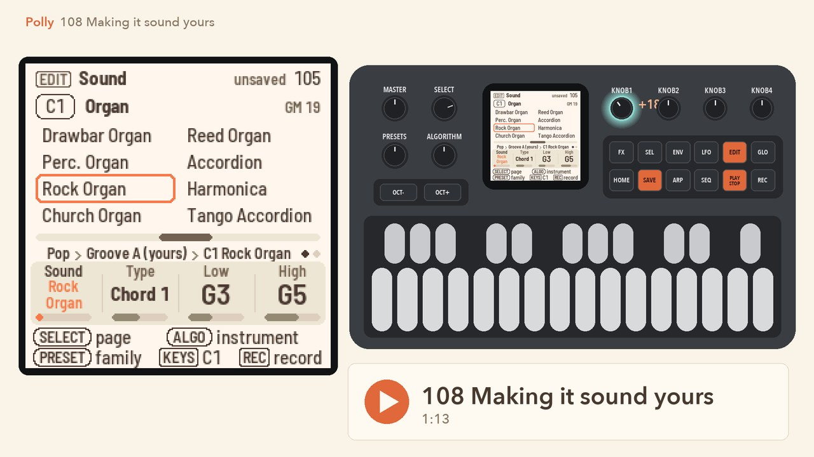
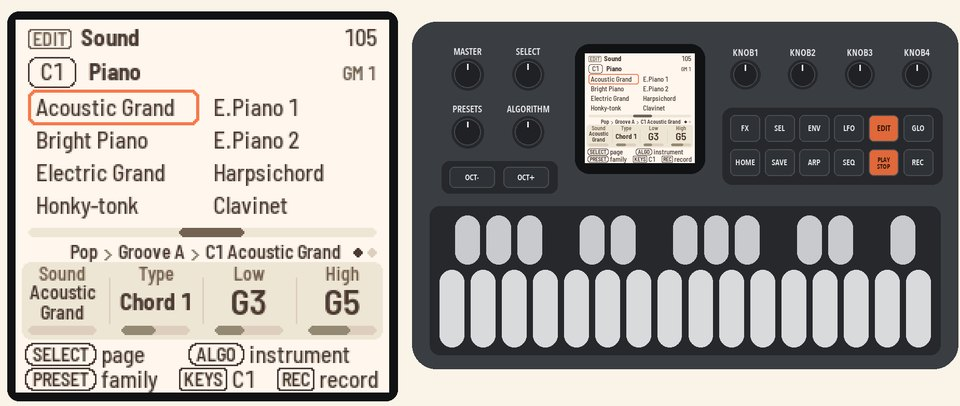
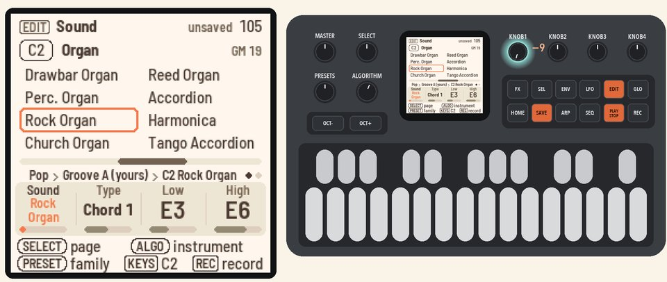
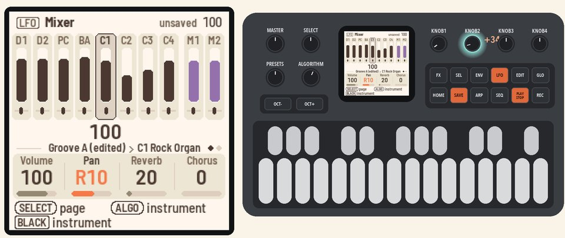
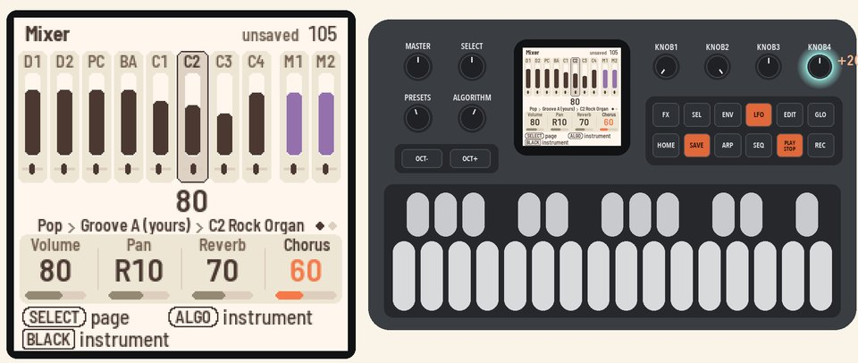
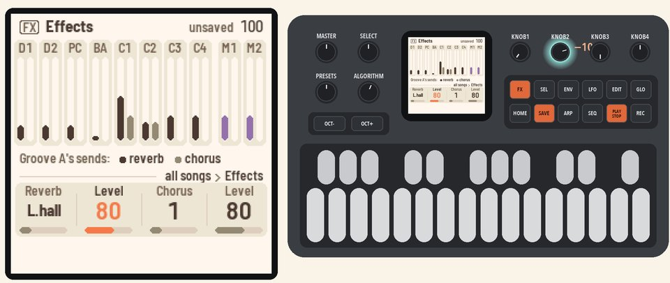
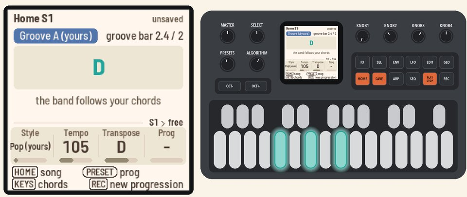

# 108 Making it sound yours

Change an instrument's sound, mix it, set the effects and move the key.

Picks up where [107](107-fixing-notes.md) left off, with Polly stopped in Notes, Funk as the style and Groove A yours.

<table>
<tr><td width="38%" valign="top"><h3>1. Open the Sound page</h3>Press <b>HOME</b> for the Home page, then <b>PLAY</b>. Press <b>EDIT</b> for the Sound page. It opens on BA, which you picked in 107.  Turn <b>ALGORITHM</b> one step to C1. In Funk, C1 plays a clavinet.</td><td></td></tr>
<tr><td width="38%" valign="top"><h3>2. Pick a sound</h3>Turn <b>KNOB 1</b> (Sound) up to Rock Organ. The clavinet part now plays on an organ.  The line above the knobs says Groove A (edited). Your note edits in 107 made an edited copy of the groove, so the new sound goes into that copy.</td><td></td></tr>
<tr><td width="38%" valign="top"><h3>3. Mix it</h3>Press <b>LFO</b> to open the Mixer on C1. Turn <b>KNOB 1</b> (Volume) to 100, and <b>KNOB 2</b> (Pan) to R10.</td><td></td></tr>
<tr><td width="38%" valign="top"><h3>4. Add space</h3>Turn <b>KNOB 3</b> (Reverb) to 70 and <b>KNOB 4</b> (Chorus) to 40. These set how much of C1 goes to the reverb and the chorus.</td><td></td></tr>
<tr><td width="38%" valign="top"><h3>5. Set the effects</h3>Press <b>FX</b> for the Effects page. Turn <b>KNOB 1</b> (Reverb) to L.hall for a large hall, and <b>KNOB 2</b> (Level) to 80.  The bars show how much each instrument sends to the effects.</td><td></td></tr>
<tr><td width="38%" valign="top"><h3>6. Move the key</h3>Press <b>HOME</b> for the Home page, then turn <b>KNOB 3</b> (Transpose) to D. Play a C chord, and the band plays D.  Press <b>PLAY</b> to stop.</td><td></td></tr>
</table>

## More in the manual

For Type, Low and High, see [Sound (EDIT)](../../MANUAL.md#sound-edit). For mutes and Mixer tone, see
[Mixer (LFO)](../../MANUAL.md#mixer-lfo). See also [Sound](../../MANUAL.md#sound), [Effects (FX)](../../MANUAL.md#effects-fx)
and [Transpose](../../MANUAL.md#transpose).

Next: [109 Keeping your work](109-keeping-your-work.md)
