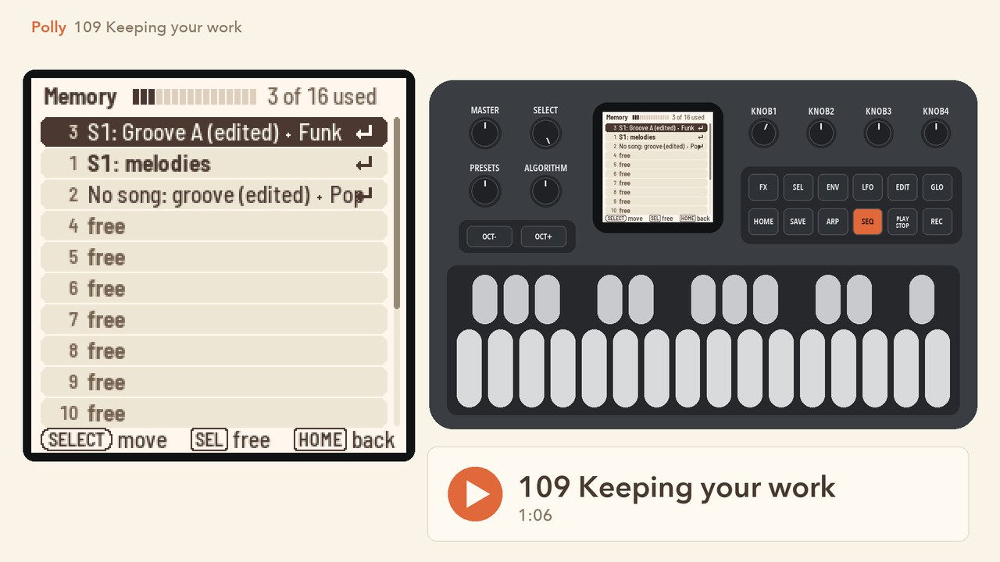
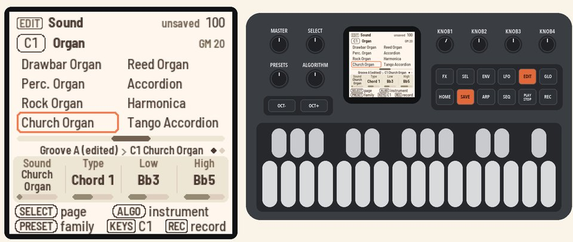
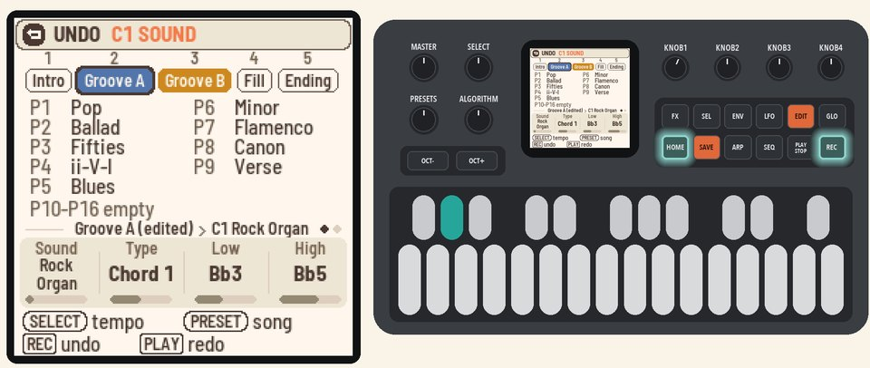
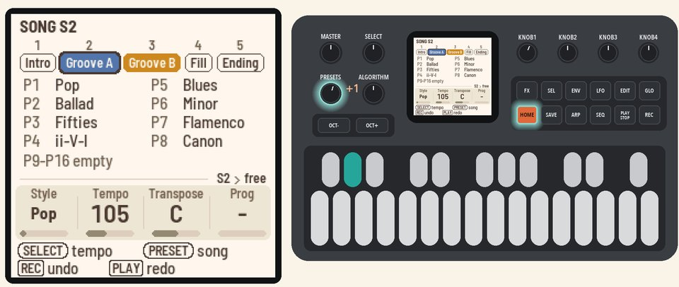
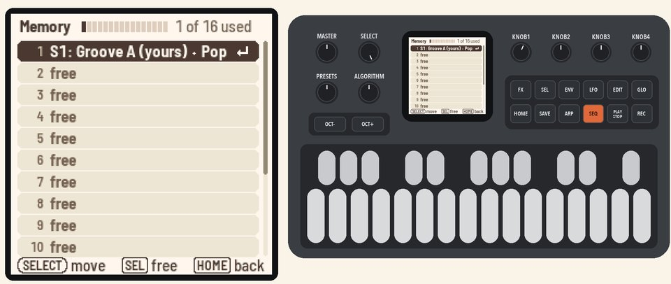
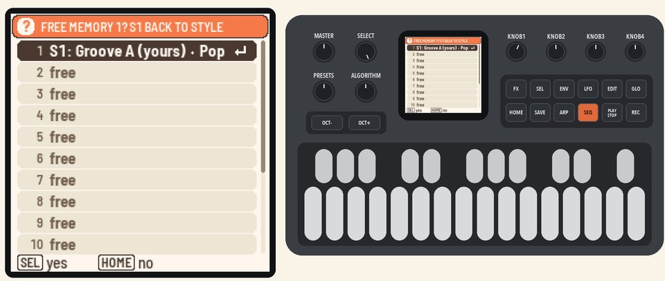

# 109 Keeping your work

Save, undo, switch songs, free a place in Memory, and back up to your computer.

Picks up where [108](108-making-it-sound-yours.md) left off, with Polly stopped and your grooves and melodies from 105 to 108 in Memory.

<table>
<tr><td width="38%" valign="top"><h3>1. Save</h3>Press <b>EDIT</b> and turn <b>KNOB 1</b> (Sound) one step. <b>SAVE</b> lights up, and the header says "unsaved".  Press <b>SAVE</b>. When Polly is stopped, it also saves by itself after about four seconds.</td><td></td></tr>
<tr><td width="38%" valign="top"><h3>2. Undo and redo</h3>Hold <b>HOME</b> and press <b>REC</b>. The old sound comes back, and the header says "UNDO C1 SOUND".  Hold <b>HOME</b> and press <b>PLAY</b> to redo it.</td><td></td></tr>
<tr><td width="38%" valign="top"><h3>3. Switch songs</h3>Hold <b>HOME</b> and turn <b>PRESETS</b> to switch between songs S1 to S4. The header shows which song you're on. Turn back to S1.  Each song has its own sections, progressions, melodies, tempo and style.</td><td></td></tr>
<tr><td width="38%" valign="top"><h3>4. Open Memory</h3>Press <b>SEQ</b>, then <b>SEL</b>. Turn <b>SELECT</b> down to MEMORY at the bottom, and press <b>SEL</b>.  Memory has 16 places, which keep your own grooves and melodies for all four songs. The header tells you how many are in use.</td><td></td></tr>
<tr><td width="38%" valign="top"><h3>5. Free a place</h3>Turn <b>SELECT</b> to the third row, numbered 2. It holds your copy from 106, which no song plays. Press <b>SEL</b>, and Polly asks if you're sure. Press <b>SEL</b> again.  The place is now free, and the copy's notes are gone.</td><td></td></tr>
<tr><td colspan="2" valign="top"><h3>6. Back up</h3>Stop Polly, and connect the FM-1 to your computer with a USB cable. Open the <a href="https://charlesvestal.github.io/fm1-polly/backup/">Backup page</a> in Chrome or Edge, and press <b>Back up</b>. The page saves your songs to a file.</td></tr>
<tr><td colspan="2" valign="top"><h3>7. Put it back</h3>Stop Polly. On the Backup page, choose your file and press <b>Restore</b>. The backup replaces everything on Polly.  When Polly shows "RESTORE FROM USB?", press <b>SEL</b>.</td></tr>
</table>

## More in the manual

For what undo covers, see [Undo](../../MANUAL.md#undo). For what each place holds, see
[Memory](../../MANUAL.md#memory). For what a backup holds and how to restore safely, see
[Backup](../../MANUAL.md#backup). See also [Four songs](../../MANUAL.md#four-songs) and [Saving](../../MANUAL.md#saving).

Next: [110 With other gear](110-with-other-gear.md)
