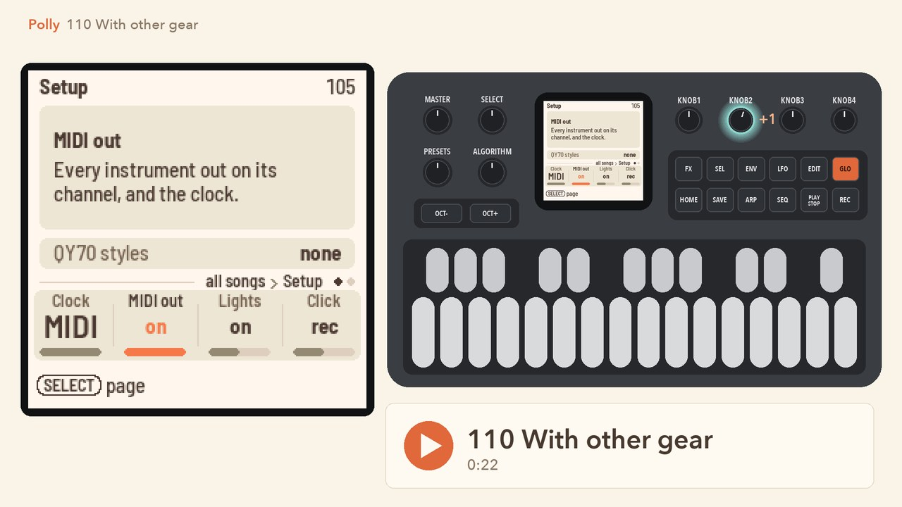
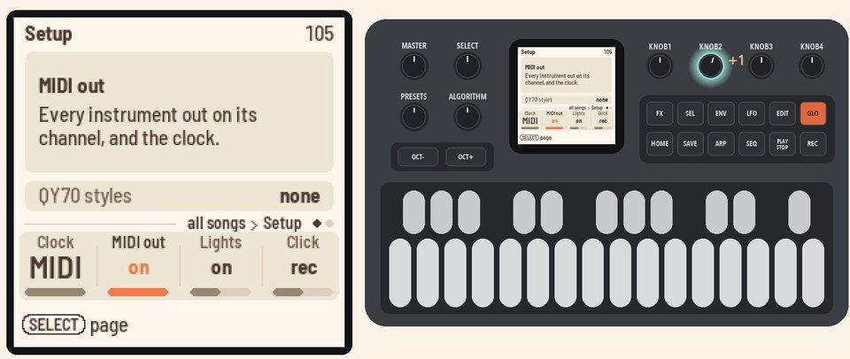
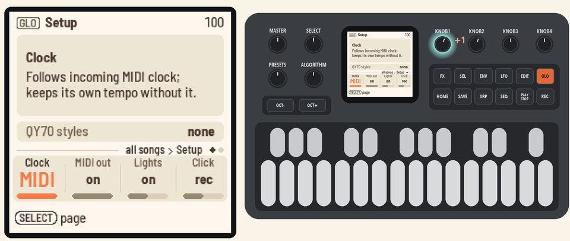

# 110 With other gear

Send Polly's band to a computer, follow its clock, play from a keyboard and mirror the screen.

Starts where [109](109-keeping-your-work.md) ended. Any song works.

<table>
<tr><td width="38%" valign="top"><h3>1. Send MIDI out</h3>Connect the FM-1 to your computer over USB. It shows up as a MIDI device named "Polly FM-1".  Press <b>GLO</b> for Setup. <b>KNOB 2</b> (MIDI out) is on: every instrument goes out on its own channel, with MIDI clock, start and stop.  In your music software, record MIDI from Polly FM-1.</td><td></td></tr>
<tr><td width="38%" valign="top"><h3>2. Follow MIDI clock</h3>On Setup, <b>KNOB 1</b> (Clock) is on MIDI.  When MIDI clock comes in, Polly follows its tempo, start and stop, and the header shows "ext" in place of the tempo.</td><td></td></tr>
<tr><td colspan="2" valign="top"><h3>3. Play from a keyboard</h3>Connect a MIDI keyboard to the FM-1's TRS MIDI jack and play. Your notes play Polly's sounds, alongside the band.  MIDI in plays all 16 channels, with drums on channel 10. MIDI from your computer over USB plays them the same way.</td></tr>
<tr><td colspan="2" valign="top"><h3>4. Mirror the screen</h3>Connect the FM-1 to your computer over USB. Open <code>web/mirror/index.html</code> from Polly's repository in Chrome. Press <b>Connect</b> and allow MIDI with SysEx.  Polly's screen and panel show live on the page. <b>Save PNG</b> saves the screen.</td></tr>
</table>

## More in the manual

[Setup and MIDI](../../MANUAL.md#setup-and-midi) (the lights, the click, and the controllers MIDI in follows),
[Screen mirroring](../../MANUAL.md#screen-mirroring) (playing Polly from the page, and from a script).
